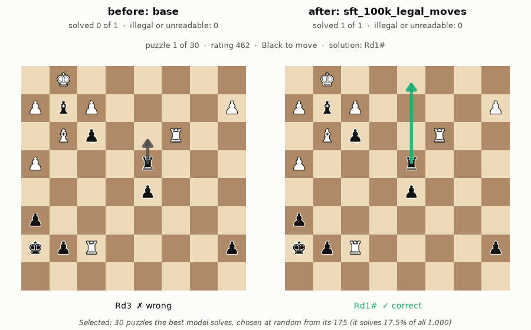

# Chess LLM post-training (CS 289A)

**Can post-training teach a small language model to play chess? We train Gemma 4 E2B with SFT, DPO and RL, alone and combined, and test every model on 1,000 Lichess puzzles it has never seen.**


<p align="center">
  
</p>
<p align="center"><em>The same puzzles, side by side. Left: the untrained base model (0 solved, 20 illegal or unreadable answers). Right: our best model, <code>sft_100k_legal_moves</code> (30 solved, none illegal). These are 30 puzzles the best model solves, chosen at random from the 175 it solves; overall it solves 17.5% of the 1,000 test puzzles. <a href="results/figures/final/before_after_random.gif">Here are 20 puzzles chosen at random</a>, with no selection.</em></p>

## TL;DR

- **Board in, move out.** The model reads a chess position as one line of text and answers with a single move. Stockfish, a chess engine, grades every answer. No test puzzle is ever trained on.
- **What the model sees in training matters most.** Five times more training positions, plus listing the legal moves in the prompt, took puzzle accuracy from 7.8% to 17.5% (a random legal move solves 5.6%).
- **DPO and RL learned their training signals, not puzzles.** None of their 11 runs beat the SFT model it started from on puzzles. RL drifts to quiet pawn moves and misses mates in one.
- **But RL makes the fewest blunders.** In ordinary game positions, RL on top of the legal-move model blunders on 44–45% of its moves, vs. 56% for the legal-move model alone and for a random legal move.

**Start here:** [docs/project_notes.md](docs/project_notes.md) explains what we did, notebook by notebook, what the results show, and the key facts for the report's Data and Methods sections. This README covers status, setup, and how to run things.

## Project description

This project studies how post-training methods improve a small language model's chess play. We fine-tune Gemma 4 E2B with supervised fine-tuning (SFT), apply direct preference optimization (DPO) and reinforcement learning (RL) on top of it, first separately and then in combination, and evaluate every model on held-out Lichess puzzles. Language models handle many reasoning tasks well but still play chess poorly, often proposing illegal moves, and prior work has mostly studied these training methods one at a time rather than comparing them under the same conditions. Our aim is not only a stronger chess-playing model, but a clear picture of what each method contributes and whether combining them helps beyond any single method, with every method given comparable data and compute.

## How the data is used

- **Training: Lichess games.** About 142,500 positions from games between players rated 2000+, each paired with the move that was played. Games give a large and varied set of realistic positions.
- **Testing: Lichess puzzles.** 1,000 puzzles (plus 200 for quick checks), each with one correct move, so answers can be graded objectively. Puzzles are never used for training, and no training position appears among them.
- **Why?** games supply many varied, realistic positions to learn from, while puzzles each have one verified answer, which makes them a fair exam. Keeping the two separate means test scores measure how well the model handles positions it has never seen (not whether it remembers answers from training).
- **Variations after the progress report:** training on Stockfish's best move for each position instead of the move the player made (notebook 08), on 100,000 positions instead of 20,000 (notebooks 12 and 12b), and with the legal moves listed in the prompt (notebook 13). Notebook 11 adds two evaluations beyond puzzles: 1,000 held-out positions from games and full games against two opponents.

## Status

**Done**
- Data pipeline, evaluation, and SFT training code (notebooks 00–03)
- DPO preference pairs and RL reward (notebook 04)
- Base and SFT results on the GPU, then DPO and RL training code and first DPO and RL runs (notebooks 02, 03, 05, 06)
- Analysis of the results for all four models (notebook 07)
- Report outline and related work (Overleaf, thanks Hannah!)

**Results so far** (1,000 test puzzles; details in `results/progress_report_table.md` and notebook 07)

| Model | Accuracy | Legal answers | Training compute |
|---|---|---|---|
| base | 2.8% | 41% | – |
| SFT | 7.8% | 72% | 6.6 GPU-hours* (1.9M tokens) |
| DPO (from SFT) | 5.9% | 63% | 0.33 GPU-hours (0.87M tokens) |
| RL / GRPO (from SFT) | 3.3% | 82% | 0.54 GPU-hours (1.5M tokens) |

\*SFT ran before a memory fix and was slowed by it (its trial ran about 5 times faster per step), so compare methods by tokens rather than hours.

**After the progress report** (design in [section 8 of the project notes](docs/project_notes.md#8-the-paper-abstract-to-methods), results in [section 9](docs/project_notes.md#9-the-paper-evaluation-and-conclusions))

| Notebook | Experiment | Status |
|---|---|---|
| 08 | SFT on Stockfish's moves (`sft_stockfish`) | done: 7.3%, no significant difference from SFT |
| 09 | DPO on the SFT model's own mistakes (`dpo_v2`), plus an SFT loss (`dpo_v3`) | done: 4.4% and 6.7% |
| 10 | RL with a KL penalty (`grpo_v2`), plus a new reward (`grpo_v3`) | done: 4.9% and 4.2% |
| 11 | Every model on held-out game positions and in full games | done for all 19 models: RL loses fewer centipawns; `sft_100k_legal_moves` finds Stockfish's move most often (15%); the RL combinations make the fewest blunders (44–45%); no model wins a game against Stockfish |
| 12 | SFT on 100,000 positions instead of 20,000 (`sft_100k`) | done: 9.4% (not significant on puzzles alone, p = 0.14), clearly better on game positions |
| 12b | The same 100,000 positions, on Stockfish's moves (`sft_100k_stockfish`): completes a 2 × 2 of answer source × data size | done: 9.2%; the answer source makes no difference, more data helps |
| 13 | Legal moves listed in the prompt (`sft_legal_moves`, `base_legal_moves`) | done: **13.2%**, 100% legal, the best model and the first to clearly beat SFT; the base model with the list: 6.0% |
| 14 | RL with a larger KL penalty, β = 0.1 and 0.2 (`grpo_v4`, `grpo_v5`) | done: 4.8% and 5.0%; less drift and fewer pawn moves, but no gain in accuracy |
| 13b | 100,000 positions with the legal moves in the prompt (`sft_100k_legal_moves`): do the two SFT gains add up? | done: **17.5%, the best model**, significantly better than every other model; the two gains add up |
| 15 | Combinations: `sft_legal_moves`, then DPO (`dpo_v3`'s setting) and RL (β = 0.2): `sft_legal_dpo`, `sft_legal_rl`, `sft_legal_dpo_rl` | done: 12.8%, 10.8%, 10.9% on puzzles; none beats `sft_legal_moves` (13.2%). RL still shifts to quiet moves and loses mates, even with legality solved. On game positions, RL after `sft_legal_moves` cuts losses sharply (blunders 56% → 45%) without finding the best move less often |
| 16 | Final comparison of every model on every evaluation (built by Nathan) | done for all 19 models, with the effect of each change, the SFT 2 × 2s, the trade-off map and a before/after animation |

Percentages are puzzle accuracy on the 1,000 test puzzles (SFT: 7.8%; a random legal move: 5.6%). **In short:** the changes to what SFT sees (more data, the legal-move list) improved the model, and together they give the best model (17.5%). On puzzles, DPO and RL never beat the SFT model they started from, alone or in combination; on ordinary game positions, RL after the legal-move SFT model makes the fewest blunders of any model. Sections 8 and 9 of the project notes follow the paper's sections: [section 8](docs/project_notes.md#8-the-paper-abstract-to-methods) (Abstract to Methods, with each experiment and why we ran it) and [section 9](docs/project_notes.md#9-the-paper-evaluation-and-conclusions) (each finding with its evidence, and the conclusions).

## Contributions up to Progress Report

- **Adrian:** repository and environment, data pipeline, prompts and move parsing, evaluation, SFT training code, DPO/RL inputs, results analysis (notebook 07), and project notes (details in `CONTRIBUTIONS.md`).
- **Hannah:** Overleaf document, report outline, literature review, and related work.
- **Nathan:** GPU runs (base, SFT, DPO, RL), DPO and RL training code, the memory fix that lets training fit in 12 GB, and the RL analysis (details in `CONTRIBUTIONS.md`).

---

## Running on a GPU

Everything below runs on an NVIDIA GPU (12 GB is enough), in this order:

1. **Set up** (once, about 20 min). See [Setup](#setup).
2. **Base and SFT results.** Run notebooks `00` → `03`, then push the results. See [Run the notebooks](#run-the-notebooks) and [Push the results](#push-the-results).
3. **DPO and RL inputs.** Run notebook `04`.
4. **DPO.** Run notebook `05`: it trains from the SFT model with the pairs from `04`, and grades the result.
5. **RL.** Run notebook `06`: a GRPO run from the SFT model with the reward from `04`, graded and compared with the other three models.
6. **Analysis.** Run notebook `07`, then push.

### Setup

You need an up-to-date NVIDIA driver (supporting CUDA 13.2), Python 3.12 or 3.13, Git, and about 25 GB of free disk space. In a terminal:

```bash
git clone https://github.com/adrianapsay/chess-post-training.git
cd chess-post-training
python -m venv .venv
.venv\Scripts\activate
pip install torch==2.15.0 --index-url https://download.pytorch.org/whl/cu132
pip install -r requirements.txt
```

Then install Stockfish, the chess engine we use to score moves. Download it from [stockfishchess.org/download](https://stockfishchess.org/download/), unzip it, tell the code where it is, and open a new terminal:

```bash
setx STOCKFISH_PATH "C:\path\to\stockfish.exe"
```

### On Databricks instead

The course gave us Databricks credits for an NVIDIA A10G (24 GB). The notebooks are the same: their first code cell installs what Databricks is missing (our pinned libraries and Stockfish 19) and does nothing on other machines. Databricks keeps its own PyTorch, which matches its GPU.

1. **Once:** Adrian's copy of the repo in Databricks is shared with the team, and the uploaded data and models live there, so open it from your workspace and use it. If you need your own copy, open [this link to create the Git folder](https://dbc-fd89e1b5-e4fc.cloud.databricks.com/browse/folders/home?addGit=&o=7474659242886734&gitUrl=https%3A%2F%2Fgithub.com%2Fadrianapsay%2Fchess-post-training&gitProvider=gitHub). Either way, link GitHub under **Settings → Linked accounts** so you can push.
2. **Once, in a new copy only:** git does not track data or models, so upload these into the same folders inside the Git folder: `data/processed/` (`train.parquet`, `val.parquet`, `dpo_pairs.jsonl`, about 30 MB) and `checkpoints/sft_v1/` (from the team drive).
3. **Each run:** click **Pull**, open the notebook, choose **Serverless GPU → Small (1xA10)**, and click **Run all**. For long training runs, run the notebook as a job instead (**New → Job**, type **Notebook**, compute **Serverless GPU**), so the browser tab can close.
   - Notebooks 08–10 need only `data/processed/` and `checkpoints/sft_v1/`. Notebook 11 also evaluates the first DPO and RL models, so it needs `checkpoints/dpo_v1/` and `checkpoints/grpo_v1/` (from the team drive); it skips any model whose folder is missing.
4. **After each run:** choose **Terminate** in the compute menu so the GPU stops billing, then commit and push the `results/` files from the Git folder. **Leave notebooks unticked:** the workspace cannot save notebook outputs to git, so committing a notebook from Databricks would erase its outputs on GitHub. Notebook changes are made and pushed from a laptop. To keep a notebook's figures on GitHub too, use **File → Export → IPython Notebook** after the run, replace the notebook on a laptop with the exported file, and commit it there.

Use only the Small size; Medium and Large cost far more. Our spending is on the course's usage dashboard (the link is in the Databricks student guide; our group ID came by email). Training records the GPU name with its GPU-hours, so compare A10G and laptop runs by tokens seen rather than hours.

### Run the notebooks

Open each notebook in VS Code, choose the `.venv` kernel, and click **Run All**. Wait for each one to finish before starting the next.

| Notebook | What it does |
|---|---|
| `00_setup_check` | Checks the setup. It should report your GPU (CUDA). |
| `01_data_pipeline` | Builds the training data (downloads 1.9 GB). |
| `02_eval_base_model` | Grades the untrained model on the puzzles (downloads the 10 GB model the first time). |
| `03_sft_first_run` | Trains the SFT model, grades it, and makes the comparison table and figures. |
| `04_dpo_rl_inputs` | Builds the DPO pairs and shows the RL reward (no GPU needed). |
| `05_dpo_first_run` | Trains the SFT model further with DPO, and grades it. |
| `06_grpo_first_run` | Trains the SFT model further with RL (GRPO), grades it, and makes the four-model comparison table and figures. |
| `07_understanding_results` | Explains why the models score as they do, from the saved results (no GPU needed). |
| `08_sft_stockfish_moves` | Trains SFT on Stockfish's best moves instead of the players' moves (`sft_stockfish`), and grades it. |
| `09_dpo_mistake_pairs` | Collects the SFT model's own mistakes as DPO pairs, then trains and grades `dpo_v2` (DPO) and `dpo_v3` (DPO + SFT loss). |
| `10_grpo_kl_reward` | Trains and grades `grpo_v2` (KL penalty) and `grpo_v3` (KL penalty + new reward). |
| `11_game_positions_and_games` | Grades every model on 1,000 held-out game positions and plays 50 games against a random mover and against Stockfish. Skips models that already have results, so rerun it after each round of new models. |
| `12_sft_more_data` | Trains SFT on 100,000 positions (`sft_100k`), saving a copy after 20k, 40k, 60k and 80k examples, and grades every copy: puzzle accuracy against training data. |
| `12b_sft_more_data_stockfish_moves` | Notebook 12 with Stockfish's best moves as the answers (`sft_100k_stockfish`), reusing notebook 08's labels for the first 20,000 positions. Compares the four SFT models (players' vs. Stockfish's moves, 20,000 vs. 100,000 positions). |
| `13_sft_legal_moves` | Lists the legal moves in the prompt: grades the base model with it (`base_legal_moves`), then trains and grades SFT with it (`sft_legal_moves`). |
| `13b_sft_legal_moves_more_data` | Notebook 12 with the legal moves in the prompt (`sft_100k_legal_moves`): do more data and the legal-move list add up? |
| `14_grpo_larger_kl` | Trains and grades `grpo_v4` (KL penalty β = 0.1) and `grpo_v5` (β = 0.2), and compares all four values of β. |
| `15_combinations` | Starting from `sft_legal_moves`: collects its own mistakes as DPO pairs, then trains and grades SFT → DPO (`sft_legal_dpo`), SFT → RL (`sft_legal_rl`) and SFT → DPO → RL (`sft_legal_dpo_rl`). |
| `16_final_comparison` | Puts every model and every evaluation in one table and set of figures, compares every model with `sft_v1` (with adjusted p-values) and with the model it changes one thing in, and adds up each model's training compute. Needs no GPU; rerun it after new results are pushed. |

Notebooks 08–15, 12b and 13b have a `QUICK_CHECK` setting. Run once with `QUICK_CHECK = True` (a few minutes, tiny sizes, nothing saved to `results/`), then with `False` for the real run. Each saves its figures and tables in its own folder, `results/figures/<run name>/`. The earlier notebooks (00–07) and their results stay as they are.

Keep the laptop plugged in and stop it from sleeping while notebooks run.

### Push the results

The report needs every model's scores, figures, and compute, so push after each run:

```bash
git add results notebooks
git commit -m "Describe the run, e.g. RL results"
git push
```

Keep `checkpoints/sft_v1/`: it is the SFT model, and DPO and RL start from it. Back it up (zipped) to the team drive, since it is not on GitHub. The same goes for `checkpoints/dpo_v1/` and `checkpoints/grpo_v1/`.

### Where the results are

Every number and figure the paper uses comes from `results/`. There are three kinds of files:

| File | What it holds | What it is for |
|---|---|---|
| `results/summary.csv` | one row per model (and a `_dev` row for its 200 dev puzzles): puzzle accuracy, legal/illegal/unparseable rates, ACPL, accuracy per rating band | the main comparison table |
| `results/figures/<experiment>/` | that experiment's figures (`.png`) and tables (`.md` to read on GitHub, `.csv` to reuse) | figures for the paper, and the tables behind each claim (e.g. the paired comparisons with p-values) |
| `results/<model>.json` | every test answer the model gave, and its grade | new analyses later without a GPU (e.g. the share of pawn moves) |

Where to find each experiment (notebooks 08 onwards; the earlier figures are directly in `results/figures/`):

| Notebook | Folder(s) in `results/figures/` | Question it answers | Main figures and tables |
|---|---|---|---|
| 08 | `sft_stockfish/` | Does SFT learn more from Stockfish's moves than from human moves? | `training_data` (how often the two agree), `puzzle_metrics.png`, `paired_comparison` |
| 09 | `dpo_mistake_pairs/`, `dpo_v2/`, `dpo_v3/` | Does DPO work better on the model's own mistakes, and with an added SFT loss? | `pairs` (what the mistakes are), `dpo_diagnostics.png` (does the best move become more likely?), `paired_comparison` |
| 10 | `grpo_v2/`, `grpo_v3/` | Does a KL penalty, or a reward without a legality bonus, stop RL's collapse to pawn moves? | `kl.png`, `move_kinds` (pawn moves, captures, checks), `paired_comparison` |
| 11 | `game_evals/` | Do the models differ outside puzzles: blunders in ordinary positions, and results in full games? | `game_positions` (legal, ACPL, blunders, same move as Stockfish), `games_vs_random`, `games_vs_stockfish` |
| 12 | `sft_100k/` | How much better does SFT get with more data? | `paired_comparison`, `scaling_curve.png` (accuracy of the copies saved during the run; progress during one run, not a data-scaling curve, see the notes) |
| 12b | `sft_100k_stockfish/` | With 100,000 positions, do Stockfish's moves help? | `two_by_two` (accuracy of the four SFT models), `scaling_curves.png` (both 100k runs on the same axes), `paired_comparison` |
| 13 | `sft_legal_moves/` | Does listing the legal moves help, and is the problem knowing the rules or choosing a move? | `accuracy_when_legal` (table and figure), `answer_outcomes.png` |
| 14 | `grpo_v4/`, `grpo_v5/` | Does a larger KL penalty keep RL closer to SFT and its accuracy? | `kl_by_beta.png`, `move_kinds`, `paired_comparison` |
| 13b | `sft_100k_legal_moves/` | Do more data and the legal-move list add up? | `two_by_two` (data size × prompt), `scaling_curves.png`, `paired_comparison` |
| 15 | `combinations/` | Do DPO and RL improve on `sft_legal_moves` once legality is solved? | `puzzle_results`, `paired_comparison`, `pairs`, `move_kinds`, `rl_reward.png`, `rl_kl.png` |
| 16 | `final/` | Every model on every evaluation, in one place, and what each change did | `final_results` (the main table), `effects` (each model vs. the model it changes, with intervals), `vs_sft_v1` (with adjusted p-values), `sft_answer_source.png` and `sft_legal_list.png` (the SFT 2 × 2s), `tradeoff`, `invalid_moves`, `move_kinds`, `compute` |
| 16 (section 11) | `paper/` | **The figures and the table for the paper** (the only ones the paper uses; listed in [project notes, sections 8 and 9](docs/project_notes.md#8-the-paper-abstract-to-methods), with how to put them into Overleaf) | `fig1_models` … `fig6_tradeoff` (PDF for Overleaf, PNG to view), `table1_models.tex` (Table 1, LaTeX) |
| 08–14 | `findings_08_14/` | Summary figures drawn after notebook 14 (replaced by notebook 16's `final/`) | `puzzle_accuracy_all.png` (every model), `effects.png` and `effects` (the effect of each change, with intervals), `tradeoff.png` (finding the best move vs. losing fewer centipawns), `sft_two_by_two.png`, `legal_moves.png`, `rl_kl_penalty.png`, `invalid_moves.png` |

Every experiment folder (08–14) also has `puzzle_results` (the main table for that experiment). Notebook 11 matters most for DPO and RL: they were trained to avoid bad moves in ordinary game positions, not to solve puzzles, so it tests what they were actually trained for. Each figure of notebooks 08–14 is also shown inside its notebook; for Jobs on Databricks, those inline copies are on the Job's run page. The figures in `findings_08_14/` are drawn from the saved results and will be part of notebook 16.

### DPO and RL training

- Both start from the SFT model (`checkpoints/sft_v1/`) and keep training its LoRA adapter. Settings are in the `training` sections of `configs/dpo.yaml` and `configs/rl.yaml`; the code is in `src/chesslm/train_dpo.py` and `src/chesslm/train_rl.py`.
- For DPO, a frozen copy of the SFT adapter is the reference model, so `beta` limits how far DPO moves from the SFT model (not from the base model).
- Each model is graded like the others, with the run names `dpo_v1` and `grpo_v1`. Their scores appear in `results/summary.csv` next to base and SFT.

### If something goes wrong

| Problem | Fix |
|---|---|
| `CUDA out of memory` | Close other apps that use the GPU. Then lower `batch_size` in `configs/eval.yaml` (to 4) or `configs/sft.yaml` (to 2), and run the notebook again. |
| `00_setup_check` says "CPU only" | PyTorch was installed without GPU support. Run the `pip install torch ...` line again, then restart the notebook. |
| `Stockfish not found` | Check `STOCKFISH_PATH`, then restart VS Code. |
| The model download stops partway (no network traffic, no progress) | Stop the notebook, delete the `.incomplete` file in `%USERPROFILE%\.cache\huggingface\hub\models--google--gemma-4-E2B-it\blobs\`, run `setx HF_HUB_DISABLE_XET 1`, open a new terminal, and run the notebook again. |
| `DLL load failed ... An Application Control policy has blocked this file` | Windows Smart App Control blocked a library file it does not trust (it happened with pandas 3.1.0). Install pandas 2.3.3 instead (`pip install pandas==2.3.3`), which it accepts; the project works with either. |
| Anything else | Send Adrian the error message. |

---

## Setup on a Mac (data and code work)

A Mac is fine for the data pipeline and the tests, but too slow to run the model.

```bash
brew install stockfish
python3 -m venv .venv
source .venv/bin/activate
pip install -r requirements.txt
```

Then run `notebooks/00_setup_check.ipynb` and `notebooks/01_data_pipeline.ipynb`. Run the tests with `pytest`.

---

## Repo layout

| Folder | What's in it |
|---|---|
| `notebooks/` | The work, step by step. Start here. |
| `configs/` | All settings (data, prompts, evaluation, training). |
| `src/chesslm/` | Shared code used by the notebooks. |
| `tests/` | Automatic checks for the shared code. |
| `results/` | Scores for each run (`summary.csv` has one row per run), figures, and the comparison table. |
| `docs/project_notes.md` | Plain-language walkthrough: each notebook, the training methods, the results, and key facts for the report. |
| `data/eval/` | The fixed test and dev puzzles (on GitHub). |
| `data/raw/`, `data/processed/` | Downloads and training data. Not on GitHub (too large); rebuilt by `01_data_pipeline.ipynb`. |
| `checkpoints/` | Trained adapters. Not on GitHub (too large); share them directly. |
