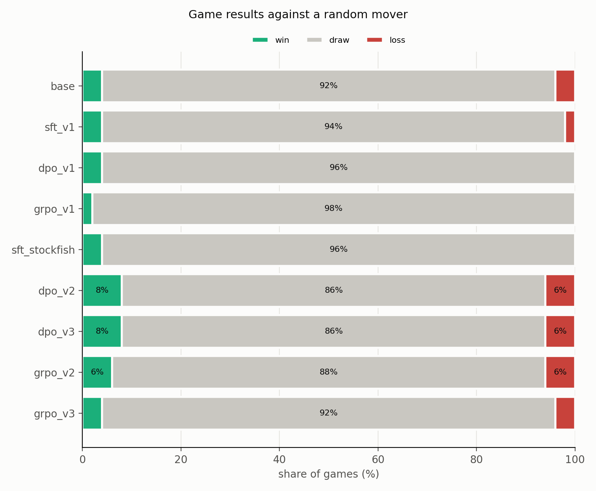
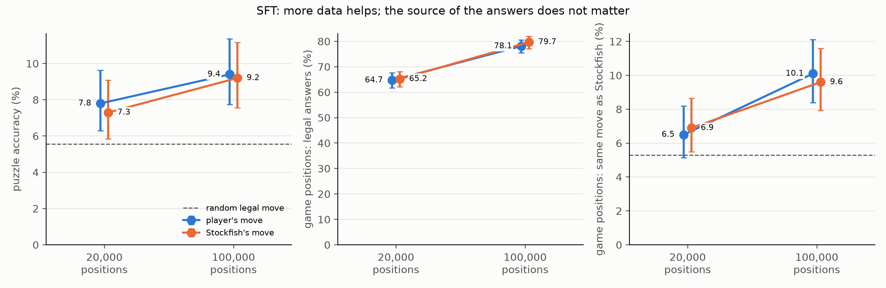
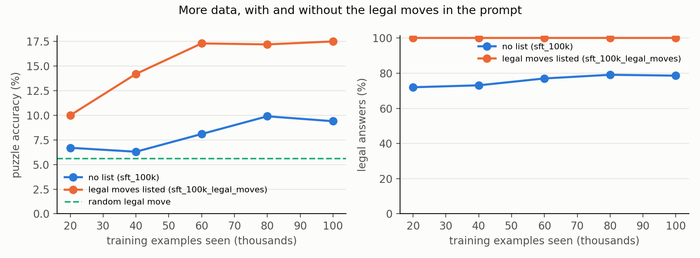
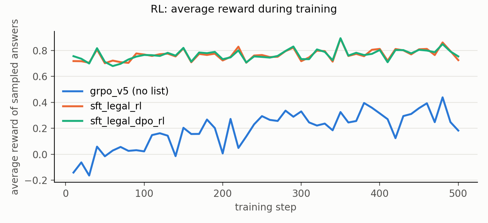
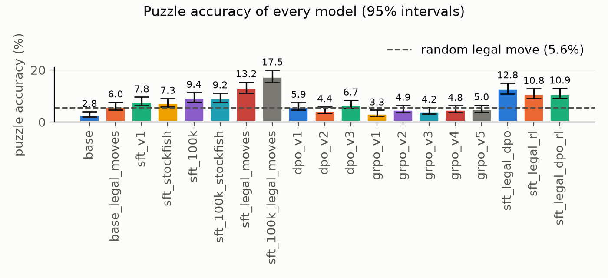
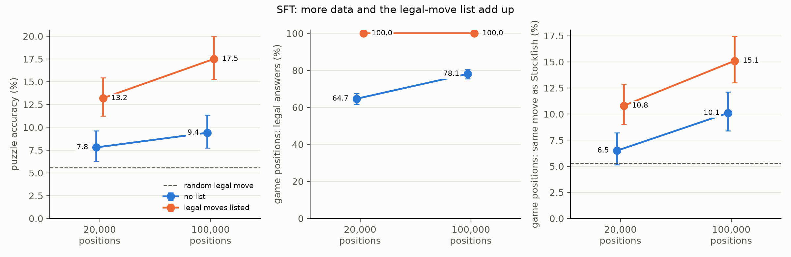

# Project notes

What we are doing and what the results show, readable without the code. Exact settings are in `configs/`, details are in each notebook, and setup instructions are in the [README](../README.md).

As of Nov 5, all four models (base, SFT, DPO, and RL) are trained and graded. After the progress report we ran fourteen new training runs (notebooks 08–15, 12b and 13b), including combinations of methods, and added two new evaluations (notebook 11). Each experiment's design, reasons and results are in [section 8](#8-after-the-progress-report-follow-up-experiments); the facts for each section of the paper (abstract to conclusions), with the key figures, are in [section 9](#9-facts-for-the-draft-by-paper-section).

1. [The project](#1-the-project)
2. [How the methods work](#2-how-the-methods-work)
3. [What each notebook does](#3-what-each-notebook-does)
4. [Results, and why](#4-results-and-why)
5. [Limitations and next steps](#5-limitations-and-next-steps)
6. [Key facts for the report](#6-key-facts-for-the-report)
7. [Glossary](#7-glossary)
8. [After the progress report: follow-up experiments](#8-after-the-progress-report-follow-up-experiments)
9. [Facts for the draft, by paper section](#9-facts-for-the-draft-by-paper-section)

---

## 1. The project

Language models can describe chess but often play it poorly, frequently proposing illegal moves. We study which post-training methods improve a small open model (Google's Gemma 4 E2B), and why. We compare supervised fine-tuning (SFT), direct preference optimization (DPO), and reinforcement learning (RL), first separately and then in combination.

```
Lichess games (2000+ players) ──> training positions ──> SFT ──┬──> DPO ──┐
                                                                └──> RL ───┤
Lichess puzzles (never trained on) ─────────────────────────> grade every model the same way ──> compare
```

We train on positions from games between strong players, and test on puzzles. Games supply many varied, realistic positions to learn from. Puzzles each have one verified answer: in a typical game position several moves are about equally good, but in a puzzle one move wins and almost every other move loses, so an answer is clearly right or wrong. No test puzzle appears in the training data, so test scores measure how well a model handles positions it has never seen, not whether it remembers answers.

We measure three things. Our main metric is **puzzle accuracy**, the percentage of puzzles solved. The **legal-move rate** is the percentage of answers that are legal moves; the rest are *illegal* (not allowed in the position) or *unparseable* (no move found). **ACPL** (average centipawn loss) measures how much worse the model's legal moves are than the best move according to Stockfish, a strong chess engine, so lower is better.

---

## 2. How the methods work

It helps to start with how the model produces a move. The model reads the prompt, which describes the board as a line of text (a FEN), and writes its answer one token at a time: `e2e4` is four tokens (`e`, `2`, `e`, `4`). At each step it assigns a probability to every possible next token, and we always take the most likely one. Nothing checks the move against the rules of chess before it is written. All three training methods change these probabilities; they differ in which answers they make more or less likely, and based on what.

**The base model** is Gemma 4 E2B as Google released it. It was trained on a very large amount of text to predict the next token, then tuned to follow instructions. That text includes chess, so it knows what moves look like, but it was never trained to choose a move for a given position.

**SFT** (supervised fine-tuning) continues the same next-token training on our own examples: a position, followed by the move a strong player made there. Training makes that move more likely. The model only ever sees correct examples; it is never shown an illegal move or told that one of its own answers was wrong.

**DPO** (direct preference optimization) trains on pairs of answers to the same position: a *chosen* move (Stockfish's best) and a *rejected* move (one that loses a lot). It makes the chosen move more likely *relative to* the rejected one, compared with where the model started. It only cares about this difference. It does not require the chosen move itself to become more likely, and it says nothing about any other move.

**RL** (reinforcement learning) shows the model no answers at all. The model generates its own answers, a *reward* scores each one, and training makes high-reward answers more likely. Our reward comes from Stockfish: −1 for an illegal or unparseable answer, and for a legal move, more the closer it is to the best move. RL is the only method that directly penalizes the model's own illegal moves. The specific algorithm we use is **GRPO**. For each position, the model samples 8 answers, and each one is compared with the group's average reward: answers above the average become more likely, and answers below it less likely. In our settings, this is the classic *policy gradient with a baseline*, where the baseline is the group average. We chose GRPO because it judges each answer simply by comparing it with the model's other answers to the same position.

| | SFT | DPO | RL (GRPO) |
|---|---|---|---|
| Starts from | base model | SFT model | SFT model |
| Learns from | 20,000 positions + the move a strong player made | 4,549 pairs of a better and a worse move | its own answers on 2,000 positions, scored by Stockfish |
| Makes more likely | the human move | the better move, relative to the worse one | answers that score above the group average |
| Compute | 6.6 GPU-hours | 0.33 GPU-hours | 0.54 GPU-hours |

All three train a small add-on to the model (a LoRA adapter) while the original model stays frozen, which lets training fit on one 12 GB GPU.

---

## 3. What each notebook does

| Notebook | What it does | Needs a GPU? |
|---|---|---|
| [00](../notebooks/00_setup_check.ipynb) Setup check | checks the libraries, GPU, Stockfish, and tokenizer | no |
| [01](../notebooks/01_data_pipeline.ipynb) Data pipeline | builds the training positions and the puzzle sets | no |
| [02](../notebooks/02_eval_base_model.ipynb) Base model | grades the untrained model | yes |
| [03](../notebooks/03_sft_first_run.ipynb) SFT | trains with SFT and grades the result | yes |
| [04](../notebooks/04_dpo_rl_inputs.ipynb) DPO and RL inputs | builds the DPO pairs and the RL reward | no |
| [05](../notebooks/05_dpo_first_run.ipynb) DPO | trains with DPO and grades the result | yes |
| [06](../notebooks/06_grpo_first_run.ipynb) RL | trains with GRPO, grades the result, and compares all four models | yes |
| [07](../notebooks/07_understanding_results.ipynb) Understanding the results | explains *why* the models score as they do | no |

Exact settings for every step are in `configs/`.

### 00 · Setup

This notebook checks that the libraries load, shows which GPU is available, tests Stockfish, and downloads the model's tokenizer. Because Stockfish grades every move in the project, we test it on two positions with known answers. The starting position scores about 0 (+32 centipawns), and the same position without Black's queen scores about a queen more (+886), which confirms the sign and the scale of its scores. The notebook also shows how the model splits moves into tokens.

### 01 · Data pipeline

This notebook builds all the data. The test and dev sets come from the Lichess puzzle database (6.2 million puzzles): 1,000 test puzzles and 200 dev puzzles, with equal numbers in four rating bands (<1200, 1200–1800, 1800–2400, 2400+). Both sets are fixed and committed in `data/eval/`.

The training data comes from one file of Lichess games from September 2025, filtered as follows ([numbers](../results/data_stats.json)):

| Filter step | Games remaining |
|---|---|
| Games read | 1,404,031 |
| Both players rated 2000+ | 245,522 |
| No bot accounts | 242,573 |
| Not bullet (at least 3 minutes per player) | 92,501 |
| Ended normally (not on time or abandoned) | 70,904 |
| At least 20 moves (first 50,000 kept) | 50,000 |

From each game we take three positions, skipping the first five moves since openings are mostly memorized, and pair each with the move that was played. This gives 142,500 positions for training and 7,500 for validation, split by game so that no game contributes to both. We exclude bot accounts because a cluster of players rated near 3000 turned out to be almost all bots, and we want the model to learn from human play. The notebook checks that no training position appears among the puzzles, and dataset versions are pinned so the data can be rebuilt exactly.

One detail of the puzzle format matters: a Lichess puzzle starts one move *before* the position to solve. The first listed move is the opponent's, so we apply it, and the second move is the answer.

### 02 · Base model evaluation

This notebook asks the base model every puzzle and grades its answers, giving the baseline every trained model is compared with. Every model, in training and testing, gets the same prompt:

```
Chess position (FEN): <the board>
White to move.
Reply with the best move in UCI notation (for example e2e4) and nothing else.
```

We grade the first move found in the reply. It is checked against the board (legal, illegal, or unparseable), compared with the puzzle's answer (in mate-in-1 puzzles, any checkmating move counts), and scored by Stockfish at a fixed search depth, with centipawn loss capped at 1000. Both UCI and standard notation are accepted, so a correct move is never marked wrong for its format. Text around the move is ignored as well: bold markers, brackets, move numbers, and HTML tags (`<h2>Rd7</h2>` reads as Rd7). The model always gives its single most likely answer (greedy decoding), so grading is reproducible. We load only Gemma's language model and skip its image and audio components, which leaves 4.63B parameters (about 9.3 GB). Each model is graded on the 200 dev puzzles first as a quick check, then on the 1,000 test puzzles.

**Same results on a different GPU.** From mid-November we also run on the course's Databricks GPUs (NVIDIA A10G), so we re-graded the base model there and compared it with the laptop run (RTX 5070 Ti) puzzle by puzzle. 768 of the 1,000 replies were identical. Greedy decoding is reproducible on one machine, but two GPUs round numbers slightly differently, and when the model's top two choices for a token are nearly tied, the rounding can decide between them. For about 10% of puzzles this tipped the base model into wrapping its move in HTML tags (`<h2>Rd7</h2>`), which our move reader did not yet ignore. With tags ignored, the two runs agree closely: accuracy 2.9% vs. 2.8%, legal moves 41.6% vs. 41.2%, unparseable 12.3% vs. 13.0%, ACPL 823 vs. 828. Ignoring tags changes no earlier result, since no laptop reply from any model contained one, and the trained models never use tags.

### 03 · SFT

This notebook trains the SFT model on 20,000 of the training positions, then grades it exactly as in notebook 02 and makes the base vs. SFT comparison. The LoRA adapter has rank 16 and covers the attention and MLP layers, and the frozen model is stored in 4 bits (QLoRA) so training fits in 12 GB of GPU memory. The loss counts only the answer, not the prompt. A 500-example trial run comes first to catch problems early. The full run took 6.6 GPU-hours.

### 04 · DPO and RL inputs

This notebook builds what DPO and RL train on, using training positions only, never puzzles. For DPO, it takes 5,000 positions. In each, Stockfish's best move is the chosen move, and a random legal move that loses at least 200 centipawns is the rejected one. In 212 positions no move lost that much, leaving 4,788 pairs. The rejected moves lose 620 centipawns at the median.

It also defines the RL reward. An illegal or unparseable answer gets −1. In the default *dense* mode, a legal move gets 0.1 plus up to 1 more, depending on how close it is to Stockfish's best move. In the *sparse* mode, only Stockfish's best move gets a reward (1). Stockfish searches less deeply here than in grading, to keep things fast.

### 05 · DPO

This notebook trains the DPO model on 4,549 pairs, starting from the SFT model, and holds out 239 pairs to monitor training. The SFT model is also the reference that DPO compares against, with β = 0.1. One large table in Gemma (4.7 GB) is kept on the CPU during training so it fits on the GPU; this was added after the SFT run, which likely ran slower without it. Training took 0.33 GPU-hours, and the model is then graded like the others.

### 06 · RL

This notebook trains the RL model with GRPO, starting from the SFT model. It uses 2,000 training positions, samples 8 answers for each (16,000 answers in all, each scored by Stockfish with the dense reward), and has no KL penalty holding it close to the SFT model. Training took 0.54 GPU-hours. The notebook then grades the model and makes the comparison table and figures for all four models.

### 07 · Understanding the results

This notebook analyzes the saved results without a GPU or the model. It measures how certain the results are, compares them with random guessing, classifies the illegal moves, measures move quality, and looks at what happened during SFT and DPO training. Every graded model is included automatically, so we rerun it after RL. Section 4 summarizes it.

---

## 4. Results, and why

All results are on the 1,000 test puzzles. The figures and calculations are in [notebook 07](../notebooks/07_understanding_results.ipynb).

| Model | Accuracy | Legal answers | Accuracy when the answer is legal |
|---|---|---|---|
| Random legal move | 5.6% | 100% | 5.6% |
| Base | 2.8% | 41% | 6.8% |
| SFT | 7.8% | 72% | 10.8% |
| DPO | 5.9% | 63% | 9.3% |
| RL (GRPO) | 3.3% | 82% | 4.0% |

The first row is a reference point: picking a random legal move solves 5.6% of the puzzles. The last column separates two questions: can the model produce a valid move, and does it choose well among valid moves?

**The base model** scores below random guessing. Only 41% of its answers are legal, and most are written in standard notation even though we ask for UCI. This fits how it was trained: it writes what chess text usually looks like, without working the move out from the board. When its answer is legal, it is about as good as random.

**SFT** is better than the base model on every measure, and the difference is statistically clear ([figure](../results/figures/accuracy_intervals.png)). It always answers in UCI, because every training example ends with a UCI move. When its answer is legal, it is right about twice as often as random, because it has learned which moves strong players make in which kinds of positions. But 28% of its answers are still illegal, because SFT makes the human move more likely without ever making illegal moves less likely. The mistakes show what the model has not learned: it almost always moves one of its own pieces, so it reads *where* the pieces are, but it often moves them where they cannot go or leaves its king in check ([figure](../results/figures/illegal_reasons.png)). This is worst when the king is under attack and few moves are legal. Puzzle accuracy also stays low because imitating typical moves in ordinary positions is a different skill from finding the one winning move in a puzzle.

**DPO** made the SFT model worse (7.8% → 5.9%), and this drop is unlikely to be chance. The training logs show why. DPO only asks for the better move to become more likely *than* the worse one, and the model achieved this by making *both* less likely: the better move ended about 20 times less likely than under SFT, the worse one about 500 times less likely ([figure](../results/figures/dpo_diagnostics.png)). Since the probabilities of all possible answers add up to 1, the removed probability went to other answers, including illegal ones: 155 answers that were legal under SFT became illegal. So DPO taught the model to prefer Stockfish's move over a bad one, but not to avoid illegal moves. This is one run with one setting, so it does not show that DPO cannot help.

**RL** fixed the weakness it targets and lost accuracy doing so. Its reward penalizes illegal answers, and RL has the most legal answers of any model (82%, up from SFT's 72%). But accuracy fell from 7.8% to 3.3%, a drop that is statistically clear, and when its answer is legal it is right less often than random (4.0% vs. 5.6%). The kind of moves it plays shows why: 41% of its legal answers are pawn moves (SFT: 2%), while captures fell from 25% to 6% and checks from 18% to 8%. A quiet pawn move is almost always legal, so it earns the legal bonus and avoids the −1 penalty, but puzzles are solved by captures, checks, and other forcing moves. The reward invites this trade: an illegal answer costs −1 against at least +0.1 for any legal one, while the best and worst legal moves differ by only 1. The reward rose steadily during training while the answers became much less varied, so the model learned what the reward asked for, not what the puzzles test. Training on game positions and testing on puzzles may add to this. As with DPO, this is one run with one setting.

Across all models, accuracy stays within a few points of random guessing. The model answers in a single move with no reasoning steps, and puzzles are hard. ACPL also turns out to say little on puzzles: almost every move in a puzzle is either about the best or a large mistake, so it mostly repeats what accuracy says ([figure](../results/figures/move_quality.png)).

Our proposal asks whether a method helps by reducing blunders or by improving tactics. On puzzles, these turn out to be almost the same thing: missing the tactic usually *is* the blunder (88% of SFT's legal answers lose 200+ centipawns, and nearly all the rest are correct). Accuracy per puzzle theme (fork, pin, mate in 1, ...) shows no theme standing out clearly, with about 100 puzzles per theme. Separating the two questions needs ordinary game positions, where most moves are reasonable and a blunder is a distinct mistake.

---

## 5. Limitations and next steps

**Limitations**
- Each method has one run, so small differences may be noise. Notebook 07 shows which differences are clear.
- Results per difficulty level are noisy (250 puzzles each, about ±3.4 points).
- SFT learns from ordinary game positions, which may transfer only partly to puzzles.
- Many DPO pairs are easy to tell apart, since the rejected moves are often very bad.
- Note to self: this is currently a WIP

**Next steps**

*Update (Nov 23): this plan was written before the progress report. Steps 1, 2 and 3 below (step 3 is notebook 15), the evaluations on game positions and in games, and the legal-move ablation are now done. Their results are in [section 8](#8-after-the-progress-report-follow-up-experiments).*

Before the progress report (Nov 6):
- Done: RL (notebook 06) has run, and notebook 07 compares all four models.

Mid November, before the first draft (Nov 24), in this order:

| Step | What to try | Why at this point |
|---|---|---|
| 1. Fix DPO and RL on their own | RL: a KL penalty to the SFT model (`beta` in `rl.yaml`), a smaller gap between illegal and legal answers, the sparse reward, or puzzle-like training positions. DPO: a lower learning rate, adding the SFT loss back in (TRL can combine the two) so the better move stops losing probability, or changing how pairs are built, as our TA suggested (the SFT model's own wrong or illegal answers as the rejected moves, or a different 200-centipawn threshold). | Both currently make SFT worse, so we cannot yet say whether either method helps, and that is the core of our research question. |
| 2. SFT on Stockfish's moves | Keep the same game positions, but use Stockfish's best move as the answer instead of the move the player made. | If it clearly beats `sft_v1`, it becomes the starting point for everything after it, so it comes before the combinations. |
| 3. Combine methods | At least SFT → DPO → RL, from the best SFT model, with the DPO and RL settings that worked in step 1. | Our research question asks which combination works best, and combining methods that each make SFT worse would teach us little. |

Step 2 targets a mismatch in our current SFT data. SFT copies whatever answer it is shown, so it now learns to play like a 2000+ player, who usually picks a reasonable move but not always the best one. A puzzle accepts only the best move. Training on Stockfish's choice teaches the model to find that move directly, which a higher rating threshold only approximates. It also means all three methods learn from the same source, since DPO and RL already use Stockfish.

Alongside these, if time allows:
- Other SFT data changes our TA suggested: train on puzzles (not the test ones) instead of games, or change the rating threshold. Each needs a new SFT run, so one or two at most.

Promised in our proposal, still to decide as a team:
- Move quality on held-out game positions (legal-move rate, centipawn loss, blunder rate). It is the cheapest of these, and the only way to separate "fewer blunders" from "better tactics", which puzzles cannot do.
- Win-loss rate in games against Stockfish (simple to run).
- ChessQA, and a comparison with ChessLLM (more work).
- RL on puzzle positions as well as games.
- A similar data and compute budget for every method. So far SFT used 6.6 GPU-hours, DPO 0.33, and RL 0.54, so at the least, we report compute for every run. SFT's time is inflated: it ran before the memory fix described under notebook 05, when its 500-example trial ran about 5 times faster per step, so tokens seen (1.9M for SFT, 0.87M for DPO, 1.5M for RL) compare the methods better than hours.

Each ablation changes one factor, retrains, and grades the result the same way. Most factors are a setting in a config file:

| Ablation | Setting (file) | Default | Alternatives |
|---|---|---|---|
| DPO rejected moves | to be added | a random move losing 200+ cp | the SFT model's own wrong answers; illegal moves |
| DPO rejection threshold | `rejected_min_cp_loss` (`dpo.yaml`) | 200 | e.g. 100, 400 |
| SFT training data | to be added | games | puzzles (not the test ones); a mix |
| SFT answer for each position | to be added | the move the player made | Stockfish's best move |
| Player rating threshold | `min_elo` (`data.yaml`) | 2000 | e.g. 1600, 2200 |
| RL reward | `mode` (`rl.yaml`) | dense | sparse (following Hwang et al., cited in our draft) |
| Legal moves in the prompt (optional) | `show_legal_moves` (`prompt.yaml`) | no | yes |

---

## 6. Key facts for the report

This section held the data and method facts for the four progress-report models. They are now extended to every model, together with the design choices and the reasons for each experiment, in [section 9](#9-facts-for-the-draft-by-paper-section). Use section 9 for the paper. (The earlier version of this section is in the repository's history.)

---

## 7. Glossary

- **Token:** the unit of text a model reads and writes.
- **FEN:** a one-line text encoding of a full board position.
- **UCI / SAN:** two ways to write a move: `e2e4` (from-square, to-square) and `e4` or `Nf3` (standard chess notation).
- **Stockfish:** a free chess engine, far stronger than any human; our reference for move quality.
- **Centipawn:** one hundredth of a pawn. +100 means White is about one pawn ahead.
- **LoRA / adapter:** fine-tuning that freezes the original model and trains a small add-on (the adapter). QLoRA does the same with the frozen model stored in 4 bits, to save GPU memory.
- **Cross-entropy loss:** the training loss of SFT. Lower means the model gives higher probability to the correct move.
- **Reference model / β:** in DPO, the frozen starting model that the trained model is compared with, and how strongly the trained model is held close to it.
- **Policy gradient / baseline:** the basic RL update: make each sampled answer more or less likely according to how much its reward exceeds a baseline, the reward the model typically gets.
- **Greedy decoding:** always choosing the most likely next token, so results are reproducible.
- **Test set / dev set:** 1,000 puzzles for final results, never used for training or for choosing settings, and 200 separate puzzles for checks and for choosing settings.
- **Data leakage:** overlap between training and test data, which inflates test scores.
- **Statistically clear:** unlikely to be explained by chance (p < 0.05 in a paired comparison on the same puzzles).
- **Ablation:** an experiment that changes one factor and keeps everything else fixed.
- **GPU-hour:** one hour of one GPU's time; our measure of compute.

---

## 8. After the progress report: follow-up experiments

This section is the record of every experiment after the progress report: what each one changed, why, what it found, and the evidence. [Section 9](#9-facts-for-the-draft-by-paper-section) summarizes it by section of the paper, with the key figures; use this section to check a detail or a number.

- **One change at a time:** each experiment changes one thing in an earlier model, so a difference in results can be attributed to that change.
- **The same grading for every model:** the 1,000 test puzzles (after the 200 dev puzzles as a check), the same grader, greedy decoding. Notebook 11 adds 1,000 held-out game positions and full games.
- **How to read a comparison:** "only this / only the other, p" counts the puzzles solved by one of two models but not the other, with the sign-test p-value (below 0.05 = unlikely to be chance). With 1,000 puzzles the margin of error of an accuracy is about ±1.6–2 points, so paired comparisons, not raw percentages, show which differences are real. Many comparisons were made, so p-values just below 0.05 should be read as borderline; notebook 16 adjusts them (Holm's method).
- **Where things are:** each experiment's tables and figures are in `results/figures/<model>/` (map in the README); the comparison of all models is notebook 16, in `results/figures/final/`. All runs after the progress report used one NVIDIA A10G GPU on Databricks.

**Status (Nov 23):** every experiment is finished and evaluated (notebooks 08–16).

### All models at a glance

Puzzles: 1,000 test puzzles. Positions: 1,000 held-out game positions. ACPL and blunders (200+ cp lost) are over each model's own legal answers; for the base model, which answers only 40% of positions legally, they are not comparable with the others.

| Model | What it is | Puzzles | Legal (puzzles) | Positions: same as Stockfish | Positions: ACPL (cp) | Positions: blunders among legal | Invalid moves in games (vs. random / Stockfish) |
|---|---|---|---|---|---|---|---|
| `base` | none | 2.8% | 41% | 2.7% | 344 | 47% | 77% / 78% |
| `base_legal_moves` | none, legal moves listed | 6.0% | 84% | 8.2% | 381 | 56% | 23% / 21% |
| `sft_v1` | SFT, 20k | 7.8% | 72% | 6.5% | 392 | 55% | 40% / 61% |
| `sft_stockfish` | SFT, 20k, Stockfish's moves | 7.3% | 72% | 6.9% | 414 | 58% | 37% / 58% |
| `sft_100k` | SFT, 100k | 9.4% | 79% | 10.1% | 348 | 50% | 23% / 42% |
| `sft_100k_stockfish` | SFT, 100k, Stockfish's moves | 9.2% | 81% | 9.6% | 370 | 52% | 20% / 42% |
| `sft_legal_moves` | SFT, 20k, legal moves listed | 13.2% | 100% | 10.8% | 389 | 56% | 0% / 0% |
| **`sft_100k_legal_moves`** | SFT, 100k, legal moves listed | **17.5%** | 100% | **15.1%** | 344 | 50% | 0% / 0% |
| `dpo_v1` | DPO from sft_v1, random rejected moves | 5.9% | 63% | 5.2% | 397 | 55% | 46% / 71% |
| `dpo_v2` | DPO from sft_v1, own mistakes | 4.4% | 62% | 4.2% | 346 | 52% | 58% / 65% |
| `dpo_v3` | DPO from sft_v1, own mistakes + SFT loss | 6.7% | 73% | 6.1% | 389 | 55% | 38% / 61% |
| `grpo_v1` | RL from sft_v1, β 0 | 3.3% | 82% | 2.5% | 322 | 47% | 50% / 60% |
| `grpo_v2` | RL from sft_v1, β 0.04 | 4.9% | 81% | 3.2% | 336 | 49% | 44% / 62% |
| `grpo_v3` | RL from sft_v1, β 0.04, new reward | 4.2% | 80% | 3.5% | 335 | 47% | 43% / 60% |
| `grpo_v4` | RL from sft_v1, β 0.1 | 4.8% | 80% | 4.1% | 342 | 49% | 38% / 58% |
| `grpo_v5` | RL from sft_v1, β 0.2 | 5.0% | 78% | 5.1% | 335 | 50% | 38% / 60% |
| `sft_legal_dpo` | sft_legal_moves → DPO | 12.8% | 100% | 8.9% | 413 | 58% | 0% / 0% |
| `sft_legal_rl` | sft_legal_moves → RL | 10.8% | 100% | 12.0% | 314 | 45% | 0% / 0% |
| `sft_legal_dpo_rl` | sft_legal_moves → DPO → RL | 10.9% | 100% | 12.6% | **301** | **44%** | 0% / 0% |
| random legal move | reference | 5.6% | 100% | 5.3% | 391 | 56% | – |

The experiments below are in the order we ran them; each one's reasons come from the results before it.

### 08 · SFT on Stockfish's moves (`sft_stockfish`)

- **Changed:** the answer SFT learns: Stockfish's best move (depth 10) instead of the move the 2000+ player made, in the same 20,000 positions, in the same order, with the same settings.
- **Why:** a puzzle accepts only the best move, and strong players often choose a different reasonable move. It also means all three methods learn from the same source, since DPO's preferred moves and RL's reward come from Stockfish. Our TA suggested this ablation.
- **Result:** the two answers differ in 57.3% of the training positions, yet `sft_stockfish` scores about the same as `sft_v1`: 7.3% vs. 7.8%, legal 71.5% vs. 72.2% (27 / 32 puzzles, p = 0.6). On game positions it plays Stockfish's move about as often as `sft_v1` (6.9% vs. 6.5%, not significant).
- **What it suggests:** with 20,000 examples, the model learns the answer format and plausible-looking moves, not which move is best. Notebooks 12 and 12b test whether more data changes this.

### 09 · DPO on the SFT model's own mistakes (`dpo_v2`, `dpo_v3`)

- **Changed:** the *rejected* answer of each DPO pair. In `dpo_v1` it was a random legal move losing 200+ cp; now it is `sft_v1`'s own mistake on training positions it was not trained on: an illegal or unparseable answer, or a legal move losing 200+ cp. The *chosen* answer is still Stockfish's best move, and the number of pairs is the same as `dpo_v1`'s (4,788). Building pairs from the model's own outputs is sometimes called *on-policy* preference data. `dpo_v3` uses the same pairs and adds the SFT loss on the chosen move.
- **Why:** `dpo_v1`'s rejected moves were mostly severe blunders the model would rarely play (median 620 cp), so avoiding them taught little; our TA suggested changing how pairs are built. In `dpo_v1`, DPO also lowered the probability of *both* answers; the SFT loss rewards the chosen move directly, so its probability should not fall.
- **The pairs:** `sft_v1` made a mistake in 59.9% of 8,000 new positions. Of the rejected answers, 50.2% are illegal moves and 49.8% legal moves losing 200+ cp (median 680 cp).
- **Result:**
  - `dpo_v2`: 4.4%, below `sft_v1` (29 / 63, p = 0.0005) and not significantly different from `dpo_v1` (35 / 50, p = 0.13);
  - `dpo_v3`: 6.7%, legal 72.9%; better than `dpo_v2` (50 / 27, p = 0.012) and not significantly different from `sft_v1` (15 / 26, p = 0.12).
- **What the training logs show:** both runs learned the preference (by the end, the chosen answer is preferred in 83% of training pairs for `dpo_v2` and 91% for `dpo_v3`). In `dpo_v2`, Stockfish's move became *less* likely (log-probability −4.19 → −5.51), the same failure as `dpo_v1`: DPO pushed the rejected answer down faster than the chosen one, and lowered both. In `dpo_v3`, the SFT loss held the chosen move steady (−4.19 → −4.22) while the model's own mistakes fell to about half their SFT probability. Figures: `dpo_v2/` and `dpo_v3/dpo_diagnostics.png` (both in section 9).
- **What it suggests:** changing the rejected answers alone did not help; the SFT loss prevents the damage, but nothing in DPO pushes the best move *up*, so it does not improve on SFT.

### 10 · RL with a KL penalty and an adjusted reward (`grpo_v2`, `grpo_v3`)

- **Background:** `grpo_v1` raised the legal-answer rate to 82% but fell to 3.3% puzzle accuracy by switching to quiet pawn moves (41% of its legal answers, vs. 2% for `sft_v1`). Two features of its setup favor this: nothing held it close to the SFT model, and the reward valued legality (−1 for an illegal answer, at least +0.1 for any legal one) as much as the whole range of move quality (a difference of 1 between the best and the worst legal move).
- **Changed:**
  - `grpo_v2` adds a **KL penalty** (β = 0.04). The KL divergence measures how far the model's probabilities have moved from the SFT model's; GRPO subtracts β × KL from what it maximizes, so moving away from SFT has a cost;
  - `grpo_v3` also changes the reward: −0.5 for an invalid answer and no bonus for legality alone.

  Both start from `sft_v1`, on the same 2,000 positions as `grpo_v1`.
- **Result:** the KL penalty helped: `grpo_v2` 4.9% vs. 3.3% for `grpo_v1` (21 / 5, p = 0.0025), with pawn moves down from 41% to 25%; but it is still below `sft_v1` (25 / 54, p = 0.0015). The reward change made no significant difference (`grpo_v3` 4.2%; 4 / 11 vs. `grpo_v2`, p = 0.12).
- **What the training logs show:** the average reward rose in every run while puzzle accuracy fell. The KL divergence from SFT kept rising (`grpo_v2`: 0.01 over the first 100 of 500 steps, 0.30 over the last 100), so β = 0.04 slowed the drift away from SFT without stopping it.

**What 08–10 suggested, and the experiments that followed:**
1. **The SFT model gives the best move little probability** (about 1.5% at the start of DPO), so DPO and RL, which only shift probability between answers the model already gives, have little to sharpen. → a stronger SFT model with more data (12).
2. **The training signals and the test measure different things.** DPO's pairs and RL's reward favor avoiding large losses in ordinary positions; puzzles need one forcing move. RL's reward rose while its puzzle accuracy fell.
3. **The fixes worked only partly** (the SFT loss for DPO, β = 0.04 for RL). → a larger KL penalty (14). And illegal answers remained the largest single failure (28% of `sft_v1`'s). → listing the legal moves in the prompt (13).

### 11 · Held-out game positions and full games (every model)

- **What:** the two evaluations our progress report committed to, run for every model, with a random legal move as a reference. The notebook skips models that already have results, so it was rerun after each round.
  - **Held-out game positions:** 1,000 positions from validation games (never trained on), frozen in `data/eval/game_positions.csv`. Measured: the legal rate, ACPL, the blunder rate (200+ cp lost), and how often the answer is Stockfish's move or the player's move. There is no single right answer in most positions, which is why these measures replace "solved or not".
  - **Full games:** 50 games per model against a random mover and against Stockfish at depth 1 (shallow, but far stronger than our models). Games start after the first three moves of 25 held-out games, each played once with each colour. An invalid answer is replaced by a random legal move and counted, so every game finishes; a game still going after 100 moves is a draw.
- **Why:** DPO and RL were trained on ordinary game positions to avoid bad moves, not to solve puzzles. These evaluations measure what they were trained for, and separate "makes fewer blunders" from "finds tactics", which puzzles alone cannot.
- **How to compare models:** ACPL and blunder rates are computed over each model's own legal answers, and those positions differ between models. Two models are therefore compared on the positions where *both* answered legally; all centipawn differences quoted in this section are computed that way. The legal and match rates cover all 1,000 positions and can be compared directly.
- **Results** (numbers in the table above):
  1. **Models that solve more puzzles also play Stockfish's move more often** in ordinary positions. `sft_100k_legal_moves` is the highest on both (17.5%, 15.1%), and the conclusions from puzzles do not depend on puzzles being an unusual test.
  2. **RL changes the kind of move, not the strength.** Every RL model's legal moves lose fewer centipawns than its starting model's (for example `grpo_v2` loses 52 cp less per move than `sft_v1`, 95% interval 24–79 cp). But the RL models from `sft_v1` play Stockfish's move *less* often than `sft_v1` (significantly for four of the five). RL learned to avoid losing material, which is what its reward pays for, rather than to find the best move.
  3. **Few models avoid blunders much better than random.** Blunders make up 44–58% of the models' legal moves, vs. 56% for a random legal move. The lowest rates belong to the RL models (44–50%) and the 100k models (50–52%).
  4. **Full games barely separate the models.**
     - Against Stockfish: no model wins a game; every model loses 31–48 of 50, and all draws (2–19 per model) are by threefold repetition.
     - Against the random mover: at most 10 of 50 games are won (`sft_legal_rl`); the rest are mostly draws by the move limit or by repetition.
     - The one game measure that differs is the **share of invalid moves**: 37–78% for the first nine models, about 20% for the 100k models, and 0% for every trained model with the legal moves listed. It is higher in games than in single positions, because games reach positions unlike the training data.

     The finding for the paper is that none of the models plays a sound game, even when every move is legal.


*`results/figures/game_evals/game_positions.png`.* One bar per model, with a random legal move as the last bar. Top: legal answers (higher is better) and ACPL of the legal answers (lower is better). Bottom: blunders as a share of *all* answers (an illegal answer is not counted as a blunder, so a model with many illegal answers has fewer blunders here; the table above gives the rate among legal answers), and how often the answer is Stockfish's move. `sft_100k_legal_moves` matches Stockfish most often (15%); the RL combinations have the lowest ACPL (301–314) and fewest blunders.



*`results/figures/game_evals/games_vs_random.png`.* Results of 50 games against a player that moves at random. Almost every game is a draw: even against random moves, the models rarely deliver mate. The two RL combinations win most often (`sft_legal_rl` 20%, `sft_legal_dpo_rl` 16%), but the difference from `sft_legal_moves` is not significant (10 vs. 3 wins, p = 0.07). `games_vs_stockfish.png` shows the same against Stockfish: no wins, and 2–19 draws per model, all by repetition. The invalid-move rates are in `final/invalid_moves.png` (section 9).

### 12 · SFT with more training data (`sft_100k`)

- **Changed:** 100,000 training positions instead of 20,000 (of the 142,500 available). The first 20,000 are exactly `sft_v1`'s, in the same order; everything else is the same.
- **Why:** every later method builds on SFT, and observation 1 above suggests the SFT model is too weak a starting point. `sft_stockfish` also suggested that 20,000 examples are too few to learn which move is best.
- **Result:**
  - **Puzzles:** 9.4% (legal 78.6%) vs. 7.8% for `sft_v1` (60 / 44, p = 0.14): not clear on puzzles alone. Most of the gain is in the easiest band (below 1200: 14.4% vs. 8.4%).
  - **Game positions:** clearly better on every measure: legal 78.1% vs. 64.7% (p < 10⁻¹⁶); Stockfish's move 10.1% vs. 6.5% (74 / 38, p = 0.0009); the player's move 12.2% vs. 6.8% (p < 10⁻⁶); 38 cp less lost per move (interval 12–64 cp); fewer blunders (50% vs. 55% of shared legal moves, p = 0.03).
- **What it suggests:** more data clearly improves the model on the kind of position it is trained on (ordinary game positions); the gain carries over to tactical puzzles only partly.
- **The scaling copies need care.** The run saved copies after 20k, 40k, 60k and 80k examples, which score 6.7%, 6.3%, 8.1% and 9.9% (final model: 9.4%). The 20k copy is *below* `sft_v1` although both saw the same 20,000 examples: the learning rate falls over the whole run (a cosine schedule), and when the 20k copy was saved it was still 90% of its starting value, while `sft_v1` had finished its schedule. So the curve shows **progress during one run, not what a model trained on 20k, 40k, … examples would score**. The clean comparison of data sizes is `sft_v1` vs. `sft_100k`. The validation loss fell steadily until about 80,000 examples.
- **Compute:** 4.4 GPU-hours of training (9.5M tokens).

### 12b · More training data, on Stockfish's moves (`sft_100k_stockfish`)

- **Changed:** `sft_100k` with Stockfish's best move as the answer, in the same 100,000 positions. The first 20,000 positions reuse notebook 08's Stockfish labels.
- **Why:** notebook 08 found no difference between the players' and Stockfish's moves with 20,000 positions. Perhaps Stockfish's moves only help with enough data. This completes a 2 × 2 of answer source × amount of data.
- **Result:**

  | | 20,000 positions | 100,000 positions |
  |---|---|---|
  | **Player's move** | 7.8% (`sft_v1`) | 9.4% (`sft_100k`) |
  | **Stockfish's move** | 7.3% (`sft_stockfish`) | 9.2% (`sft_100k_stockfish`) |

  - **The answer source makes no difference with either amount of data** (`sft_100k_stockfish` vs. `sft_100k`: 31 / 33, p = 0.9).
  - **More data helps both rows by about the same amount** (+1.6 and +1.9 points). On puzzles alone this is borderline (`sft_100k_stockfish` vs. `sft_stockfish`: 58 / 39, p = 0.067); on game positions it is clear, as in 12 (Stockfish's move 9.6% vs. 6.9%, p = 0.009; 43 cp less lost per move, interval 16–71 cp).
  - **Each model learned the answer it was given** (in game positions, `sft_100k` plays the player's move far more often: 12.2% vs. 8.4%, p < 0.0001), **but learning Stockfish's moves did not make the model agree with Stockfish more** (9.6% vs. 10.1%, p = 0.68), and its moves lose slightly more (22 cp, interval 4–40 cp). A possible explanation, which we have not tested: Stockfish's choice comes from a search many moves deep that the model cannot reproduce from the board alone, while players' moves follow more recognizable patterns.
  - **The learning-rate caveat is confirmed:** this run's 20k copy scores 5.2%, below `sft_stockfish` (7.3%; 31 / 52, p = 0.028), although both saw the same data.
- **Compute:** 4.4 GPU-hours of training, plus labelling 80,000 new positions with Stockfish.



*`results/figures/final/sft_answer_source.png`* (notebook 16). The four SFT models of this 2 × 2, with 95% intervals: puzzle accuracy (left), legal answers on game positions (middle), and Stockfish match on game positions (right). The blue (player's move) and orange (Stockfish's move) lines lie almost on top of each other, so the answer source does not matter; both rise with more data, most clearly on game positions.

### 13 · Listing the legal moves in the prompt (`sft_legal_moves`, `base_legal_moves`)

- **Changed:** the prompt gains one line listing every legal move in the position, in alphabetical order (`show_legal_moves` in `configs/prompt.yaml`). The model must still choose a move but no longer has to work out which moves are possible. Two models: `base_legal_moves` (the untrained model with the new prompt; compared with `base`) and `sft_legal_moves` (SFT on `sft_v1`'s 20,000 positions with the new prompt; compared with `sft_v1`). Training and grading both use the new prompt.
- **Why:** illegal answers were the largest single failure (28% of `sft_v1`'s). This separates two reasons a model can fail: naming an impossible move, and choosing a poor move among the possible ones.
- **Caveat:** the list gives the model information the other models must work out themselves, so this is an easier version of the task. Models with the list should be compared with each other.
- **Result on puzzles:**

  | Model | Accuracy | Legal | Accuracy when legal |
  |---|---|---|---|
  | base | 2.8% | 41.2% | 6.8% |
  | `base_legal_moves` | 6.0% | 84.3% | 7.1% |
  | `sft_v1` | 7.8% | 72.2% | 10.8% |
  | `sft_legal_moves` | **13.2%** | **100%** | 13.2% |

  - **`sft_legal_moves` was the first model to clearly beat `sft_v1`** (109 / 55, p = 0.00003), and better than both 100k models (101 / 63 against `sft_100k`, p = 0.004), with 5 times less data. It never answers illegally and improves in every rating band (2400+: 11.6% vs. 3.6%).
  - **Most of the gain comes from never answering illegally.** Of the 109 puzzles only it solves, 40 are puzzles where `sft_v1`'s answer was illegal. On the 722 puzzles where `sft_v1` answered legally, the two are close (12.7% vs. 10.8%; 69 / 55, p = 0.24).
  - **The list alone does little for the untrained model.** `base_legal_moves` doubles the legal rate and beats `base` (58 / 26, p = 0.0006), but its 6.0% equals a random legal move (5.6%, p = 0.31), and it tends to pick the first move in the list (11.6% of its answers, vs. 2–4% for the trained models). Training is needed to use the list.
  - **The trained model does not exploit the order of the list:** its choices are spread across the list like the correct answers are.
- **Result on game positions:** it plays Stockfish's move more often than `sft_v1` (10.8% vs. 6.5%, p = 0.0003), but **its moves are no better than random ones at avoiding losses**: ACPL 389 and 56% blunders, the same as a random legal move (391, 56%; both answer all 1,000 positions, so this comparison is fair). It finds the best move more often, but when it misses, its move is about as bad as a random one.
- **Cost:** a training example is 2.4 times longer (227 vs. 95 tokens on average), so training took 1.14 GPU-hours instead of about 0.94, and answering is about 50% slower.


*`results/figures/findings_08_14/legal_moves.png`.* **Left:** puzzle accuracy of `sft_v1` and `sft_legal_moves`, split by whether `sft_v1`'s answer was legal. Where it was legal, the two are close (10.8% vs. 12.7%); where it was illegal (278 puzzles), `sft_v1` scores 0 and `sft_legal_moves` 14.4%. This is where most of the gain comes from. **Right:** on game positions, `sft_legal_moves` plays Stockfish's move as often as `sft_100k` (11% vs. 10%), but 56% of its moves are blunders, the same as a random legal move.

### 14 · RL with a larger KL penalty (`grpo_v4`, `grpo_v5`)

- **Changed:** the KL penalty β: 0.1 (`grpo_v4`) and 0.2 (`grpo_v5`). Everything else as in `grpo_v2` (the original reward, the same 2,000 positions, starting from `sft_v1`). With `grpo_v1` (β = 0) and `grpo_v2` (0.04), this gives four values of β.
- **Why:** with β = 0.04 the KL divergence from SFT kept rising and the model still drifted towards pawn moves.
- **Result:**

  | Model | β | Puzzles | KL from SFT (last 100 steps) | Pawn moves | Captures | Checks |
  |---|---|---|---|---|---|---|
  | `sft_v1` | – | 7.8% | – | 2% | 25% | 18% |
  | `grpo_v1` | 0 | 3.3% | (not logged) | 41% | 6% | 8% |
  | `grpo_v2` | 0.04 | 4.9% | 0.30 | 25% | 9% | 10% |
  | `grpo_v4` | 0.1 | 4.8% | 0.22 | 15% | 10% | 11% |
  | `grpo_v5` | 0.2 | 5.0% | 0.17 | 10% | 12% | 13% |

  - **The penalty does what it is designed to do:** the larger β, the closer the model stays to SFT, the more varied its answers stay, and the smaller the shift to pawn moves.
  - **But puzzle accuracy does not recover:** the three values of β give the same accuracy (p ≈ 1 between them), all significantly below `sft_v1` (for `grpo_v5`: 18 / 46, p = 0.0006). When legal, their answers are right about 6% of the time, close to a random legal move.
  - **On game positions, β = 0.2 is slightly better than β = 0.04** (Stockfish's move 5.1% vs. 3.2%, p = 0.011), with the same ACPL.
- **What it suggests:** the KL penalty limits *how far* the model follows the reward, but not *what* the reward asks for. The reward pays for losing few centipawns and for legality, which quiet, safe moves achieve; puzzles need forcing moves. The KL sweep figure is in section 9 (`findings_08_14/rl_kl_penalty.png`).

### 13b · More data with the legal moves in the prompt (`sft_100k_legal_moves`)

- **Changed:** compared with `sft_legal_moves`, only the amount of data (100,000 positions; the first 20,000 the same, in the same order); compared with `sft_100k`, only the prompt.
- **Why:** both changes to SFT gave good results on their own, in different ways. More data (`sft_100k`) clearly improved play on game positions, including losing fewer centipawns. The legal-move list (`sft_legal_moves`) gave the best puzzle accuracy, but its other moves lose as much as random ones. More data improves exactly what the legal-move model lacks, so: do the two gains add up?
- **Result: the two gains add up. `sft_100k_legal_moves` is our best model, at 17.5% of the test puzzles.**

  | | 20,000 positions | 100,000 positions |
  |---|---|---|
  | **No list** | 7.8% (`sft_v1`) | 9.4% (`sft_100k`) |
  | **Legal moves listed** | 13.2% (`sft_legal_moves`) | **17.5%** (`sft_100k_legal_moves`) |

  - **Better than every other model,** with p ≤ 0.0002 against each of the other 18 (for example vs. `sft_legal_moves` 86 / 43; vs. `sft_100k` 145 / 64, p = 2 × 10⁻⁸). It never answers illegally and improves in every rating band (<1200: 24.4%; 1200–1800: 14.0%; 1800–2400: 16.8%; 2400+: 14.8%).
  - **At least additive:** more data adds 1.6 points without the list but 4.3 with it. The difference (+2.7 points) is not statistically clear (95% interval −0.3 to +5.7), so we can say the two changes add up, but not that they reinforce each other.
  - **Where the gain over `sft_100k` comes from:** on the 214 puzzles where `sft_100k` answered illegally, it solves 26%; on the 786 where `sft_100k` answered legally, 15.1% vs. 12.0% (89 / 64, p = 0.052, borderline). As in 13, most of the list's gain is legality.
  - **Game positions:** the best model at finding good moves: Stockfish's move in 15.1% of positions and the player's move in 19.2%, both the highest of any model. Compared with `sft_legal_moves`, its moves lose 45 cp less (interval 24–66 cp) and blunder less (50% vs. 56%, p < 0.0001); compared with `sft_100k`, the list adds Stockfish matches (+5.0 points) but does not change the centipawn loss of legal moves.
  - **Games:** no invalid moves and no wins against Stockfish, but the most draws of any model (19 of 50, all by repetition).
  - **The learning-rate caveat appears again:** the 20k copy (10.0%) is below `sft_legal_moves` (13.2%; 42 / 74, p = 0.004). The copies after 60k and 80k examples and the final model all score about 17% (17.3%, 17.2%, 17.5%), but because the learning rate was still falling, this does not show that more data would stop helping.
- **Compute:** 5.3 GPU-hours of training (22.6M tokens; the prompts are 2.4 times longer than in 12).



*`results/figures/sft_100k_legal_moves/scaling_curves.png`.* Puzzle accuracy (left) and legal answers (right) of the copies saved during the two 100k runs, with the legal moves listed (orange) and without (blue). The orange line is 3 to 9 points above the blue one at every point and always 100% legal. As in 12, these show progress during one run. The data × prompt figure with intervals is in section 9 (`final/sft_legal_list.png`).

### 15 · Combinations of methods (`sft_legal_dpo`, `sft_legal_rl`, `sft_legal_dpo_rl`)

**Design, and why.** The combinations apply the best DPO and RL settings on top of the best SFT model, which our research question asks about. Each changes one thing relative to the model it starts from.
- **The SFT starting point, `sft_legal_moves`** (the best model when 15 was designed; 13b ran at the same time):
  1. it was clearly ahead of every other model on puzzles;
  2. **it removes the problem that seemed to make DPO and RL fail.** Both spent much of their training on legality: half of `dpo_v2`'s rejected answers were illegal moves, and RL's reward paid at least +0.1 for any legal move. With the list, the model almost never answers illegally. In GRPO, each answer is scored against the average of the 8 answers to the same position, so when all 8 are legal, the legal bonus cancels and only centipawn loss separates them; DPO's rejected answers become legal blunders;
  3. **its weakness is what RL is good at:** its non-best moves are as bad as random ones, while RL reliably lowers centipawn loss.
- **DPO setting:** `dpo_v3`'s (DPO + SFT loss), with pairs rebuilt from `sft_legal_moves`' own mistakes, as in 09: the only DPO variant that did not damage SFT.
- **RL setting:** `grpo_v5`'s (β = 0.2, the original reward): the KL penalty was the one RL change that clearly helped, and β = 0.2 kept the model closest to SFT.

| Combination | Starts from | Question |
|---|---|---|
| `sft_legal_dpo` | `sft_legal_moves` | Does DPO help once there are no illegal answers to fix? |
| `sft_legal_rl` | `sft_legal_moves` | Does RL improve move quality once legality is solved? |
| `sft_legal_dpo_rl` | `sft_legal_dpo` | Does RL add to DPO? |

We planned to repeat SFT → RL from `sft_100k_legal_moves` if it turned out clearly better; it did, but RL made `sft_legal_moves` worse on puzzles (below), so we did not.

**Result on puzzles: no combination improves on its starting model.**

| Model | Puzzles | vs. `sft_legal_moves` (13.2%): only this / only the other, p |
|---|---|---|
| `sft_legal_dpo` | 12.8% | 46 / 50, p = 0.76: no change |
| `sft_legal_rl` | 10.8% | 43 / 67, p = 0.028: lower |
| `sft_legal_dpo_rl` | 10.9% | 50 / 73, p = 0.047: lower |

The two RL drops are borderline: after adjusting for the number of comparisons (Holm's method), they are not statistically clear. `sft_legal_dpo_rl` and `sft_legal_rl` are almost identical (29 / 28, p = 1.0). All three stay 100% legal.

**DPO learned exactly what it was trained on, but this did not change puzzle accuracy.**
- As expected, all 4,788 rejected answers are now legal blunders (0% illegal, vs. 50% for `dpo_v2`); `sft_legal_moves` made a mistake in 47.9% of the new positions it answered (`sft_v1`: 59.9%).
- On held-out pairs, the model prefers Stockfish's move over its own mistake 90% of the time; Stockfish's move keeps its probability, and the model's own mistakes fall to about half, the same pattern as `dpo_v3`.
- At the start, `sft_legal_moves` gave Stockfish's move a log-probability of −3.26 (about 3.8%), more than `sft_v1`'s −4.19 (about 1.5%): the legal-move model already considers the best move more likely.

**RL: our hypothesis was wrong. Solving legality did not stop the drift towards quiet moves.**
- Legality was indeed solved: the average reward was +0.73 from the start (`grpo_v5`: −0.07), so illegal answers were rare.
- Yet pawn moves rose from 4% to 24% of answers (`sft_legal_dpo_rl`: 28%), and checks fell from 16% to 11%. DPO alone left the kind of move unchanged.
- **Where RL lost:** mostly on **mate-in-1 puzzles** (110 of the 1,000, 88 of them in the easiest band): `sft_legal_rl` solves 5.5% of them vs. 11.8% for `sft_legal_moves`, and its accuracy in the <1200 band halves (10.4% vs. 20.8%), while the other bands change little.
- **Small changes in probability, large changes in answers:** the KL divergence from the starting model stayed smaller than in any earlier RL run (0.08 vs. 0.17 for `grpo_v5`), yet RL changed the answer on 60% of the test puzzles. With greedy decoding, a small shift between two close options changes the answer.
- **What it suggests:** legality was not what drove RL away from good moves; the reward itself was. It pays for losing few centipawns in ordinary positions, where a quiet move is often safe and a mate is rare. This is our reading of the results, not something we tested directly.

**Result on game positions: on ordinary positions, the combination worked as designed.**

| Model | Same as Stockfish | Same as the player | ACPL (cp) | Blunders |
|---|---|---|---|---|
| `sft_legal_moves` (start) | 10.8% | 11.9% | 389 | 56% |
| `sft_legal_dpo` | 8.9% | 11.1% | 413 | 58% |
| `sft_legal_rl` | 12.0% | 13.2% | 314 | 45% |
| `sft_legal_dpo_rl` | 12.6% | 13.1% | 301 | 44% |
| random legal move | 5.3% | 6.5% | 391 | 56% |

(All these models answer every position legally, so all 1,000 positions are compared.)
- **RL cuts losses sharply:** `sft_legal_rl` loses 75 cp less per move than `sft_legal_moves` (interval 55–96 cp), and blunders fall from 56% to 45% (p < 10⁻¹⁰); `sft_legal_dpo_rl`: 88 cp less, 44%. These are the lowest ACPL and blunder rates of any model.
- **Without losing the best move:** unlike the RL models from `sft_v1`, these play Stockfish's move slightly *more* often than their starting model (+1.2 and +1.8 points), although the rise is not significant (p = 0.3 and 0.14).
- **So, compared with `sft_v1`, both RL combinations are clearly better on both measures** (`sft_legal_dpo_rl`: 86 cp saved, Stockfish's move 6.1 points more often; both intervals exclude 0). They reach the top right of the trade-off map (section 9), the goal of the design. **But on puzzles they are worse than their starting point**: avoiding losses in ordinary positions is not the same skill as finding a puzzle's winning move.
- **DPO slightly hurt on game positions** (Stockfish's move −1.9 points, p = 0.037; 24 cp more lost per move, interval 6–42 cp). DPO → RL is much better than DPO alone but about the same as RL alone, so the DPO step added nothing.
- **Games:** no combination wins against Stockfish. Against the random mover, `sft_legal_rl` wins 10 of 50 games, the most of any model (vs. 3 for `sft_legal_moves`, p = 0.07).



*`results/figures/combinations/rl_reward.png`.* The average reward of the sampled answers during RL training. With the legal moves listed (orange, green), the reward starts high (about 0.7) and rises only slightly, because almost every sampled answer is legal. Without the list (`grpo_v5`, blue), it starts below 0, because many sampled answers are illegal (−1 each), and rises during training. The move-kinds and mate-in-1 figure is in section 9 (`final/move_kinds.png`).

- **Compute:** 0.54 GPU-hours for DPO and 1.14 for each RL run, plus collecting the DPO pairs and grading. Figures and tables: `results/figures/combinations/`.

### 16 · Final comparison

Notebook 16 (built by Nathan, with additions) puts every model and every evaluation in one place, needs no GPU, and is rerun whenever new results are pushed. Its outputs, in `results/figures/final/`:
- `final_results`: every model on every evaluation, with training tokens;
- `vs_sft_v1`: every model compared with `sft_v1`, with p-values adjusted for the number of comparisons (Holm's method);
- `accuracy.png` and `accuracy_decomposition.png`: puzzle accuracy with intervals, and its split into legal answers × accuracy when legal;
- `effects`: each model compared with the model it changes one thing in, on puzzles and game positions, with intervals;
- `sft_answer_source.png`, `sft_legal_list.png`: the two SFT 2 × 2 designs;
- `tradeoff`: finding the best move vs. losing fewer centipawns;
- `invalid_moves`, `move_kinds`: invalid moves in positions vs. games; the kind of moves each model plays and its accuracy on mates in one;
- `compute`: each model's training stages, tokens and GPU-hours;
- `before_after_solved.gif`, `before_after_random.gif`: the base model and the best model answering the same puzzles.

These replace the earlier summary figures in `results/figures/findings_08_14/`, which stay as they were (drawn before 13b and 15). The overall findings, takeaways and caveats are in [section 9](#9-facts-for-the-draft-by-paper-section).


---

## 9. Facts for the draft, by paper section

This section collects the facts for each section of the paper in one place, in the order of the paper. It is **material to write from, not text for the paper**: the team writes the paper. Most facts repeat sections 1–8, where the details and figures are. **Every citation below must be checked by a person** (authors, year, venue) before it goes into the paper.

### Abstract (the facts it needs)

- **Problem:** language models can talk about chess but often play poorly and propose illegal moves.
- **Question:** which post-training methods improve a small open model at chess, alone and in combination, and why?
- **Model:** Google's Gemma 4 E2B (instruction-tuned; about 2.3B "effective" parameters), trained with LoRA adapters on one GPU.
- **Methods compared:** supervised fine-tuning (SFT), direct preference optimization (DPO), reinforcement learning (RL, with GRPO), and combinations (SFT → DPO, SFT → RL, SFT → DPO → RL). 19 models in total.
- **Data:** positions from Lichess games between 2000+ rated players for training; 1,000 Lichess puzzles for testing (never trained on).
- **Evaluation:** puzzle accuracy (main), legal-move rate, centipawn loss; also 1,000 held-out game positions and full games against a random player and against Stockfish.
- **Key numbers:**
  - base model 2.8% of puzzles; first SFT model 7.8%; a random legal move 5.6%;
  - best model 17.5%: SFT on 100,000 positions with the legal moves listed in the prompt;
  - DPO and RL never beat the SFT model they started from on puzzles;
  - but RL after the legal-move SFT model cut blunders in ordinary game positions from 56% to 44–45%, the fewest of any model.
- **Takeaway:** what the model sees in SFT (more data, the legal moves) decided puzzle performance. DPO and RL optimized their own training signals (avoiding the model's own blunders, losing few centipawns in ordinary positions), which did not transfer to puzzles.

### Related Work (pointers; check each citation)

From the team's Overleaf draft, and how each paper connects to what we did:

| Work | What it does | Connection to our project |
|---|---|---|
| ChessLLM (Zhang et al., 2025, NAACL) | SFT on complete games; longer game context helps; reports Elo against Stockfish | We train on single positions without the move history. Our games against Stockfish are a much weaker version of their evaluation. A direct comparison was planned and dropped (allowed in our progress report). |
| Hwang et al., 2025 (arXiv 2507.00726) | RL with sparse (right or wrong) vs. dense rewards; dense was often better (check the paper's exact setting) | Our RL reward is dense (based on centipawn loss). We found that it rewards safe, quiet moves rather than finding the best one (section 8). A sparse reward is implemented (`mode: sparse` in `configs/rl.yaml`) but was not run: a natural next step. |
| LLM CHESS (Kolasani et al., 2025) | Measures legality and instruction-following errors of language models playing chess | Matches our split of wrong answers into illegal (not allowed) and unparseable (no move found). |
| ChessQA (Wen et al., 2025) | A chess benchmark for language models | Planned as an external benchmark; dropped (allowed in our progress report). |

Methods and tools the paper will need to cite (check each): LoRA and QLoRA (parameter-efficient fine-tuning; QLoRA trains on a 4-bit model); DPO; GRPO (introduced with DeepSeekMath); the TRL library (our trainers); Stockfish; the Lichess game and puzzle databases; Holm's method for multiple comparisons; McNemar's (sign) test for paired comparisons.

### Background (optional section)

What a reader needs to follow the paper. Sections 2 and 7 (glossary) explain each in more detail.
- **Chess notation:** a position is written as a FEN (one line of text); moves are written in UCI (`e2e4`: from-square, to-square). A move is *legal* if the rules allow it in that position.
- **Stockfish and centipawns:** Stockfish is a chess engine far stronger than any human; a centipawn is 1/100 of a pawn. Centipawn loss = how much worse a move is than Stockfish's best move. A blunder (our definition) loses 200+ centipawns, about two pawns.
- **Puzzles:** positions from real games with one winning move (often a mate or a forcing move such as a capture or check), rated by difficulty (we use four bands: <1200, 1200–1800, 1800–2400, 2400+). 110 of our 1,000 test puzzles are mates in one.
- **The methods, briefly:**
  - **SFT:** learn to copy example answers;
  - **DPO:** learn to prefer a better answer over a worse one, relative to the starting model;
  - **RL (GRPO):** the model samples several answers, a reward scores them, and above-average answers become more likely;
  - **KL penalty:** a cost for moving away from the starting model;
  - **LoRA:** a small trainable add-on to a frozen model.
- **Greedy decoding:** the model always gives its single most likely answer, so results are reproducible. (This also means small shifts in probability can change the answer.)

### Methods / Approach

**Data**
- **Training games:** Lichess database, September 2025, one file of 1,404,031 games. Filters:
  - both players rated 2000+;
  - no bot accounts;
  - at least 3 minutes per player;
  - normal ending;
  - at least 20 moves.

  The first 50,000 games that pass are kept.
- **Training positions:** 3 per game, skipping the first 5 moves. That gives 142,500 training positions (47,500 games) and 7,500 validation positions (2,500 games), split by game. Each position comes with the move the player made.
- **Test puzzles:** 1,000 test and 200 dev puzzles from the Lichess puzzle database (6.2M puzzles), 250 (test) and 50 (dev) per rating band. No training position appears among them. The dev puzzles are graded first, as a check, before the test puzzles.
- **Held-out game positions:** 1,000 positions sampled from the validation games (never trained on), frozen in `data/eval/game_positions.csv`.
- **Game openings:** 25 openings (the first 3 moves of held-out games), each played once with each colour, frozen in `data/eval/game_openings.csv`.

**Shared setup (all models)**
- **Model:** Gemma 4 E2B, instruction-tuned, with a pinned version. Only its language part is used: 4.63B parameters, about 2.3B "effective".
- **Training:** LoRA (rank 16, on attention and MLP layers), on a 4-bit quantized model (QLoRA), one epoch, fixed seeds.
- **Prompt:** the FEN, whose turn it is, and "reply with the best move in UCI". The **legal-move variant** adds one line listing every legal move in the position, in alphabetical order. A model is always tested with the prompt it was trained with.
- **Decoding:** greedy (always the most likely answer), the same for every model.
- **Grading:** Stockfish depth 12; centipawn loss capped at 1,000.

**Design choices, and why** (the reasons from our proposal, the course guidelines, and our earlier results)

| Choice | What we did | Why |
|---|---|---|
| Kind of project | post-train an existing model; no comparison of different model families | the course's "Path 1": go deep on *what makes post-training work* (data, inputs, settings), backed by ablations |
| Model | Gemma 4 E2B, instruction-tuned (about 2.3B effective parameters) | a small open model whose training fits on one 12 GB GPU (the laptop GPU we had before Databricks); the instruction-tuned version already follows a prompt format |
| Training method | LoRA adapters on a 4-bit model (QLoRA) | trains a small add-on instead of the whole model, so every run fits on one GPU and takes hours, not days; the frozen model is identical for every run |
| The three methods | SFT first; then DPO and RL, each starting from the same SFT model; then combinations | our research question. DPO and RL need a model that already answers in the right format, so SFT comes first. Starting both from one SFT model shows what each adds on its own |
| SFT | learn to copy a strong player's (or Stockfish's) move | the simplest way to teach the task and the answer format; it gives DPO and RL their starting point |
| DPO | learn from pairs: Stockfish's best move preferred over a bad move | learns which of two moves is better without a separate reward model; the pairs can target exactly the mistakes we want to remove |
| RL with GRPO | the model samples 8 answers per position; Stockfish scores them; above-average answers become more likely | the only method that learns from the model's own answers, including its illegal ones. GRPO judges each answer against the other answers to the same position, so no extra model is needed to estimate how good a position is |
| Off-the-shelf trainers | TRL's SFT, DPO and GRPO trainers | well-tested implementations; we only set their options |
| Training data | positions from Lichess games between 2000+ players, with the move played | many varied, realistic positions with good moves; filters remove fast games, bots and abandoned games |
| Test data | 1,000 Lichess puzzles, 250 per rating band, never trained on | each puzzle has one verified winning move, so an answer is clearly right or wrong; equal bands show where models fail |
| Grading | Stockfish judges every answer (legal? same as the best move? centipawns lost?) | an objective, automatic referee, much stronger than any human |
| Prompt | the board as a FEN, whose turn it is, and "reply in UCI"; no move history | puzzles come with a single position, so the model must work from the board alone; UCI is easy to check |
| Decoding | greedy (always the most likely answer) | results are reproducible and every model is asked the same way |
| One change per experiment | each new model differs from an earlier one in one thing | a difference in results can then be attributed to that change (the course asks for ablations) |
| Dev before test | 200 dev puzzles are graded first; the 1,000 test puzzles are never used to choose settings | keeps the test score an honest estimate |
| Extra evaluations | 1,000 held-out game positions, and full games | promised in our progress report; DPO and RL are trained on ordinary positions, so these test what they were trained for |
| Equal treatment | same prompt format, puzzles, grader and decoding for every model; compute logged per run | a fair comparison, as our proposal promised |

**Settings per method**
- **SFT:**
  - 20,000 positions (or 100,000 for the "100k" models);
  - learning rate 2 × 10⁻⁴ with a cosine schedule, effective batch 32;
  - the answer is the player's move, or Stockfish's best move at depth 10 for the "stockfish" models.
- **DPO:**
  - 4,788 pairs (4,549 for training, 5% held out to monitor training); β = 0.1; learning rate 2 × 10⁻⁵; one epoch;
  - the reference model is the starting SFT model;
  - chosen answer = Stockfish's best move (depth 10);
  - rejected answer = a random legal move losing 200+ cp (`dpo_v1`), or the starting model's own mistake (`dpo_v2`, `dpo_v3`, `sft_legal_dpo`);
  - `dpo_v3` and `sft_legal_dpo` add the SFT loss on the chosen move.
- **RL (GRPO):**
  - 2,000 training positions, 8 sampled answers each (temperature 1.0); learning rate 1 × 10⁻⁵;
  - reward: −1 for an illegal or unparseable answer; for a legal move, 0.1 + (1 − centipawn loss / 1,000), with Stockfish at depth 8;
  - `grpo_v3` changes the reward to −0.5 for invalid answers and no 0.1 bonus;
  - KL penalty β = 0 (`grpo_v1`), 0.04 (`grpo_v2`, `grpo_v3`), 0.1 (`grpo_v4`), 0.2 (`grpo_v5` and both combinations).

**Every model, and why we trained it.** Each model changes one thing in an earlier model, chosen because of what the earlier results showed:

| Model | Method (starts from) | What changed | Why we ran it |
|---|---|---|---|
| `base` | none | – | reference: the model before any training |
| `sft_v1`, `dpo_v1`, `grpo_v1` | SFT; DPO and RL from `sft_v1` | the first version of each method | the progress report: one run per method |
| `sft_stockfish` | SFT | answer = Stockfish's best move, not the player's | puzzles accept only the best move, and strong players often play a different reasonable move; our TA suggested it |
| `dpo_v2` | DPO (`sft_v1`) | rejected = the SFT model's own mistakes | `dpo_v1`'s rejected moves were random blunders the model rarely plays (median 620 cp), so avoiding them taught little; our TA suggested changing the pairs |
| `dpo_v3` | DPO (`sft_v1`) | `dpo_v2` + SFT loss on the chosen move | in `dpo_v1` and `dpo_v2`, DPO lowered the probability of the good move too |
| `grpo_v2` | RL (`sft_v1`) | KL penalty β = 0.04 | `grpo_v1` drifted away from SFT to safe pawn moves (41% of its answers) |
| `grpo_v3` | RL (`sft_v1`) | `grpo_v2` + reward without the legality bonus | the reward valued "any legal move" as much as the whole range of move quality |
| `sft_100k` | SFT | 100,000 positions instead of 20,000 | DPO and RL cannot improve on a weak SFT model; `sft_stockfish` suggested 20,000 examples were too few |
| `sft_100k_stockfish` | SFT | `sft_100k` with Stockfish's moves | do Stockfish's answers help once there is enough data? (completes a 2 × 2) |
| `base_legal_moves`, `sft_legal_moves` | none; SFT | the legal moves listed in the prompt | illegal answers were the largest failure (28% of `sft_v1`'s); separates "knowing the rules" from "choosing a move" |
| `grpo_v4`, `grpo_v5` | RL (`sft_v1`) | β = 0.1 and 0.2 | β = 0.04 slowed the drift away from SFT but did not stop it |
| `sft_100k_legal_moves` | SFT | 100,000 positions with the list | both changes helped on their own; do they add up? |
| `sft_legal_dpo`, `sft_legal_rl`, `sft_legal_dpo_rl` | DPO and/or RL (`sft_legal_moves`) | the combinations, with the best settings: `dpo_v3`'s and β = 0.2 | the research question asks about combinations. Our hypothesis: with no illegal answers, DPO and RL would focus on move quality, which is `sft_legal_moves`' weakness |

Not run, and why:
- the sparse RL reward: optional, and time went to the KL and combination experiments;
- RL again from `sft_100k_legal_moves`: RL made `sft_legal_moves` worse on puzzles;
- training on puzzles, and a different rating threshold: each needs several new runs.

**Compute**
- All later runs used one NVIDIA A10G GPU on Databricks; the first three models used a laptop RTX 5070 Ti.
- Training time per run:
  - SFT: about 1 GPU-hour on 20,000 positions, 1.1 with the list, about 4.4 on 100,000, and 5.3 on 100,000 with the list;
  - DPO: 0.2–0.55 GPU-hours;
  - RL: 0.5 GPU-hours, or 1.1 with the longer legal-move prompt.
- The later runs total about 21.5 A10 GPU-hours of training, plus grading and collecting DPO pairs.
- `sft_v1`'s 6.6 GPU-hours are inflated: it ran on a laptop before a memory fix. Compare methods by tokens seen; notebook 16's `compute` table has both.

### Evaluation / Analysis

**What is measured**

| Evaluation | Size | Metrics |
|---|---|---|
| Test puzzles | 1,000 (250 per rating band) | accuracy (main), legal / illegal / unparseable rate, ACPL of legal answers, accuracy per band |
| Held-out game positions | 1,000 | legal rate, same move as Stockfish, same move as the player, ACPL and blunder rate of legal answers |
| Full games | 50 per opponent (25 openings × 2 colours), vs. a random mover and vs. Stockfish at depth 1 | wins, draws, losses, score; invalid answers are replaced by a random legal move and counted; a game still going after 100 moves is a draw |

**Statistics**
- 95% intervals for accuracies use Wilson's method.
- Two models are compared on the same puzzles with a sign test (McNemar's exact test), counting the puzzles only one of them solves.
- Differences on the same puzzles or positions get 95% intervals by a paired bootstrap.
- With many comparisons, p-values are adjusted with Holm's method (notebook 16).
- The random-move reference (5.6% on puzzles) is the expected accuracy of picking a legal move uniformly at random.
- ACPL and blunder rates are computed over each model's own legal answers. Two models are therefore compared on the positions where both answered legally.

**Main results** (the full table for every model is `results/figures/final/final_results.md`)

| Model | Puzzles | Legal (puzzles) | Positions: same as Stockfish | Positions: ACPL (cp) | Positions: blunders among legal |
|---|---|---|---|---|---|
| base | 2.8% | 41% | 2.7% | 344* | 47%* |
| `sft_v1` | 7.8% | 72% | 6.5% | 392 | 55% |
| `sft_100k` | 9.4% | 79% | 10.1% | 348 | 50% |
| `sft_legal_moves` | 13.2% | 100% | 10.8% | 389 | 56% |
| **`sft_100k_legal_moves`** | **17.5%** | 100% | **15.1%** | 344 | 50% |
| `dpo_v3` (best DPO from `sft_v1`) | 6.7% | 73% | 6.1% | 389 | 55% |
| `grpo_v5` (best RL from `sft_v1`) | 5.0% | 78% | 5.1% | 335 | 50% |
| `sft_legal_dpo` | 12.8% | 100% | 8.9% | 413 | 58% |
| `sft_legal_rl` | 10.8% | 100% | 12.0% | 314 | 45% |
| `sft_legal_dpo_rl` | 10.9% | 100% | 12.6% | **301** | **44%** |
| random legal move | 5.6% | 100% | 5.3% | 391 | 56% |

\* The base model answers only 40% of positions legally, probably the easier ones, so its ACPL and blunder rate are not comparable with the others.

**Findings, each with its evidence**
1. **More data and the legal-move list add up** (17.5%, better than every other model with p ≤ 0.0002).
   - The list adds +5.4 points at 20,000 positions and +8.1 at 100,000; more data adds +1.6 without the list and +4.3 with it.
   - Most of the list's gain comes from never answering illegally.
   - *Evidence:* `final/sft_legal_list.png`, `final/effects.png`; sections 13 and 13b.
2. **The answer source does not matter.** Stockfish's moves and the players' moves give the same accuracy at 20,000 and 100,000 positions, although they differ in 57% of positions.
   - *Evidence:* `final/sft_answer_source.png`; sections 08 and 12b.
3. **DPO never improved its starting SFT model** (4 versions).
   - The model learns to prefer the better move on its pairs (85–90% of held-out pairs in the later versions), but its puzzle accuracy does not rise.
   - Without the SFT loss, DPO lowers the probability of the best move too.
   - *Evidence:* `dpo_v2/` and `dpo_v3/dpo_diagnostics.png`; sections 09 and 15.
4. **RL made every SFT model worse on puzzles but better at avoiding losses.**
   - In all 7 RL runs, the legal moves lose fewer centipawns, and the model shifts towards quiet pawn moves and away from checks and mates in one.
   - A larger KL penalty limits the shift but does not restore accuracy.
   - Solving legality (the combinations) did not prevent it.
   - *Evidence:* `final/move_kinds.png`, `findings_08_14/rl_kl_penalty.png`, `final/tradeoff.png`; sections 10, 14 and 15.
5. **The combinations reached their design goal on game positions, not on puzzles.**
   - The RL combinations have the fewest blunders of any model (44–45% vs. 56% for a random move), without finding Stockfish's move less often than their starting model.
   - On puzzles they are below `sft_legal_moves` (the drop is not statistically clear after adjusting for multiple comparisons).
   - *Evidence:* `final/tradeoff.png`; section 8, notebook 15.
6. **Full games barely separate the models.** No model wins against Stockfish, and most games against a random player are draws. The share of invalid moves in games is the one game measure that differs (about 77% for the base model, 0% for every trained model with the list).
   - *Evidence:* `final/invalid_moves.png`, `game_evals/games_vs_*.png`.

**Figures for the paper, with what each shows** (all in `results/figures/`; more detail in section 8)



*`final/accuracy.png`.* **What it shows:** the puzzle accuracy of all 19 models, with 95% intervals; the dashed line is a random legal move (5.6%). **How to read it:** a model whose interval lies above the line is clearly better than guessing. Only the SFT models (and DPO / RL on top of the legal-move SFT model) are; the DPO and RL models from `sft_v1` are not. `sft_100k_legal_moves` (17.5%) is the highest. **Use:** the main results figure.


*`final/effects.png`.* **What it shows:** one row per change (for example "legal moves listed, SFT on 20k"), measured as the difference from the model it changes, on puzzles (left), Stockfish match on game positions (middle) and centipawns saved per move (right). **How to read it:** a dot right of 0 means the change helped; a filled dot means the 95% interval excludes 0. **Use:** the single figure behind most findings.



*`final/sft_legal_list.png`.* **What it shows:** the 2 × 2 of data size (20,000 vs. 100,000 positions) × prompt (with or without the legal moves), on puzzles and on game positions. **How to read it:** both lines rise (more data helps) and the orange line is above the blue one (the list helps); together they add up to the best model. `final/sft_answer_source.png` is the same design for the answer source, where the lines lie on top of each other (no effect).


*`dpo_v2/` (top) and `dpo_v3/dpo_diagnostics.png` (bottom).* **What it shows:** during DPO training, how often the model prefers the chosen answer (left) and the probability of the chosen and rejected answers relative to the SFT model (right, log scale). **How to read it:** both runs learn the preference (left, about 85–90%). But without the SFT loss (`dpo_v2`), Stockfish's move becomes *less* likely (about 0.3×); with it (`dpo_v3`), it stays at about 1×. **Use:** explains why DPO did not improve puzzle accuracy: nothing pushes the best move up.


*`findings_08_14/rl_kl_penalty.png`.* **What it shows:** RL with KL penalty β = 0, 0.04, 0.1 and 0.2: how far the model moves from SFT (left), its share of pawn moves (middle), and its puzzle accuracy (right). **How to read it:** a larger β keeps the model closer to SFT and cuts the pawn moves, but accuracy stays at about 5%, below SFT (dashed). **Use:** the penalty limits the damage but does not fix what the reward rewards.


*`final/move_kinds.png`.* **What it shows:** for every model, the share of pawn moves, captures and checks among its legal answers, and its accuracy on the 110 mate-in-one puzzles. **How to read it:** every RL model plays far more pawn moves and fewer checks than the model it started from, and the RL models after `sft_legal_moves` solve about half as many mates in one. **Use:** shows *how* RL changes the model's play.


*`final/tradeoff.png`.* **What it shows:** every model compared with `sft_v1` on the held-out game positions: up = plays Stockfish's move more often, right = its moves lose fewer centipawns. **How to read it:** RL from `sft_v1` (purple) goes right but down; the legal-move SFT models go up; the RL combinations (teal) reach the top right, which is what they were designed for. **Use:** shows that puzzles and ordinary positions measure different skills.


*`final/invalid_moves.png`.* **What it shows:** the share of illegal or unreadable answers in single positions and over whole games. **How to read it:** games are harder (unfamiliar positions), more data lowers the rate by a third to a half, and every trained model with the legal moves listed makes none. **Use:** the one game result that separates the models.

*`final/before_after_solved.gif` and `before_after_random.gif`* (shown at the top of the README): the base model and the best model answering the same puzzles, for slides and the video. The first is a selection of puzzles the best model solves, and says so on every frame; the second is random.

### Conclusions

**Key takeaways**
1. For this small model, the biggest gains came from what SFT sees: more training positions, and the legal moves in the prompt. Together they took puzzle accuracy from 7.8% to 17.5%.
2. DPO and RL learned what their training signals asked for:
   - DPO learned to avoid the model's own blunders on its training pairs;
   - RL learned to lose fewer centipawns in ordinary positions.

   Neither signal asks for the single best move that a puzzle requires, and neither improved puzzle accuracy.
3. Removing illegal answers did not change this for RL. The drift towards quiet moves came from the reward itself, not from legality.
4. Puzzles and ordinary game positions measure different skills. The RL combinations are the best at avoiding losses in game positions and worse on puzzles, so a paper should report both.

**Limitations**
- **One training run per model:** we used one seed, and some differences of 1–2 points are within noise.
- **One small model** (about 2B effective parameters), answering with a single move and no reasoning.
- **The legal-move list makes the task easier.** Models with the list should be compared with each other, not presented as solving the original task.
- **The puzzles and the game positions come from Lichess,** and so do all the training games, from a single month.
- **The copies saved partway through the 100k runs** are not equivalent to models trained on less data, because of the learning-rate schedule.
- **Full games:** invalid answers are replaced by random moves, and the Stockfish opponent is very shallow (depth 1).
- **Compute differs between methods** (for example, 100k SFT vs. 0.5 GPU-hours of RL). The `compute` table gives tokens per model.

**Future work**
- A second seed for the main comparison (`sft_v1` vs. `sft_legal_moves`, and the best model).
- RL with a reward that pays for finding the best move:
  - the sparse reward (Hwang et al.);
  - or RL on puzzle-like positions, where one move wins.
- Training on puzzles (our TA's suggestion), or adding the move history to the prompt (as in ChessLLM).
- Letting the model reason before answering, and larger models.
- The dropped comparisons: ChessQA, and ChessLLM's evaluation.
