# Project notes

What we are doing and what the results show, readable without the code. Exact settings are in `configs/`, details are in each notebook, and setup instructions are in the [README](../README.md).

As of Nov 5, all four models (base, SFT, DPO, and RL) are trained and graded. After the progress report we ran fourteen new training runs (notebooks 08–15, 12b and 13b), including combinations of methods, and added two new evaluations (notebook 11). Their design, results, and a final summary of what worked best are in [section 8](#8-after-the-progress-report-follow-up-experiments). The facts for each section of the paper (abstract to conclusions) are collected in [section 9](#9-facts-for-the-draft-by-paper-section).

1. [The project](#1-the-project)
2. [How the methods work](#2-how-the-methods-work)
3. [What each notebook does](#3-what-each-notebook-does)
4. [Results, and why](#4-results-and-why)
5. [Limitations and next steps](#5-limitations-and-next-steps)
6. [Key facts for the report](#6-key-facts-for-the-report)
7. [Glossary](#7-glossary)
8. [After the progress report: follow-up experiments](#8-after-the-progress-report-follow-up-experiments)
9. [Facts for the draft, by paper section](#9-facts-for-the-draft-by-paper-section)

---

## 1. The project

Language models can describe chess but often play it poorly, frequently proposing illegal moves. We study which post-training methods improve a small open model (Google's Gemma 4 E2B), and why. We compare supervised fine-tuning (SFT), direct preference optimization (DPO), and reinforcement learning (RL), first separately and then in combination.

```
Lichess games (2000+ players) ──> training positions ──> SFT ──┬──> DPO ──┐
                                                                └──> RL ───┤
Lichess puzzles (never trained on) ─────────────────────────> grade every model the same way ──> compare
```

We train on positions from games between strong players, and test on puzzles. Games supply many varied, realistic positions to learn from. Puzzles each have one verified answer: in a typical game position several moves are about equally good, but in a puzzle one move wins and almost every other move loses, so an answer is clearly right or wrong. No test puzzle appears in the training data, so test scores measure how well a model handles positions it has never seen, not whether it remembers answers.

We measure three things. Our main metric is **puzzle accuracy**, the percentage of puzzles solved. The **legal-move rate** is the percentage of answers that are legal moves; the rest are *illegal* (not allowed in the position) or *unparseable* (no move found). **ACPL** (average centipawn loss) measures how much worse the model's legal moves are than the best move according to Stockfish, a strong chess engine, so lower is better.

---

## 2. How the methods work

It helps to start with how the model produces a move. The model reads the prompt, which describes the board as a line of text (a FEN), and writes its answer one token at a time: `e2e4` is four tokens (`e`, `2`, `e`, `4`). At each step it assigns a probability to every possible next token, and we always take the most likely one. Nothing checks the move against the rules of chess before it is written. All three training methods change these probabilities; they differ in which answers they make more or less likely, and based on what.

**The base model** is Gemma 4 E2B as Google released it. It was trained on a very large amount of text to predict the next token, then tuned to follow instructions. That text includes chess, so it knows what moves look like, but it was never trained to choose a move for a given position.

**SFT** (supervised fine-tuning) continues the same next-token training on our own examples: a position, followed by the move a strong player made there. Training makes that move more likely. The model only ever sees correct examples; it is never shown an illegal move or told that one of its own answers was wrong.

**DPO** (direct preference optimization) trains on pairs of answers to the same position: a *chosen* move (Stockfish's best) and a *rejected* move (one that loses a lot). It makes the chosen move more likely *relative to* the rejected one, compared with where the model started. It only cares about this difference. It does not require the chosen move itself to become more likely, and it says nothing about any other move.

**RL** (reinforcement learning) shows the model no answers at all. The model generates its own answers, a *reward* scores each one, and training makes high-reward answers more likely. Our reward comes from Stockfish: −1 for an illegal or unparseable answer, and for a legal move, more the closer it is to the best move. RL is the only method that directly penalizes the model's own illegal moves. The specific algorithm we use is **GRPO**. For each position, the model samples 8 answers, and each one is compared with the group's average reward: answers above the average become more likely, and answers below it less likely. In our settings, this is the classic *policy gradient with a baseline*, where the baseline is the group average. We chose GRPO because it judges each answer simply by comparing it with the model's other answers to the same position.

| | SFT | DPO | RL (GRPO) |
|---|---|---|---|
| Starts from | base model | SFT model | SFT model |
| Learns from | 20,000 positions + the move a strong player made | 4,549 pairs of a better and a worse move | its own answers on 2,000 positions, scored by Stockfish |
| Makes more likely | the human move | the better move, relative to the worse one | answers that score above the group average |
| Compute | 6.6 GPU-hours | 0.33 GPU-hours | 0.54 GPU-hours |

All three train a small add-on to the model (a LoRA adapter) while the original model stays frozen, which lets training fit on one 12 GB GPU.

---

## 3. What each notebook does

| Notebook | What it does | Needs a GPU? |
|---|---|---|
| [00](../notebooks/00_setup_check.ipynb) Setup check | checks the libraries, GPU, Stockfish, and tokenizer | no |
| [01](../notebooks/01_data_pipeline.ipynb) Data pipeline | builds the training positions and the puzzle sets | no |
| [02](../notebooks/02_eval_base_model.ipynb) Base model | grades the untrained model | yes |
| [03](../notebooks/03_sft_first_run.ipynb) SFT | trains with SFT and grades the result | yes |
| [04](../notebooks/04_dpo_rl_inputs.ipynb) DPO and RL inputs | builds the DPO pairs and the RL reward | no |
| [05](../notebooks/05_dpo_first_run.ipynb) DPO | trains with DPO and grades the result | yes |
| [06](../notebooks/06_grpo_first_run.ipynb) RL | trains with GRPO, grades the result, and compares all four models | yes |
| [07](../notebooks/07_understanding_results.ipynb) Understanding the results | explains *why* the models score as they do | no |

Exact settings for every step are in `configs/`.

### 00 · Setup

This notebook checks that the libraries load, shows which GPU is available, tests Stockfish, and downloads the model's tokenizer. Because Stockfish grades every move in the project, we test it on two positions with known answers. The starting position scores about 0 (+32 centipawns), and the same position without Black's queen scores about a queen more (+886), which confirms the sign and the scale of its scores. The notebook also shows how the model splits moves into tokens.

### 01 · Data pipeline

This notebook builds all the data. The test and dev sets come from the Lichess puzzle database (6.2 million puzzles): 1,000 test puzzles and 200 dev puzzles, with equal numbers in four rating bands (<1200, 1200–1800, 1800–2400, 2400+). Both sets are fixed and committed in `data/eval/`.

The training data comes from one file of Lichess games from September 2025, filtered as follows ([numbers](../results/data_stats.json)):

| Filter step | Games remaining |
|---|---|
| Games read | 1,404,031 |
| Both players rated 2000+ | 245,522 |
| No bot accounts | 242,573 |
| Not bullet (at least 3 minutes per player) | 92,501 |
| Ended normally (not on time or abandoned) | 70,904 |
| At least 20 moves (first 50,000 kept) | 50,000 |

From each game we take three positions, skipping the first five moves since openings are mostly memorized, and pair each with the move that was played. This gives 142,500 positions for training and 7,500 for validation, split by game so that no game contributes to both. We exclude bot accounts because a cluster of players rated near 3000 turned out to be almost all bots, and we want the model to learn from human play. The notebook checks that no training position appears among the puzzles, and dataset versions are pinned so the data can be rebuilt exactly.

One detail of the puzzle format matters: a Lichess puzzle starts one move *before* the position to solve. The first listed move is the opponent's, so we apply it, and the second move is the answer.

### 02 · Base model evaluation

This notebook asks the base model every puzzle and grades its answers, giving the baseline every trained model is compared with. Every model, in training and testing, gets the same prompt:

```
Chess position (FEN): <the board>
White to move.
Reply with the best move in UCI notation (for example e2e4) and nothing else.
```

We grade the first move found in the reply. It is checked against the board (legal, illegal, or unparseable), compared with the puzzle's answer (in mate-in-1 puzzles, any checkmating move counts), and scored by Stockfish at a fixed search depth, with centipawn loss capped at 1000. Both UCI and standard notation are accepted, so a correct move is never marked wrong for its format. Text around the move is ignored as well: bold markers, brackets, move numbers, and HTML tags (`<h2>Rd7</h2>` reads as Rd7). The model always gives its single most likely answer (greedy decoding), so grading is reproducible. We load only Gemma's language model and skip its image and audio components, which leaves 4.63B parameters (about 9.3 GB). Each model is graded on the 200 dev puzzles first as a quick check, then on the 1,000 test puzzles.

**Same results on a different GPU.** From mid-November we also run on the course's Databricks GPUs (NVIDIA A10G), so we re-graded the base model there and compared it with the laptop run (RTX 5070 Ti) puzzle by puzzle. 768 of the 1,000 replies were identical. Greedy decoding is reproducible on one machine, but two GPUs round numbers slightly differently, and when the model's top two choices for a token are nearly tied, the rounding can decide between them. For about 10% of puzzles this tipped the base model into wrapping its move in HTML tags (`<h2>Rd7</h2>`), which our move reader did not yet ignore. With tags ignored, the two runs agree closely: accuracy 2.9% vs. 2.8%, legal moves 41.6% vs. 41.2%, unparseable 12.3% vs. 13.0%, ACPL 823 vs. 828. Ignoring tags changes no earlier result, since no laptop reply from any model contained one, and the trained models never use tags.

### 03 · SFT

This notebook trains the SFT model on 20,000 of the training positions, then grades it exactly as in notebook 02 and makes the base vs. SFT comparison. The LoRA adapter has rank 16 and covers the attention and MLP layers, and the frozen model is stored in 4 bits (QLoRA) so training fits in 12 GB of GPU memory. The loss counts only the answer, not the prompt. A 500-example trial run comes first to catch problems early. The full run took 6.6 GPU-hours.

### 04 · DPO and RL inputs

This notebook builds what DPO and RL train on, using training positions only, never puzzles. For DPO, it takes 5,000 positions. In each, Stockfish's best move is the chosen move, and a random legal move that loses at least 200 centipawns is the rejected one. In 212 positions no move lost that much, leaving 4,788 pairs. The rejected moves lose 620 centipawns at the median.

It also defines the RL reward. An illegal or unparseable answer gets −1. In the default *dense* mode, a legal move gets 0.1 plus up to 1 more, depending on how close it is to Stockfish's best move. In the *sparse* mode, only Stockfish's best move gets a reward (1). Stockfish searches less deeply here than in grading, to keep things fast.

### 05 · DPO

This notebook trains the DPO model on 4,549 pairs, starting from the SFT model, and holds out 239 pairs to monitor training. The SFT model is also the reference that DPO compares against, with β = 0.1. One large table in Gemma (4.7 GB) is kept on the CPU during training so it fits on the GPU; this was added after the SFT run, which likely ran slower without it. Training took 0.33 GPU-hours, and the model is then graded like the others.

### 06 · RL

This notebook trains the RL model with GRPO, starting from the SFT model. It uses 2,000 training positions, samples 8 answers for each (16,000 answers in all, each scored by Stockfish with the dense reward), and has no KL penalty holding it close to the SFT model. Training took 0.54 GPU-hours. The notebook then grades the model and makes the comparison table and figures for all four models.

### 07 · Understanding the results

This notebook analyzes the saved results without a GPU or the model. It measures how certain the results are, compares them with random guessing, classifies the illegal moves, measures move quality, and looks at what happened during SFT and DPO training. Every graded model is included automatically, so we rerun it after RL. Section 4 summarizes it.

---

## 4. Results, and why

All results are on the 1,000 test puzzles. The figures and calculations are in [notebook 07](../notebooks/07_understanding_results.ipynb).

| Model | Accuracy | Legal answers | Accuracy when the answer is legal |
|---|---|---|---|
| Random legal move | 5.6% | 100% | 5.6% |
| Base | 2.8% | 41% | 6.8% |
| SFT | 7.8% | 72% | 10.8% |
| DPO | 5.9% | 63% | 9.3% |
| RL (GRPO) | 3.3% | 82% | 4.0% |

The first row is a reference point: picking a random legal move solves 5.6% of the puzzles. The last column separates two questions: can the model produce a valid move, and does it choose well among valid moves?

**The base model** scores below random guessing. Only 41% of its answers are legal, and most are written in standard notation even though we ask for UCI. This fits how it was trained: it writes what chess text usually looks like, without working the move out from the board. When its answer is legal, it is about as good as random.

**SFT** is better than the base model on every measure, and the difference is statistically clear ([figure](../results/figures/accuracy_intervals.png)). It always answers in UCI, because every training example ends with a UCI move. When its answer is legal, it is right about twice as often as random, because it has learned which moves strong players make in which kinds of positions. But 28% of its answers are still illegal, because SFT makes the human move more likely without ever making illegal moves less likely. The mistakes show what the model has not learned: it almost always moves one of its own pieces, so it reads *where* the pieces are, but it often moves them where they cannot go or leaves its king in check ([figure](../results/figures/illegal_reasons.png)). This is worst when the king is under attack and few moves are legal. Puzzle accuracy also stays low because imitating typical moves in ordinary positions is a different skill from finding the one winning move in a puzzle.

**DPO** made the SFT model worse (7.8% → 5.9%), and this drop is unlikely to be chance. The training logs show why. DPO only asks for the better move to become more likely *than* the worse one, and the model achieved this by making *both* less likely: the better move ended about 20 times less likely than under SFT, the worse one about 500 times less likely ([figure](../results/figures/dpo_diagnostics.png)). Since the probabilities of all possible answers add up to 1, the removed probability went to other answers, including illegal ones: 155 answers that were legal under SFT became illegal. So DPO taught the model to prefer Stockfish's move over a bad one, but not to avoid illegal moves. This is one run with one setting, so it does not show that DPO cannot help.

**RL** fixed the weakness it targets and lost accuracy doing so. Its reward penalizes illegal answers, and RL has the most legal answers of any model (82%, up from SFT's 72%). But accuracy fell from 7.8% to 3.3%, a drop that is statistically clear, and when its answer is legal it is right less often than random (4.0% vs. 5.6%). The kind of moves it plays shows why: 41% of its legal answers are pawn moves (SFT: 2%), while captures fell from 25% to 6% and checks from 18% to 8%. A quiet pawn move is almost always legal, so it earns the legal bonus and avoids the −1 penalty, but puzzles are solved by captures, checks, and other forcing moves. The reward invites this trade: an illegal answer costs −1 against at least +0.1 for any legal one, while the best and worst legal moves differ by only 1. The reward rose steadily during training while the answers became much less varied, so the model learned what the reward asked for, not what the puzzles test. Training on game positions and testing on puzzles may add to this. As with DPO, this is one run with one setting.

Across all models, accuracy stays within a few points of random guessing. The model answers in a single move with no reasoning steps, and puzzles are hard. ACPL also turns out to say little on puzzles: almost every move in a puzzle is either about the best or a large mistake, so it mostly repeats what accuracy says ([figure](../results/figures/move_quality.png)).

Our proposal asks whether a method helps by reducing blunders or by improving tactics. On puzzles, these turn out to be almost the same thing: missing the tactic usually *is* the blunder (88% of SFT's legal answers lose 200+ centipawns, and nearly all the rest are correct). Accuracy per puzzle theme (fork, pin, mate in 1, ...) shows no theme standing out clearly, with about 100 puzzles per theme. Separating the two questions needs ordinary game positions, where most moves are reasonable and a blunder is a distinct mistake.

---

## 5. Limitations and next steps

**Limitations**
- Each method has one run, so small differences may be noise. Notebook 07 shows which differences are clear.
- Results per difficulty level are noisy (250 puzzles each, about ±3.4 points).
- SFT learns from ordinary game positions, which may transfer only partly to puzzles.
- Many DPO pairs are easy to tell apart, since the rejected moves are often very bad.
- Note to self: this is currently a WIP

**Next steps**

*Update (Nov 23): this plan was written before the progress report. Steps 1, 2 and 3 below (step 3 is notebook 15), the evaluations on game positions and in games, and the legal-move ablation are now done. Their results are in [section 8](#8-after-the-progress-report-follow-up-experiments).*

Before the progress report (Nov 6):
- Done: RL (notebook 06) has run, and notebook 07 compares all four models.

Mid November, before the first draft (Nov 24), in this order:

| Step | What to try | Why at this point |
|---|---|---|
| 1. Fix DPO and RL on their own | RL: a KL penalty to the SFT model (`beta` in `rl.yaml`), a smaller gap between illegal and legal answers, the sparse reward, or puzzle-like training positions. DPO: a lower learning rate, adding the SFT loss back in (TRL can combine the two) so the better move stops losing probability, or changing how pairs are built, as our TA suggested (the SFT model's own wrong or illegal answers as the rejected moves, or a different 200-centipawn threshold). | Both currently make SFT worse, so we cannot yet say whether either method helps, and that is the core of our research question. |
| 2. SFT on Stockfish's moves | Keep the same game positions, but use Stockfish's best move as the answer instead of the move the player made. | If it clearly beats `sft_v1`, it becomes the starting point for everything after it, so it comes before the combinations. |
| 3. Combine methods | At least SFT → DPO → RL, from the best SFT model, with the DPO and RL settings that worked in step 1. | Our research question asks which combination works best, and combining methods that each make SFT worse would teach us little. |

Step 2 targets a mismatch in our current SFT data. SFT copies whatever answer it is shown, so it now learns to play like a 2000+ player, who usually picks a reasonable move but not always the best one. A puzzle accepts only the best move. Training on Stockfish's choice teaches the model to find that move directly, which a higher rating threshold only approximates. It also means all three methods learn from the same source, since DPO and RL already use Stockfish.

Alongside these, if time allows:
- Other SFT data changes our TA suggested: train on puzzles (not the test ones) instead of games, or change the rating threshold. Each needs a new SFT run, so one or two at most.

Promised in our proposal, still to decide as a team:
- Move quality on held-out game positions (legal-move rate, centipawn loss, blunder rate). It is the cheapest of these, and the only way to separate "fewer blunders" from "better tactics", which puzzles cannot do.
- Win-loss rate in games against Stockfish (simple to run).
- ChessQA, and a comparison with ChessLLM (more work).
- RL on puzzle positions as well as games.
- A similar data and compute budget for every method. So far SFT used 6.6 GPU-hours, DPO 0.33, and RL 0.54, so at the least, we report compute for every run. SFT's time is inflated: it ran before the memory fix described under notebook 05, when its 500-example trial ran about 5 times faster per step, so tokens seen (1.9M for SFT, 0.87M for DPO, 1.5M for RL) compare the methods better than hours.

Each ablation changes one factor, retrains, and grades the result the same way. Most factors are a setting in a config file:

| Ablation | Setting (file) | Default | Alternatives |
|---|---|---|---|
| DPO rejected moves | to be added | a random move losing 200+ cp | the SFT model's own wrong answers; illegal moves |
| DPO rejection threshold | `rejected_min_cp_loss` (`dpo.yaml`) | 200 | e.g. 100, 400 |
| SFT training data | to be added | games | puzzles (not the test ones); a mix |
| SFT answer for each position | to be added | the move the player made | Stockfish's best move |
| Player rating threshold | `min_elo` (`data.yaml`) | 2000 | e.g. 1600, 2200 |
| RL reward | `mode` (`rl.yaml`) | dense | sparse (following Hwang et al., cited in our draft) |
| Legal moves in the prompt (optional) | `show_legal_moves` (`prompt.yaml`) | no | yes |

---

## 6. Key facts for the report

Key facts for the Data and Methods sections. More detail is in the sections above, exact numbers are in `results/data_stats.json`, and all settings are in `configs/`. The Method facts below describe the four models of the progress report; what each follow-up run changed is in [section 8](#8-after-the-progress-report-follow-up-experiments).

**Data**
- **Training games:** Lichess game database, September 2025 (one file of 1.4M games), filtered to 50,000 games:
  - both players rated 2000+
  - no bot accounts
  - at least 3 minutes per player
  - a normal ending
  - at least 20 moves
- **Training examples:** 3 positions per game, skipping the first 5 moves. Each example is a board position and the move played. 142,500 for training and 7,500 for validation, split by game.
- **Test puzzles:** from the Lichess puzzle database (6.2M puzzles). 1,000 test and 200 dev puzzles, with equal numbers in four rating bands (<1200, 1200–1800, 1800–2400, 2400+). Each has one correct move.
- **No leakage:** no training position appears among the test or dev puzzles.

**Method**
- **Model:** Gemma 4 E2B, instruction-tuned. Only the language part is used: 4.63B parameters, about 2.3B "effective".
- **Prompt:** the board as a FEN, whose turn it is, and "reply with the best move". It is the same for every model, in training and testing.
- **SFT:** LoRA (rank 16) on 20,000 examples, one epoch. The model learns to produce the move that was played.
- **DPO:** 4,788 pairs. The preferred move is Stockfish's best; the rejected move is a legal move losing 200+ centipawns (our metric that grades how worse the model's move is than Stockfish's best). Training continues the SFT adapter for one epoch over 95% of the pairs (5% held out), with β = 0.1 and the SFT model as the reference.
- **RL (GRPO):** the model's own answers are scored by Stockfish. Illegal answers get −1; legal moves score higher the closer they are to Stockfish's best. Training continues the SFT adapter on 2,000 training positions, with 8 sampled answers per position and no KL penalty.
- **Evaluation:**
  - puzzle accuracy (primary; overall and per rating band)
  - legal-move rate (illegal and unparseable answers counted separately)
  - average centipawn loss (ACPL) against Stockfish
- **Fair comparison:** every model gets the same prompts, puzzles, and grading. Decoding is deterministic, seeds are fixed, data and model versions are pinned, and compute is logged per run.

---

## 7. Glossary

- **Token:** the unit of text a model reads and writes.
- **FEN:** a one-line text encoding of a full board position.
- **UCI / SAN:** two ways to write a move: `e2e4` (from-square, to-square) and `e4` or `Nf3` (standard chess notation).
- **Stockfish:** a free chess engine, far stronger than any human; our reference for move quality.
- **Centipawn:** one hundredth of a pawn. +100 means White is about one pawn ahead.
- **LoRA / adapter:** fine-tuning that freezes the original model and trains a small add-on (the adapter). QLoRA does the same with the frozen model stored in 4 bits, to save GPU memory.
- **Cross-entropy loss:** the training loss of SFT. Lower means the model gives higher probability to the correct move.
- **Reference model / β:** in DPO, the frozen starting model that the trained model is compared with, and how strongly the trained model is held close to it.
- **Policy gradient / baseline:** the basic RL update: make each sampled answer more or less likely according to how much its reward exceeds a baseline, the reward the model typically gets.
- **Greedy decoding:** always choosing the most likely next token, so results are reproducible.
- **Test set / dev set:** 1,000 puzzles for final results, never used for training or for choosing settings, and 200 separate puzzles for checks and for choosing settings.
- **Data leakage:** overlap between training and test data, which inflates test scores.
- **Statistically clear:** unlikely to be explained by chance (p < 0.05 in a paired comparison on the same puzzles).
- **Ablation:** an experiment that changes one factor and keeps everything else fixed.
- **GPU-hour:** one hour of one GPU's time; our measure of compute.

---

## 8. After the progress report: follow-up experiments

The first results raised three questions: would SFT learn more from Stockfish's moves than from human moves, why did DPO and RL make the SFT model worse, and do the models differ in ways puzzles cannot show? Each experiment below changes **one thing** compared with a model we already have, so a difference in results can be attributed to that change. The earlier models, results, and figures are left exactly as they were.

All new models are graded with the same puzzles, prompt, greedy decoding, and grader as before. Each experiment saves its tables and figures in its own folder, `results/figures/<model>/`; the [README](../README.md#where-the-results-are) has a map of every folder. All new runs used one NVIDIA A10G GPU on Databricks.

**Status (Nov 23):** every training run is finished (08–15, 12b, 13b). The short version is the [Final summary](#final-summary-what-worked-best-notebooks-0815): the best model is `sft_100k_legal_moves` (17.5% of the test puzzles), and no combination with DPO or RL beat the SFT model it started from. Notebook 11 has evaluated all 19 models on game positions and in games, and notebook 16 (the final comparison) includes all of them.

### Results at a glance (notebooks 08–10)

All numbers are on the 1,000 test puzzles. "Only this / only sft_v1" counts the puzzles solved by one of the two models but not the other; p is the sign-test p-value (below 0.05 = unlikely to be chance).

| Model | What changed | Accuracy | Legal | ACPL (cp) | vs. `sft_v1`: only this / only sft_v1, p | Training compute |
|---|---|---|---|---|---|---|
| `sft_v1` (reference) | – | 7.8% | 72.2% | 793 | – | 1.9M tokens |
| `sft_stockfish` | SFT answer = Stockfish's move | 7.3% | 71.5% | 799 | 27 / 32, p = 0.6 | 0.94 GPU-h, 1.9M tokens |
| `dpo_v1` (reference) | – | 5.9% | 63.3% | 820 | 22 / 41, p = 0.023 | 0.87M tokens |
| `dpo_v2` | rejected = the model's own mistakes | 4.4% | 61.6% | 793 | 29 / 63, p = 0.0005 | 0.22 GPU-h, 0.87M tokens |
| `dpo_v3` | `dpo_v2` + SFT loss | 6.7% | 72.9% | 806 | 15 / 26, p = 0.12 | 0.21 GPU-h, 0.87M tokens |
| `grpo_v1` (reference) | – | 3.3% | 81.6% | 836 | 17 / 62 | 1.5M tokens |
| `grpo_v2` | KL penalty β = 0.04 | 4.9% | 80.6% | 818 | 25 / 54, p = 0.0015 | 0.50 GPU-h, 1.5M tokens |
| `grpo_v3` | `grpo_v2` + new reward | 4.2% | 79.7% | 828 | 21 / 57, p < 0.001 | 0.50 GPU-h, 1.5M tokens |

A random legal move solves 5.6%. With 1,000 puzzles, the 95% margin of error at these accuracies is about ±1.6 percentage points, so the paired comparisons, not the raw percentages, show which differences are real.

**In one sentence:** no change beat `sft_v1` on puzzles; the changes to DPO (an added SFT loss) and RL (a KL penalty) significantly reduced the damage that post-training did, without improving on SFT.

### 08 · SFT on Stockfish's moves (`sft_stockfish`)

- **What changes:** the answer the model learns. `sft_v1` learned the move the 2000+ player made; `sft_stockfish` learns Stockfish's best move (search depth 10) in exactly the same 20,000 positions, in the same order, with the same settings.
- **Why:** a puzzle accepts only the best move, and strong players often choose a different, reasonable move. Training on the engine's choice targets puzzle-solving directly. It also means all three methods learn from the same source, since DPO's preferred moves and RL's reward already come from Stockfish. Our TA suggested this ablation.
- **Compared with:** `sft_v1` (the effect of the answer source) and the base model.
- **Also reported:** how often the human move and Stockfish's move agree in the training positions, which shows how much the training data actually changes.
- **Results:** the player's move equals Stockfish's in only 42.7% of the 20,000 training positions, so the experiment changed 57.3% of the answers. Yet `sft_stockfish` scores about the same as `sft_v1`: 7.3% vs. 7.8%, legal 71.5% vs. 72.2%; 27 puzzles are solved only by `sft_stockfish` and 32 only by `sft_v1` (p = 0.6, no significant difference). It is far better than the base model (68 vs. 23, p = 2.5 × 10⁻⁶).
- **What it suggests:** with 20,000 examples, the model does not learn *which* move is best from either kind of answer; it learns the answer format and plausible-looking moves. Notebook 11 confirms this in ordinary game positions: `sft_stockfish` plays Stockfish's move in 6.9% of them and the player's move in 5.9%, vs. 6.5% and 6.8% for `sft_v1`, and neither difference is significant.
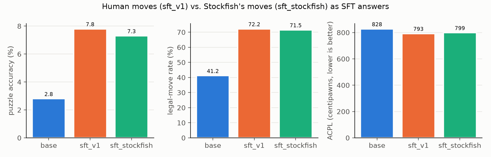

*`results/figures/sft_stockfish/puzzle_metrics.png`.* Both SFT models are far above the base model on every metric, and nearly identical to each other: 7.8% vs. 7.3% accuracy, 72.2% vs. 71.5% legal answers, ACPL 793 vs. 799 (lower is better).

- **Figures and tables** (`results/figures/sft_stockfish/`): `training_data` (how often the two answers agree), `training_loss.png`, `puzzle_results`, `paired_comparison`, `puzzle_metrics.png`, `accuracy_by_band.png`, `answer_outcomes.png`.

### 09 · DPO on the SFT model's own mistakes (`dpo_v2`, `dpo_v3`)

- **What changes in the data:** the *rejected* answer of each pair. In `dpo_v1` it was a random legal move losing at least 200 centipawns: mostly severe blunders the model would rarely play, so avoiding them taught little. Now we run `sft_v1` on training positions it was not trained on and keep its own mistakes: answers that are illegal, unparseable, or legal but losing at least 200 centipawns. Each mistake is paired with Stockfish's best move as the *chosen* answer. Building pairs from the model's own outputs is sometimes called *on-policy* preference data. Our TA suggested changing how pairs are built.
- **Two runs, both starting from `sft_v1`, with the same 4,788 pairs (the same number as `dpo_v1`):**
  - `dpo_v2`: the standard DPO loss. Compared with `dpo_v1`, only the rejected answers differ.
  - `dpo_v3`: the DPO loss plus the SFT loss on the chosen answer. In `dpo_v1`, DPO lowered the probability of both the chosen and the rejected move, and the freed probability partly went to illegal moves. The added SFT term rewards the chosen move directly, so its probability should not fall. Compared with `dpo_v2`, only the loss differs.
- **Also reported:** how often `sft_v1` makes a mistake on new game positions, and what share of the mistakes are illegal moves vs. blunders.
- **The pairs:** `sft_v1` answered 8,000 new training positions and made a mistake in 59.9% of them. Of the 4,788 rejected answers, 50.2% are illegal moves and 49.8% legal moves losing 200+ centipawns (median loss 680 cp). `dpo_v1`'s rejected moves were all legal blunders (median 620 cp).
- **Results:** `dpo_v2` scores 4.4%, significantly below `sft_v1` (29 vs. 63, p = 0.0005) and not significantly different from `dpo_v1` (35 vs. 50, p = 0.13). `dpo_v3` scores 6.7% with 72.9% legal answers: significantly better than `dpo_v2` (50 vs. 27, p = 0.012) and not significantly different from `sft_v1` (15 vs. 26, p = 0.12).
- **What the training logs show:** the model learned to separate the pairs in both runs (it preferred the chosen answer in 83% of training pairs for `dpo_v2` and 91% for `dpo_v3` by the end). In `dpo_v2`, however, the probability of Stockfish's move *fell* (log-probability −4.19 → −5.51), the same failure as `dpo_v1`: DPO pushed the rejected answer down faster than the chosen one, and lowered both. In `dpo_v3`, the SFT loss held the chosen move's probability steady (−4.19 → −4.22) while the model's own mistakes fell to about half their SFT probability. This is why `dpo_v3` keeps SFT's accuracy and legality, but nothing in it pushes the best move *up*, so it does not improve on SFT.
- **So:** changing the rejected answers alone did not help; the SFT loss is what prevented the damage.

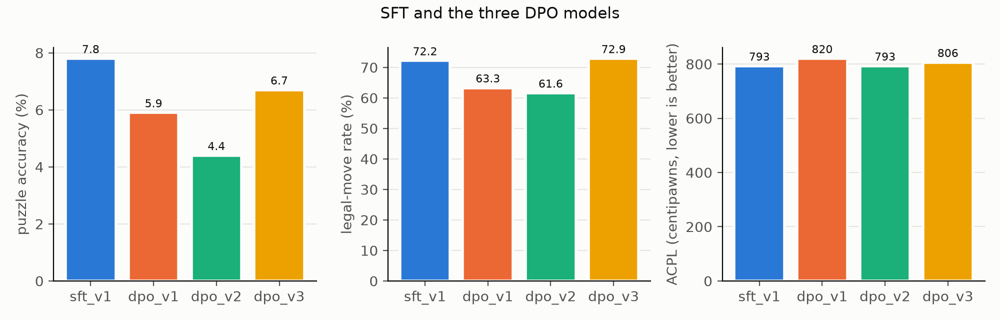

*`results/figures/dpo_v3/puzzle_metrics.png`.* `dpo_v2` (own mistakes as rejected answers) falls below `dpo_v1` in accuracy and legality; adding the SFT loss (`dpo_v3`) brings both back to `sft_v1`'s level (6.7% vs. 7.8%, not a significant difference; 72.9% vs. 72.2% legal).

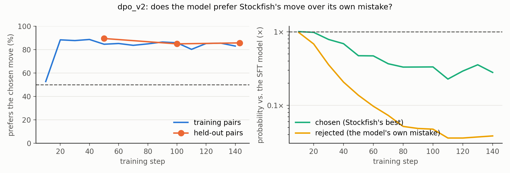

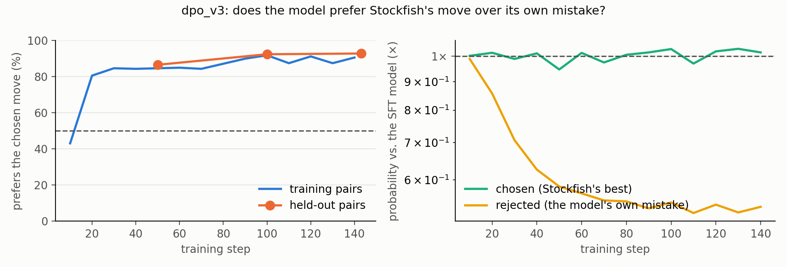

*`dpo_v2/dpo_diagnostics.png` (top) and `dpo_v3/dpo_diagnostics.png` (bottom).* **Left panels:** how often the model gives the chosen answer (Stockfish's move) a higher probability than the rejected one (its own mistake), relative to SFT; 50% means no preference. Both runs learn this quickly, on training pairs and on held-out pairs (about 85% for `dpo_v2`, about 90% for `dpo_v3`). **Right panels:** the probability of each answer relative to the SFT model, on a log scale (1× = unchanged). In `dpo_v2`, both fall: the mistakes to about 0.04× and Stockfish's move to about 0.3×, so the model becomes *less* likely to play the best move. In `dpo_v3`, Stockfish's move stays at about 1× and only the mistakes fall (to about 0.55×). This is the effect of the SFT loss, and also why `dpo_v3` does not improve on SFT: nothing raises the best move above its SFT probability.
- **Figures and tables:** `results/figures/dpo_mistake_pairs/` (`pairs`: what the mistakes are; `rejected_move_loss.png`: how much the legal mistakes lose), and in `results/figures/dpo_v2/` and `dpo_v3/`: `dpo_diagnostics.png` (left: how often the chosen answer is preferred; right: the probability of the chosen and rejected answers relative to SFT), `training_loss.png`, `puzzle_results`, `paired_comparison`, `puzzle_metrics.png`, `accuracy_by_band.png`, `answer_outcomes.png`.

### 10 · RL with a KL penalty and an adjusted reward (`grpo_v2`, `grpo_v3`)

- **Background:** `grpo_v1` raised the legal-answer rate to 82% but fell to 3.3% puzzle accuracy by switching to quiet pawn moves. Two features of its setup favor this: nothing held it close to the SFT model, and the reward valued legality (−1 for illegal, at least +0.1 for any legal move) as much as the whole range of move quality (best vs. worst legal move: a difference of 1).
- **The KL penalty:** the *KL divergence* measures how far the model's probabilities over answers have moved from those of the SFT model. GRPO subtracts β × KL from what it maximizes, so drifting away from SFT has a cost that β controls. The model can still change where the reward gain outweighs that cost.
- **Two runs, both starting from `sft_v1`, on the same 2,000 positions as `grpo_v1`:**
  - `grpo_v2`: adds the KL penalty (β = 0.04), with the original reward. Compared with `grpo_v1`, only β differs.
  - `grpo_v3`: the KL penalty and a new reward: −0.5 for an illegal or unparseable answer, and 1 − (centipawn loss / 1000) for a legal move, with no bonus for legality alone. An illegal answer is still worse than any legal move, but the gap is now half the range of move quality. Compared with `grpo_v2`, only the reward differs.
- **Also reported:** the KL divergence during training, and the share of pawn moves, captures, and checks among each model's legal answers.
- **Results:** the KL penalty helped. `grpo_v2` solves 4.9%, significantly more than `grpo_v1`'s 3.3% (21 vs. 5, p = 0.0025), and its share of pawn moves among legal answers fell from 41% to 25% (captures 9%, checks 10%; `sft_v1`: 2% pawn moves, 25% captures, 18% checks). It is still significantly below `sft_v1` (25 vs. 54, p = 0.0015). The reward change in `grpo_v3` made no significant difference compared with `grpo_v2` (4.2%; 4 vs. 11, p = 0.12; pawn moves 30%).
- **What the training logs show:** the average reward rose in every run (`grpo_v2`: −0.14 → 0.30), while puzzle accuracy fell. The KL divergence from SFT kept rising throughout training, more slowly and with larger swings towards the end: for `grpo_v2` it averaged 0.01 over the first 100 of 500 steps and 0.30 over the last 100 (`grpo_v3`: 0.01 and 0.36). β = 0.04 slowed the drift away from SFT but did not stop it. Notebook 14 tests larger values.
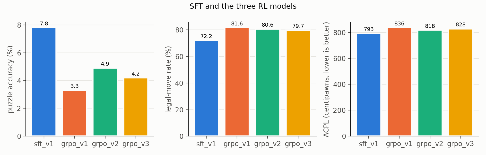

*`results/figures/grpo_v3/puzzle_metrics.png`.* All three RL models give more legal answers than `sft_v1` (about 80% vs. 72%) but solve fewer puzzles and have a higher ACPL. Among them, `grpo_v2` (KL penalty) is the best (4.9%).

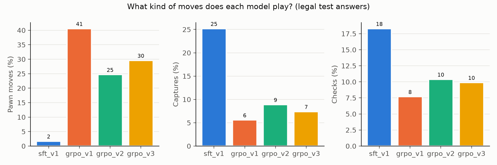

*`results/figures/grpo_v2/move_kinds.png`.* What kind of moves each model plays, among its legal test answers. `sft_v1` rarely plays pawn moves (2%) and often captures (25%) or gives check (18%), as puzzles require. `grpo_v1` shifted to pawn moves (41%). The KL penalty reduced this shift (`grpo_v2`: 25%) but did not remove it, and captures and checks stayed far below `sft_v1`'s.

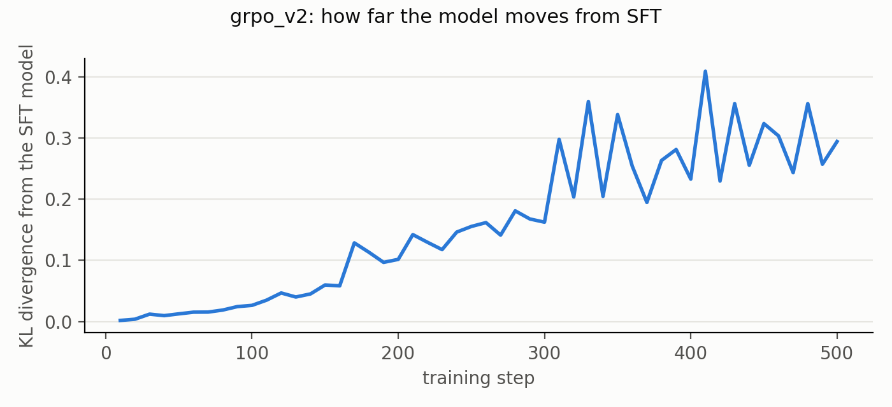

*`results/figures/grpo_v2/kl.png`.* How far `grpo_v2` moves from the SFT model during training (0 = identical to SFT). It rises through the whole run, faster after about step 150 and with larger swings after step 300, so β = 0.04 did not hold the model near SFT.

- **Figures and tables** (`results/figures/grpo_v2/` and `grpo_v3/`, the same comparison in both): `reward.png`, `kl.png`, `move_kinds` (table and figure), `puzzle_results`, `paired_comparison`, `puzzle_metrics.png`, `accuracy_by_band.png`, `answer_outcomes.png`.

### Why post-training has not beaten SFT so far

Three observations from the results and training logs above:

1. **The SFT model gives the best move little probability, so there is little for DPO and RL to sharpen.** DPO and RL do not teach new moves; they shift probability between answers the model already produces. At the start of DPO training, `sft_v1` gave Stockfish's move a log-probability of about −4.2, a probability of roughly 1.5%. `sft_stockfish` points the same way: changing 57% of the training answers did not change puzzle accuracy, so 20,000 examples do not seem to be enough for the model to learn which move is best. (Notebooks 12 and 12b later supported this: 5 times more data improved the model, while the source of the answers still made no difference.)
2. **The training signal and the test measure different things.** All training positions come from ordinary games, and the DPO pairs and RL reward favor moves that avoid large centipawn losses. Puzzles require one forcing tactical move. In ordinary positions a quiet move is often good enough, which is what RL learned: its reward rose while its puzzle accuracy fell. Notebook 11 confirms this in ordinary positions: the RL models' legal moves lose significantly fewer centipawns than `sft_v1`'s, but they play Stockfish's best move less often (see 11 below).
3. **The fixes worked only partly.** The SFT loss kept DPO from lowering the best move's probability but did not raise it; the KL penalty slowed RL's drift away from SFT but β = 0.04 did not stop it.

These motivate notebooks 12 (a stronger SFT starting point), 13 (separating "knowing which moves are legal" from "choosing a good one"), and 14 (a larger KL penalty). Notebook 15 later tested whether legality was behind DPO's and RL's failures: removing illegal answers did not make either of them improve on SFT (see [Results of the combinations](#15--results-of-the-combinations)).

### 11 · Held-out game positions and full games (every model)

These are the two evaluations our progress report committed to. They run on every model, old and new, and add new result files without changing earlier ones. The notebook skips models that already have results, so it is rerun after each round of new models and only evaluates what is new.

- **Held-out game positions:** 1,000 ordinary positions from validation games (games no model trained on), frozen in `data/eval/game_positions.csv`. There is no single right answer in most of them, so we measure the legal-move rate, ACPL, the **blunder rate** (answers losing 200+ centipawns), and how often the answer equals Stockfish's move and the player's move. A random legal move is included as a reference. This separates "makes fewer blunders in ordinary positions" from "finds tactics in puzzles", which puzzles alone cannot.
- **Full games:** 50 games per model against each of two opponents: a player that moves at random (the weakest possible opponent) and Stockfish searching to depth 1 (shallow, but far stronger than our models). Games start after the first three moves of 25 different held-out games, and each opening is played once with each color. An illegal or unparseable answer is replaced by a random legal move and counted, so every game finishes. A game still going after 100 moves counts as a draw. We report wins, draws, losses, the score ((wins + ½ draws) / games), and the share of invalid moves over whole games.
- **Why:** DPO and RL were trained on ordinary game positions to avoid bad moves, not to solve puzzles. These two evaluations measure exactly that, so they are the fairer test of what DPO and RL changed. A model with lower puzzle accuracy could still lose fewer centipawns in ordinary positions, and the RL models do (point 2 below).
- **Outputs:** `results/positions_summary.csv` and `results/games_summary.csv` (one row per model, and per opponent), `results/<model>_positions.json` and `results/<model>_games.json` (every answer and every game, as PGN that any chess site can replay), and in `results/figures/game_evals/`: `game_positions` (table and figure: legal rate, ACPL, blunders, same move as Stockfish), `games_vs_random` and `games_vs_stockfish` (tables and figures: wins, draws, losses).
- **Results (all 19 models):**

  | Model | Legal | Same move as Stockfish | Same move as the player | ACPL on legal answers (cp) | Blunders among legal answers | Invalid moves in games (vs. random / vs. Stockfish) |
  |---|---|---|---|---|---|---|
  | base | 40.4% | 2.7% | 2.6% | 344 | 47% | 77% / 78% |
  | `sft_v1` | 64.7% | 6.5% | 6.8% | 392 | 55% | 40% / 61% |
  | `sft_stockfish` | 65.2% | 6.9% | 5.9% | 414 | 58% | 37% / 58% |
  | `sft_100k` | 78.1% | 10.1% | 12.2% | 348 | 50% | 23% / 42% |
  | `sft_100k_stockfish` | 79.7% | 9.6% | 8.4% | 370 | 52% | 20% / 42% |
  | `base_legal_moves` | 81.7% | 8.2% | 8.2% | 381 | 56% | 23% / 21% |
  | `sft_legal_moves` | 100% | 10.8% | 11.9% | 389 | 56% | 0% / 0% |
  | `sft_100k_legal_moves` | 100% | **15.1%** | **19.2%** | 344 | 50% | 0% / 0% |
  | `dpo_v1` | 55.4% | 5.2% | 5.4% | 397 | 55% | 47% / 71% |
  | `dpo_v2` | 57.8% | 4.2% | 4.1% | 346 | 52% | 58% / 65% |
  | `dpo_v3` | 65.9% | 6.1% | 6.6% | 389 | 55% | 38% / 61% |
  | `grpo_v1` | 81.5% | 2.5% | 3.7% | 322 | 47% | 51% / 60% |
  | `grpo_v2` | 78.2% | 3.2% | 4.5% | 336 | 49% | 44% / 62% |
  | `grpo_v3` | 78.6% | 3.5% | 4.6% | 335 | 47% | 43% / 60% |
  | `grpo_v4` | 77.6% | 4.1% | 4.6% | 342 | 49% | 38% / 58% |
  | `grpo_v5` | 76.2% | 5.1% | 5.7% | 335 | 50% | 38% / 60% |
  | `sft_legal_dpo` | 100% | 8.9% | 11.1% | 413 | 58% | 0% / 0% |
  | `sft_legal_rl` | 100% | 12.0% | 13.2% | 314 | 45% | 0% / 0% |
  | `sft_legal_dpo_rl` | 100% | 12.6% | 13.1% | **301** | **44%** | 0% / 0% |
  | random legal move | 100% | 5.3% | 6.5% | 391 | 56% | – |

  **How to read the ACPL and blunder columns.** Each model is scored only on the positions where it answered legally, and these differ between models. The base model, for example, answers legally in only 40% of positions, probably the easier ones, which is why its ACPL looks good. Two models are therefore compared on the positions where *both* answered legally; all ACPL differences quoted below are computed this way. The legal, Stockfish-match and player-match columns cover all 1,000 positions and can be compared directly.

  1. **The puzzle ranking holds in ordinary positions.** As on puzzles, the SFT models and `dpo_v3` most often play Stockfish's move, and the RL models least often. `sft_v1`, `sft_stockfish` and `dpo_v3` do not differ significantly from each other (for example `sft_v1` vs. `sft_stockfish`: 28 positions where only `sft_v1` plays Stockfish's move, 32 where only `sft_stockfish` does, p = 0.7), while `sft_v1` is significantly ahead of `grpo_v2` (55 vs. 22, p = 0.0002). The conclusions from notebooks 08–10 therefore do not depend on puzzles being an unusual test.
  2. **RL changed the kind of move, not the strength.** The RL models answer legally more often, and their legal moves lose fewer centipawns (ACPL about 330 vs. 392 for `sft_v1`). This is not only because they answer legally in different positions: on the positions where both `sft_v1` and `grpo_v2` answer legally, `grpo_v2` loses on average 52 cp less (95% bootstrap interval 24–79 cp). But they match Stockfish's best move less often. RL learned to avoid losing material, which is what its reward pays for, rather than to find the best move. This is the clearest evidence that our post-training optimized something other than what puzzles measure (point 2 of "Why post-training has not beaten SFT so far" above).
  3. **The first nine models are only slightly above a random legal move; the new SFT models are clearly above it.** The first nine play Stockfish's move in at most 6.9% of positions vs. 5.3% for a random legal move, a difference within the margin of error at 1,000 positions (about ±1.5 points). The models with 5 times more data (`sft_100k`, 10.1%) or with the legal moves in the prompt (`sft_legal_moves`, 10.8%) are the first to be clearly above random. But **no model avoids blunders much better than random**: 47–58% of every model's legal moves lose 200+ cp, vs. 56% for a random legal move. The lowest rates (47–50%) belong to the RL models, `sft_100k`, and the base model on its few legal answers.
  4. **Full games do not separate the models.** Against Stockfish (depth 1), no model wins a game; every model loses 31–48 of 50, and all draws (2–19 per model) are threefold repetitions. The legal-move models draw most often (`sft_100k_legal_moves` 19 of 50, `base_legal_moves` 13), but most of these differences are not significant (for example 13 vs. `sft_v1`'s 5: Fisher exact test, p = 0.07; 19 vs. `sft_100k`'s 7: p = 0.011 on its own, borderline after adjusting for the many comparisons). Against the random player, at most 10 of 50 games are won (`sft_legal_rl`; vs. 3 for `sft_legal_moves`, p = 0.07); the rest are draws by the 100-move limit or by repetition (the models often move a piece back and forth). Over whole games, many moves are illegal or unparseable and are replaced by a random legal move: 37–78% for the first nine models, about 20% for the 100k models, 0% for every model with the legal moves listed except the untrained base model. Games reach positions unlike the training data, so this is far more than in single positions. The invalid-move rate is the only game measure that separates the models, and it ranks them the same way as the position measures. The finding for the paper is that none of the models plays a sound game, even when every move is legal.

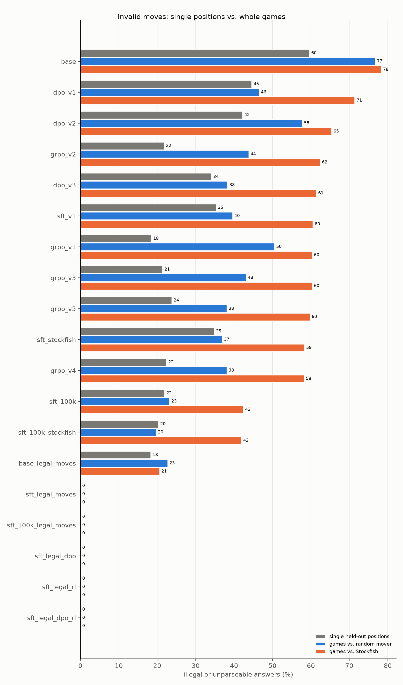

*`results/figures/final/invalid_moves.png`* (notebook 16, all 19 models)*.* The share of illegal or unparseable answers for each model in three settings: the 1,000 single held-out positions (grey), games against the random mover (blue), and games against Stockfish (orange). Models are sorted by the last. For almost every model, the rate is higher in games than in single positions, and highest against Stockfish, whose play leads to the least familiar positions (`sft_v1`: 35%, 40% and 61%). More SFT data lowers the rate in games by a third to a half (`sft_100k`: 23% and 42%). With the legal moves listed, every trained model makes no invalid moves at all (they do not appear as bars), and even the untrained base model drops to about 20%. The numbers are in `invalid_moves.csv`.

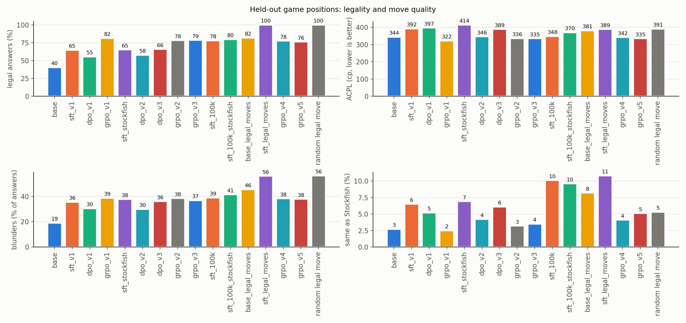

*`results/figures/game_evals/game_positions.png`.* One bar per model, with a random legal move as the last bar. Top row: legal answers (higher is better) and ACPL of the legal answers (lower is better). Bottom row: blunders as a share of all answers (an illegal answer is not counted as a blunder, so a model with many illegal answers has fewer blunders here; the table above gives the blunder rate among legal answers), and how often the answer is Stockfish's move. Among the first nine models, the RL models (`grpo_*`) have the most legal answers and the lowest ACPL, but the lowest Stockfish match. Of the later models, `sft_100k_legal_moves` matches Stockfish most often (15%), followed by the RL combinations (12–13%); every model with the legal moves listed is always legal. The RL combinations have the lowest ACPL (301–314) and the fewest blunders (44–45%); `sft_legal_moves` and `sft_legal_dpo` blunder about as often as a random legal move (56–58%).

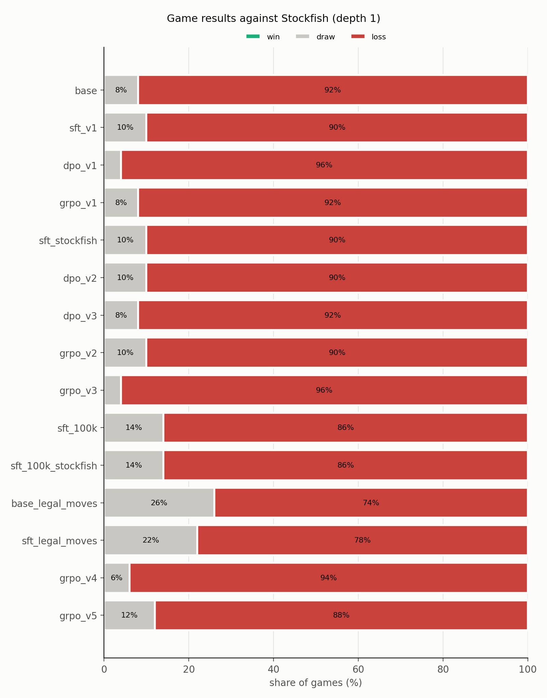

*`results/figures/game_evals/games_vs_stockfish.png`.* Share of the 50 games against Stockfish (depth 1) won (green), drawn (grey) and lost (red). No model wins a game; the 2–19 draws per model are all threefold repetitions. The legal-move models draw most often (up to 19 of 50 for `sft_100k_legal_moves`), all by threefold repetition.


*`results/figures/game_evals/games_vs_random.png`.* The same against a player that moves at random. Almost every game is a draw, by the 100-move limit or by repetition: even against random moves, the models rarely deliver mate. The two RL combinations win most often (`sft_legal_rl` 20%, `sft_legal_dpo_rl` 16%), but the differences are small (10 vs. 3 wins against `sft_legal_moves`, p = 0.07). No trained model with the legal moves listed loses a game (the untrained `base_legal_moves` loses one).

### 12 · SFT with more training data (`sft_100k`)

- **What changes:** the number of training examples, from 20,000 to 100,000 (of the 142,500 available). The first 20,000 are exactly `sft_v1`'s positions, in the same order; everything else (answers, settings, prompt) is the same.
- **Why:** every later method builds on SFT, and the observations above suggest the SFT model is too weak a starting point. A stronger SFT model should also give DPO and RL more to work with.
- **The scaling curve:** instead of training five separate models, one run saves a copy of the model after 20k, 40k, 60k and 80k examples, and every copy is graded on the puzzles. This gives puzzle accuracy as a function of training data. Caveat: the learning rate decreases over the whole run (a cosine schedule), so a copy saved partway has not finished that schedule. The copies are close to, but not exactly, models trained on fewer examples. Comparing the 20k copy with `sft_v1` (the same data, schedule finished) shows how large this effect is.
- **Compared with:** `sft_v1` (the effect of 5 times more data).
- **Results on puzzles:** `sft_100k` solves 9.4% (legal 78.6%) vs. 7.8% (legal 72.2%) for `sft_v1`. 60 puzzles are solved only by `sft_100k` and 44 only by `sft_v1` (p = 0.14), so on puzzles alone the gain is not statistically clear. Most of it is in the easiest rating band (below 1200: 14.4% vs. 8.4%); the other bands change by 1–2 points, within the noise of 250 puzzles per band.
- **Results on held-out game positions** (notebook 11), where the gain is clear on every measure:
  - legal answers 78.1% vs. 64.7% (198 positions legal only for `sft_100k`, 64 only for `sft_v1`, p < 10⁻¹⁶);
  - same move as Stockfish 10.1% vs. 6.5% (74 vs. 38, p = 0.0009); same move as the player 12.2% vs. 6.8% (81 vs. 27, p < 10⁻⁶);
  - on the 583 positions where both answered legally, `sft_100k` loses 38 cp less per move (95% bootstrap interval 12–64 cp) and blunders less often (50% vs. 55% of those moves; 59 vs. 86, p = 0.03).
- **What it suggests:** more data clearly improves the model on the kind of position it is trained on (ordinary positions from games), and the gain carries over to tactical puzzles only partly. This fits observation 1 of "Why post-training has not beaten SFT so far": with 20,000 examples the model had not learned much about which moves are good.
- **The scaling curve needs care.** The copies score 6.7% (20k), 6.3% (40k), 8.1% (60k), 9.9% (80k) and 9.4% (100k, the final model). The 20k copy is *below* `sft_v1` (6.7% vs. 7.8%), although both have seen exactly the same 20,000 examples. The reason is the learning-rate schedule noted above: when the 20k copy was saved, the learning rate was still 1.8 × 10⁻⁴, 90% of its starting value, whereas `sft_v1` had finished its schedule (learning rate near 0), which usually gives a better final model. At 40k, 60k and 80k the learning rate was 1.3 × 10⁻⁴, 7 × 10⁻⁵ and 2 × 10⁻⁵. The curve therefore shows **progress during one training run**, not what a model trained on 20k, 40k, ... examples would score. The clean comparison of data sizes is `sft_v1` vs. `sft_100k`. The dip at 40k and the difference between 80k and 100k (9 vs. 4 puzzles, p = 0.27) are noise. The validation loss fell steadily until about 80k examples (0.71 after 16k, 0.56 after 80k, 0.56 at the end).
- **Figures and tables** (`results/figures/sft_100k/`): `scaling_curve.png` and `scaling` (accuracy and legal rate against training examples), `training_data`, `training_loss.png`, `puzzle_results`, `paired_comparison`, `puzzle_metrics.png`, `accuracy_by_band.png`, `answer_outcomes.png`.
- **Compute:** 4.4 GPU-hours of training on one A10 (9.5M tokens), plus about 20 minutes of grading.

### 12b · More training data, on Stockfish's moves (`sft_100k_stockfish`)

- **What changes:** compared with `sft_100k`, only the answer the model learns: Stockfish's best move (depth 10), as in notebook 08, in the same 100,000 positions in the same order. It saves and grades copies after 20k, 40k, 60k and 80k examples, like notebook 12.
- **Why:** notebook 08 found no significant difference between the players' moves and Stockfish's moves with 20,000 positions. One explanation is that 20,000 examples are too few for the model to learn which move is best from either kind of answer. With this run, the four SFT models form a 2 × 2 comparison of answer source and amount of data:

  | | 20,000 positions | 100,000 positions |
  |---|---|---|
  | **Player's move** | `sft_v1` | `sft_100k` |
  | **Stockfish's move** | `sft_stockfish` | `sft_100k_stockfish` |

  If Stockfish's moves help only with enough data, the gap between the rows opens up in the 100,000 column.
- **Labels:** the first 20,000 positions reuse notebook 08's Stockfish labels; the other 80,000 are labelled in chunks of 10,000, each saved as soon as it is done (`data/processed/sft_100k_stockfish_labels/`, not on GitHub).
- **Compared with:** `sft_100k` (the answer source with 100,000 positions), `sft_stockfish` (the extra data with Stockfish's moves), `sft_v1`; and the 20k copy with `sft_stockfish` (the learning-rate schedule caveat, as in 12).
- **The training data:** the player's move equals Stockfish's in 42.6% of the 100,000 positions (42.7% in the first 20,000), so as in notebook 08, the two runs learn different answers in 57% of the positions.
- **Results, the 2 × 2** (test-puzzle accuracy):

  | | 20,000 positions | 100,000 positions |
  |---|---|---|
  | **Player's move** | 7.8% (`sft_v1`) | 9.4% (`sft_100k`) |
  | **Stockfish's move** | 7.3% (`sft_stockfish`) | 9.2% (`sft_100k_stockfish`) |

  - **The answer source makes no difference, with either amount of data.** `sft_100k_stockfish` vs. `sft_100k`: 31 vs. 33 puzzles, p = 0.9. The gap between the rows did not open up with more data.
  - **More data helps both rows by about the same amount** (+1.6 and +1.9 points). `sft_100k_stockfish` vs. `sft_stockfish`: 58 vs. 39, p = 0.067. On puzzles alone this is borderline; on game positions it is clear, as in 12: legal 79.7% vs. 65.2% (p < 10⁻¹⁹), same move as Stockfish 9.6% vs. 6.9% (63 vs. 36, p = 0.009), 43 cp less lost per move on the positions both answered legally (95% interval 16–71 cp), fewer blunders (52% vs. 59% of those moves; 55 vs. 93, p = 0.002).
- **Each model learned the answer it was given, but this did not change how often it agrees with Stockfish.** In game positions, `sft_100k` plays the player's move far more often than `sft_100k_stockfish` (12.2% vs. 8.4%; 57 vs. 19, p < 0.0001), as expected. But `sft_100k_stockfish` does not play Stockfish's move more often (9.6% vs. 10.1%, p = 0.68), and on the positions both answered legally it loses slightly *more* centipawns (22 cp, 95% interval 4–40 cp). A possible explanation, which we have not tested: Stockfish's choice comes from a search many moves deep that the model cannot reproduce from the board alone, while the players' moves follow more recognizable patterns, so they are easier to learn from.
- **The learning-rate caveat is confirmed.** The 20k copy of this run scores 5.2%, significantly below `sft_stockfish` (7.3%; 31 vs. 52, p = 0.028), although both saw the same 20,000 examples. The scaling curves show progress during the run (see 12).


*`results/figures/findings_08_14/sft_two_by_two.png`.* The four SFT models, with 95% intervals. Left: puzzle accuracy. Middle and right: legal answers and same move as Stockfish on the 1,000 held-out game positions. The blue (player's move) and orange (Stockfish's move) lines lie almost on top of each other, so the answer source does not matter. Both rise from 20,000 to 100,000 positions; on game positions the rise is far larger than the intervals.

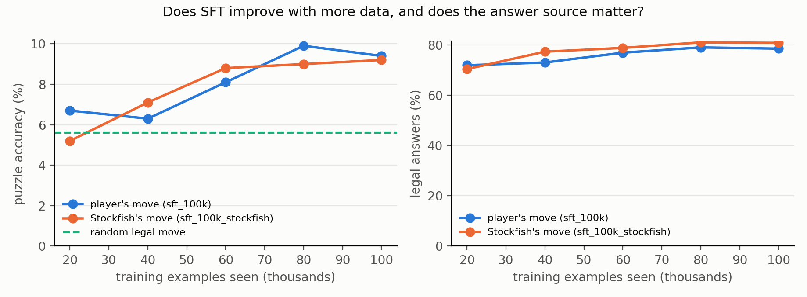

*`results/figures/sft_100k_stockfish/scaling_curves.png`.* Puzzle accuracy (left) and legal answers (right) of the copies saved during the two 100k runs. Read this as progress during one run, not as a data-scaling curve: the early copies were saved before the learning rate had come down, which is why the 20k copies are below the models trained on 20,000 examples (7.8% and 7.3%, not shown).

- **Figures and tables** (`results/figures/sft_100k_stockfish/`): `two_by_two` (puzzle accuracy of the four SFT models), `scaling_curves.png` and `scaling` (this run and `sft_100k` on the same axes), `training_data` (how often the player's move equals Stockfish's), `training_loss.png`, `puzzle_results`, `paired_comparison`, `puzzle_metrics.png`, `accuracy_by_band.png`, `answer_outcomes.png`.
- **Compute:** 4.4 GPU-hours of training on one A10 (9.5M tokens), plus the labelling of 80,000 new positions with Stockfish and about 20 minutes of grading.

### 13 · Listing the legal moves in the prompt (`sft_legal_moves`, `base_legal_moves`)

- **What changes:** the prompt gains one line listing every legal move in the position (`show_legal_moves` in `configs/prompt.yaml`, which existed but was off). The model must still choose a move, but no longer has to work out from the FEN which moves are possible. Training uses `sft_v1`'s 20,000 positions and answers; training and grading both use the new prompt.
- **Why:** illegal answers are the largest single failure (28% of `sft_v1`'s answers). This experiment separates two reasons a model can fail: naming an impossible move, and choosing a poor move among the possible ones.
- **Two models:** `base_legal_moves` (the untrained base model with the new prompt; compared with `base`, the effect of the list alone) and `sft_legal_moves` (SFT with the new prompt; compared with `sft_v1`, the effect with training).
- **Also reported:** *accuracy when legal* = puzzle accuracy among the legal answers only. If legality rises but this does not, the list removed impossible moves without improving the choice.
- **Caveat:** the list gives the model information the other models must work out themselves, so this is an easier version of the task, reported as an ablation rather than a replacement for the original setting.
- **Results on puzzles:**

  | Model | Accuracy | Legal | Accuracy when legal |
  |---|---|---|---|
  | base | 2.8% | 41.2% | 6.8% |
  | `base_legal_moves` | 6.0% | 84.3% | 7.1% |
  | `sft_v1` | 7.8% | 72.2% | 10.8% |
  | `sft_legal_moves` | **13.2%** | **100%** | 13.2% |

  - **`sft_legal_moves` is the best model so far, and the first to clearly beat `sft_v1`:** 109 puzzles solved only by it, 55 only by `sft_v1` (p = 0.00003). It also beats both 100k models (101 vs. 63 against `sft_100k`, p = 0.004), although it was trained on 5 times less data. It never gives an illegal answer, and it improves in every rating band, including the hardest (2400+: 11.6% vs. 3.6%; with 250 puzzles per band the margin of error is about ±4 points).
  - **Most of the gain comes from never answering illegally.** Of the 109 puzzles only it solves, 40 are puzzles where `sft_v1`'s answer was illegal; it solves 14.4% of those 278 puzzles, where `sft_v1` solved none. On the 722 puzzles where `sft_v1` answered legally, the two are close (12.7% vs. 10.8%; 69 vs. 55, p = 0.24). So the list mostly removes impossible answers; whether it also improves the choice among legal moves is not clear.
  - **The list alone does almost nothing for the untrained model.** `base_legal_moves` doubles the legal rate and solves more puzzles than the base model (58 vs. 26, p = 0.0006), but its 6.0% equals a random legal move (5.6%; binomial test p = 0.31), and its accuracy when legal barely changes (7.1% vs. 6.8%). It also tends to pick the first move in the list (11.6% of its answers, vs. 2–4% for the trained models). Training is needed to make use of the list.
  - **The trained model does not exploit the order of the list.** The moves are listed alphabetically, and `sft_legal_moves`' choices are spread across the list like the correct answers are.
- **Results on held-out game positions:** it plays Stockfish's move in 10.8% of positions vs. 6.5% for `sft_v1` (91 vs. 48, p = 0.0003). But **its legal moves are no better than random ones**: ACPL 389 and 56% blunders, vs. 391 and 56% for a random legal move (both cover all 1,000 positions, so this comparison is fair). On the positions both answered legally, it loses about as much as `sft_v1` (13 cp more, 95% interval −15 to +41 cp) and 56 cp more than `sft_100k` (interval 30–82 cp; blunders 59% vs. 50% of those moves, p < 0.0001). So it finds the best move more often, but when it misses, the move it chooses is as bad as a random one. It seems to recognize some strong (often forcing) moves, without a general sense of which moves lose material.
- **In games:** none of its moves were invalid (0% against both opponents), the first model to manage this. It still wins no game against Stockfish (11 draws by repetition, 39 losses) and only 3 of 50 against the random player.
- **Cost:** a training example is 2.4 times longer (227 vs. 95 tokens on average, at most 349), so training took 69 minutes (1.14 GPU-hours, 4.5M tokens) instead of about 56 for the same 20,000 positions without the list, and answering a puzzle takes about 50% longer (0.106 s vs. 0.070 s).

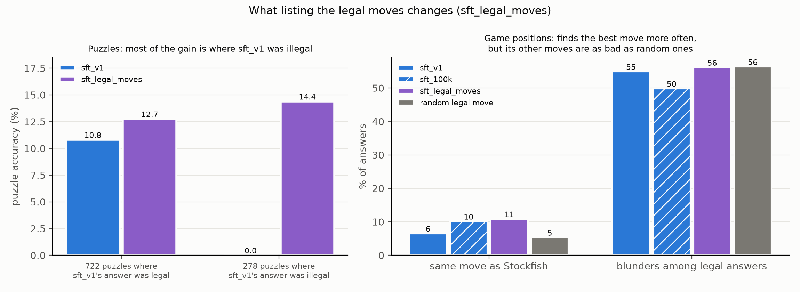

*`results/figures/findings_08_14/legal_moves.png`.* **Left:** puzzle accuracy of `sft_v1` and `sft_legal_moves`, split by whether `sft_v1`'s answer was legal. Where `sft_v1` was legal, the two are close (10.8% vs. 12.7%); where it was illegal (278 puzzles), `sft_v1` scores 0 and `sft_legal_moves` 14.4%. This is where most of the gain comes from. **Right:** on game positions, `sft_legal_moves` plays Stockfish's move as often as `sft_100k` (11% vs. 10%), but 56% of its moves are blunders, the same as a random legal move. (The blunder rate is over each model's own legal answers; `sft_legal_moves` and the random move both answer all 1,000 positions.)

- **Figures and tables** (`results/figures/sft_legal_moves/`): `prompt_length`, `training_loss.png`, `puzzle_results`, `accuracy_when_legal` (table and figure), `paired_comparison`, `answer_outcomes.png`, `accuracy_by_band.png`.
- **Compute:** 1.14 GPU-hours of training on one A10, plus grading.

### 14 · RL with a larger KL penalty (`grpo_v4`, `grpo_v5`)

- **What changes:** the KL penalty β, from 0.04 (`grpo_v2`) to 0.1 (`grpo_v4`) and 0.2 (`grpo_v5`). Everything else is as in `grpo_v2`: the original reward (`grpo_v3`'s reward change made no significant difference), the same 2,000 positions, starting from `sft_v1`.
- **Why:** with β = 0.04 the KL divergence from SFT kept rising and the model still drifted towards pawn moves. Together with `grpo_v1` (β = 0) and `grpo_v2`, this gives four values of β.
- **Also reported:** the KL divergence and reward of all runs on one figure, and the share of pawn moves, captures, and checks.
- **Results:**

  | Model | β | Puzzle accuracy | Legal | KL from SFT (last 100 steps) | Pawn moves | Captures | Checks |
  |---|---|---|---|---|---|---|---|
  | `sft_v1` | – | 7.8% | 72.2% | – | 2% | 25% | 18% |
  | `grpo_v1` | 0 | 3.3% | 81.6% | (not logged) | 41% | 6% | 8% |
  | `grpo_v2` | 0.04 | 4.9% | 80.6% | 0.30 | 25% | 9% | 10% |
  | `grpo_v4` | 0.1 | 4.8% | 80.2% | 0.22 | 15% | 10% | 11% |
  | `grpo_v5` | 0.2 | 5.0% | 78.3% | 0.17 | 10% | 12% | 13% |

  (Pawn moves, captures and checks are shares of each model's legal test answers.)
  - **The penalty does what it is designed to do.** The larger β, the closer the model stays to SFT (lower KL), the less its answers lose variety (entropy at the end of training 0.36, 0.43 and 0.52, from 0.78 at the start), and the smaller the shift to pawn moves (25% → 15% → 10%).
  - **But puzzle accuracy does not recover.** The three values of β give the same accuracy (`grpo_v4` vs. `grpo_v2`: 11 vs. 12 puzzles, p = 1.0; `grpo_v5` vs. `grpo_v2`: 18 vs. 17, p = 1.0), and all three are significantly below `sft_v1` (for `grpo_v5`: 18 vs. 46, p = 0.0006). When their answer is legal, they are right about 6% of the time, close to a random legal move (5.6%) and well below `sft_v1` (10.8%).
  - **On game positions, β = 0.2 is slightly better than β = 0.04:** Stockfish's move 5.1% vs. 3.2% (35 vs. 16 positions, p = 0.011), with the same ACPL. And as for every RL model, its legal moves lose fewer centipawns than `sft_v1`'s (46 cp less on the positions both answered legally, 95% interval 22–71 cp).
- **What it suggests:** the KL penalty limits *how far* the model follows the reward, but not *what* the reward asks for. The reward pays for avoiding lost centipawns and for legality, which quiet, safe moves achieve; puzzles need forcing moves. A larger β keeps more of SFT's behavior, so the model changes less, but it does not make the reward point at better moves. To improve on SFT, RL needs a reward or starting point where avoiding losses and finding the best move go together (see [Choosing the combinations](#15--choosing-the-combinations)).

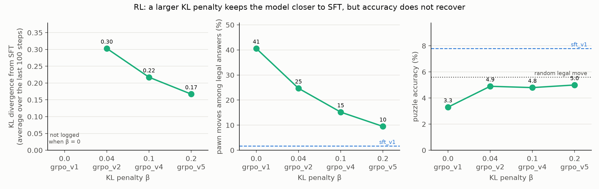

*`results/figures/findings_08_14/rl_kl_penalty.png`.* The four RL runs that differ only in β (`grpo_v1`: 0, `grpo_v2`: 0.04, `grpo_v4`: 0.1, `grpo_v5`: 0.2). Left: KL divergence from SFT at the end of training, which falls as β grows (not logged when β = 0). Middle: the share of pawn moves among legal answers falls towards `sft_v1`'s 2% (dashed). Right: puzzle accuracy stays at about 5% for every β > 0, below `sft_v1` (dashed) and close to a random legal move (dotted).

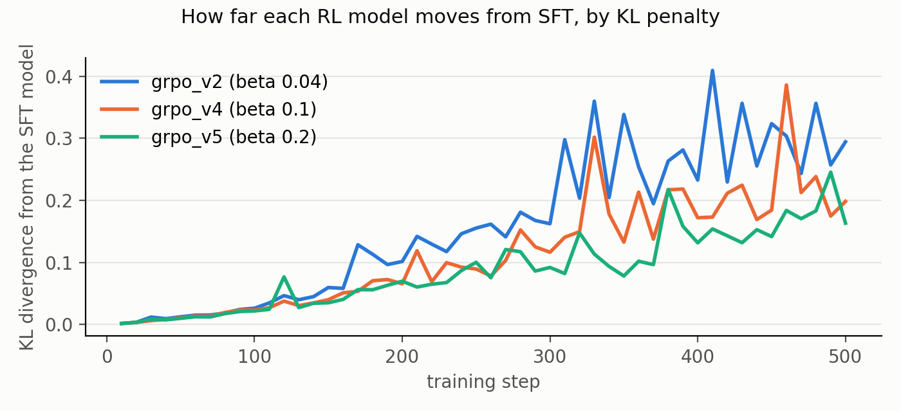

*`results/figures/grpo_v5/kl_by_beta.png`.* KL divergence from SFT during training. It rises in every run, more slowly with larger β; even with β = 0.2 it has not levelled off after 500 steps.

- **Figures and tables** (`results/figures/grpo_v4/` and `grpo_v5/`, the same comparison in both): `kl_by_beta.png`, `reward_by_beta.png`, `puzzle_results` (with β), `paired_comparison`, `move_kinds` (table and figure), `puzzle_metrics.png`, `accuracy_by_band.png`, `answer_outcomes.png`.
- **Compute:** 0.5 GPU-hours of training per run on one A10, plus grading.

### What worked best, and why (notebooks 08–14)

*Written after notebook 14, before 13b and 15 had run; it explains how we chose the combinations. The updated summary, with 13b and 15, is in [Final summary](#final-summary-what-worked-best-notebooks-0815).*

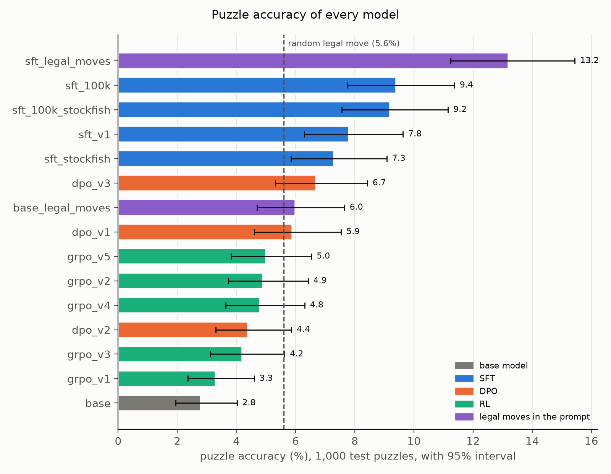

*`results/figures/findings_08_14/puzzle_accuracy_all.png`.* Every model on the 1,000 test puzzles, with 95% intervals (Wilson), colored by method. The dashed line is a random legal move (5.6%). Only the SFT models and `sft_legal_moves` are clearly above it; no DPO or RL model is.

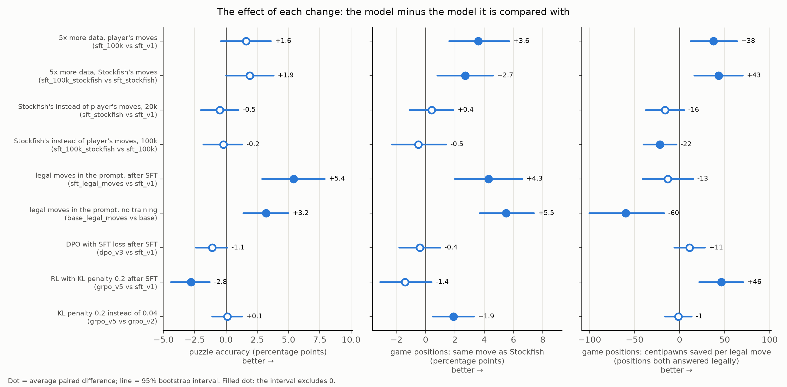

*`results/figures/findings_08_14/effects.png`.* Each row is one change, measured as the difference between a model and the model it changes one thing in (named in brackets). Each dot is the average difference over the same puzzles or positions, and the line is its 95% bootstrap interval; a filled dot means the interval excludes 0 (the difference is unlikely to be chance). In every panel, right is better. Left: puzzle accuracy. Middle: how often the answer is Stockfish's move on the held-out game positions. Right: centipawns saved per move, on the positions where both models answered legally. The numbers are in `effects.csv` in the same folder. All figures in `results/figures/findings_08_14/` are drawn from the saved results; no model was rerun.

What helped, in order of effect size:

1. **Listing the legal moves in the prompt** (`sft_legal_moves`): +5.4 points on puzzles (95% interval +2.9 to +7.9), the largest effect of any change, and the only change that clearly beats `sft_v1` on puzzles. **Why:** illegal answers were the largest failure (28% of `sft_v1`'s puzzle answers), and the list removes them; about three quarters of the gain comes from puzzles where `sft_v1` answered illegally. **Limit:** the list makes the task easier, and on ordinary positions the model's non-best moves are as bad as random ones.
2. **More SFT data** (`sft_100k`, `sft_100k_stockfish`): +1.6 and +1.9 points on puzzles (not clear on puzzles alone), but a clear gain on every measure in game positions: more legal answers, more Stockfish moves, and about 40 cp less lost per move. **Why:** the model learns more about the kind of position it is trained on; the improvement carries over to tactical puzzles only partly. Unlike the list, this makes the model better *without* changing the task.
3. **Learning Stockfish's moves instead of the players' moves:** no effect with 20,000 or 100,000 positions. The source of the answers matters much less than how many there are.
4. **Changes to DPO and RL** improved on their own first versions but never on the SFT model they started from:
   - the best DPO setting is `dpo_v3` (DPO + SFT loss): the only DPO model not significantly below `sft_v1`, because the SFT loss keeps the best move's probability from falling (notebook 09);
   - the best RL setting is `grpo_v5` (β = 0.2): the same puzzle accuracy as β = 0.04 and 0.1, but the least drift from SFT, the fewest pawn moves, and the most Stockfish moves on game positions of the RL models (notebook 14);
   - RL has one consistent strength: its legal moves lose fewer centipawns than SFT's (46 cp less for `grpo_v5`). This is exactly what its reward pays for.

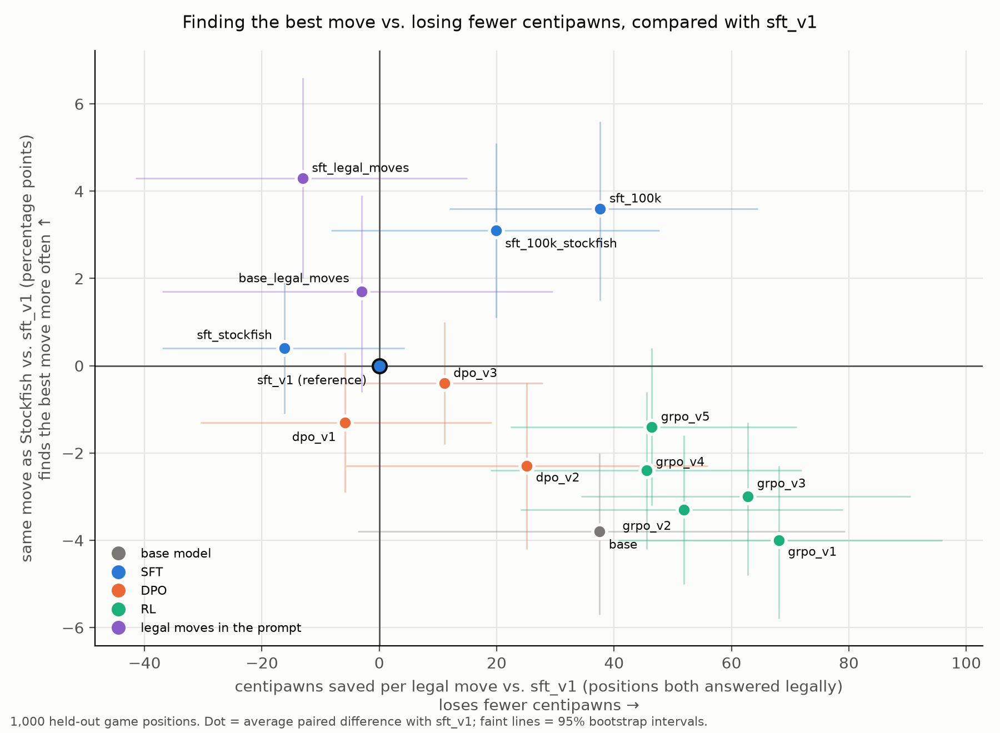

*`results/figures/findings_08_14/tradeoff.png`.* Every model compared with `sft_v1` (the black-ringed dot at 0, 0) on the 1,000 held-out game positions. Up = plays Stockfish's move more often; right = its legal moves lose fewer centipawns (on the positions both answered legally). The faint lines are 95% intervals. The methods fall into clear groups:
- the RL models (green) sit to the right and below: they lose fewer centipawns but find the best move less often;
- `sft_legal_moves` (purple) sits at the top, but not to the right: it finds the best move more often, but its moves lose as much as `sft_v1`'s;
- the DPO models stay near `sft_v1`;
- only `sft_100k` is clearly better on both axes (both intervals exclude 0).

The aim of the combinations is to reach the top right: `sft_legal_moves`' height together with RL's shift to the right. The numbers are in `tradeoff.csv`.

**Overall:** the changes that improved the model were changes to *what SFT sees* (the prompt and the amount of data). DPO and RL, as set up so far, trade puzzle accuracy for safer moves. The two weaknesses left are complementary: `sft_legal_moves` finds the best move more often but its other moves are as bad as random, while RL is good at avoiding losses but not at finding the best move. This is what the combinations are designed around.

### 15 · Choosing the combinations

The combinations apply the best DPO and RL settings on top of the best SFT model. Each combination changes one thing relative to the model it starts from, so every step can be evaluated on its own.

**The SFT starting point: `sft_legal_moves`.** Three reasons from the results above:

1. **It is the best model,** clearly ahead of every other on puzzles.
2. **It removes the problem that made DPO and RL fail.** Both spent much of their training on legality instead of move quality:
   - Half of `dpo_v2`'s rejected answers were illegal moves.
   - RL's reward gives −1 for an illegal answer and at least +0.1 for any legal one, which is what pushed `grpo_v1` to safe pawn moves.

   With the legal moves listed, the model almost never answers illegally, and both signals become about move quality:
   - **RL:** GRPO scores each answer by how much better its reward is than the average of the other answers to the same position (the group of 8). When all 8 answers are legal, the legal bonus is the same for all of them and cancels out, so the only difference left between answers is how many centipawns they lose.
   - **DPO:** the model's own mistakes, which become the rejected answers, are now all legal blunders.

   (Notebook 15 confirmed the DPO part: all rejected answers were legal blunders. For RL, legality was solved, but the model still drifted to quiet moves; see the results below.)
3. **Its weakness is what DPO and RL are good at.** Its non-best moves are as bad as random (56% blunders), while RL reliably lowers centipawn loss and DPO's pairs target exactly the model's own blunders. If the combination works, it should keep `sft_legal_moves`' ability to find the best move and lose fewer centipawns when it misses.

**The DPO setting: `dpo_v3`'s** (DPO + SFT loss on the chosen move), with pairs rebuilt from `sft_legal_moves`' own mistakes on new training positions, as in notebook 09. It is the only DPO variant that did not damage SFT, and the training logs show why (the SFT loss keeps the best move's probability).

**The RL setting: `grpo_v5`'s** (β = 0.2, the original reward). The KL penalty is the one RL change that significantly helped (notebook 10), and β = 0.2 kept the model closest to SFT with the fewest pawn moves and the best Stockfish match among the RL models. The reward change of `grpo_v3` made no difference, and with the legal moves listed the legal bonus cancels anyway (point 2 above).

**The three combinations, all with the legal moves in the prompt:**

| Combination | Starts from | What it tests |
|---|---|---|
| SFT → DPO | `sft_legal_moves` | Does DPO help once there are no illegal answers to fix? |
| SFT → RL | `sft_legal_moves` | Does RL improve move quality once legality is solved? |
| SFT → DPO → RL | SFT → DPO | Does RL add to DPO? |

Each is graded on the puzzles and in notebook 11. The main comparison is with `sft_legal_moves` itself (same prompt). A combination succeeds if it solves more puzzles, or loses fewer centipawns on the same game positions without matching Stockfish less often.

**Caveat for the paper:** all combinations use the easier prompt. They are compared with `sft_legal_moves`, not with the models that had to work out the legal moves themselves.

**Run alongside: `sft_100k_legal_moves`** (notebook 13b, see below). Notebook 15 did not wait for it. The plan was to run SFT → RL again from it if it turned out clearly better than `sft_legal_moves`. It did (17.5%), but RL made `sft_legal_moves` worse (results below), so we do not plan to repeat RL from it.

### 15 · Results of the combinations

All three combinations start from `sft_legal_moves` and use its prompt (legal moves listed). Test puzzles:

| Model | Steps | Puzzle accuracy | vs. `sft_legal_moves` (13.2%): only this / only the other, p |
|---|---|---|---|
| `sft_legal_dpo` | SFT → DPO | 12.8% | 46 / 50, p = 0.76: **no change** |
| `sft_legal_rl` | SFT → RL | 10.8% | 43 / 67, p = 0.028: **worse** |
| `sft_legal_dpo_rl` | SFT → DPO → RL | 10.9% | 50 / 73, p = 0.047: **worse** |

`sft_legal_dpo_rl` and `sft_legal_rl` are almost identical (29 vs. 28 puzzles, p = 1.0), so the DPO step made no difference to what RL did. **No combination improves on the SFT model it started from.** Every model stays 100% legal.

**DPO: it learned exactly what it was trained on, but this did not change puzzle accuracy.**
- As expected, the pairs changed: all 4,788 rejected answers are now legal blunders (0% illegal, vs. 50% for `dpo_v2`). `sft_legal_moves` made a mistake in 47.9% of the new positions it answered (`sft_v1`: 59.9%). The median rejected move loses 681 cp.
- The training worked as designed: on held-out pairs, the model prefers Stockfish's move over its own mistake 90% of the time; Stockfish's move keeps its probability, and the model's own mistakes fall to about half their probability, the same pattern as `dpo_v3`.
- But the model solves the same puzzles as before. Making the model's typical blunders less likely did not make it find the best move more often.
- One observation from the logs: at the start of training, `sft_legal_moves` gave Stockfish's move a log-probability of −3.26 (about 3.8%), clearly more than `sft_v1`'s −4.19 (about 1.5%, notebook 09). So the legal-move model already considers the best move more likely.

**RL: our hypothesis was wrong. Solving legality did not stop RL's drift towards quiet moves.**
- We expected that with no illegal answers, the reward would only reward better moves (see "Choosing the combinations"). Legality was indeed solved: the average reward was +0.73 from the start (`grpo_v5`: −0.07), and no logged average fell below +0.68, so illegal answers were rare.
- Yet the models still shifted to pawn moves, and away from checks:

  | Model | Pawn moves | Captures | Checks |
  |---|---|---|---|
  | `sft_legal_moves` | 4% | 23% | 16% |
  | `sft_legal_dpo` | 2% | 22% | 17% |
  | `sft_legal_rl` | 24% | 23% | 11% |
  | `sft_legal_dpo_rl` | 28% | 20% | 12% |

  (Shares of each model's legal test answers.)
- **Where RL lost:** mostly on **mate-in-1 puzzles**, which make up 110 of the 1,000 test puzzles, 88 of them in the easiest band. `sft_legal_rl` solves 5.5% of them vs. 11.8% for `sft_legal_moves` (2 gained, 9 lost), and its accuracy in the <1200 band halves (10.4% vs. 20.8%), while the other bands change little. DPO did not have this effect (12.7% of mate-in-1 puzzles).
- **Small changes in probability, large changes in answers:** the KL divergence from the starting model stayed smaller than in any earlier RL run (0.08 over the last 100 steps, vs. 0.17 for `grpo_v5`), yet RL changed the answer on 60% of the test puzzles. With greedy decoding, the model always plays its single most likely move, so a small shift between two close options changes the answer.
- **What it suggests:** legality was not what drove RL away from good moves; the reward itself was. The reward pays for losing few centipawns in ordinary game positions. There, a quiet pawn move is often safe, and a mate is rare, so the reward almost never pays for finding a mate. This is the same pattern as in every earlier RL run, now without legality as an alternative explanation. (This is our reading of the results, not something we tested directly.)
- **On ordinary game positions, RL does what it was trained to do** (notebook 11, the 1,000 held-out positions; all these models answer every position legally, so all 1,000 are compared):

  | Model | Same as Stockfish | Same as the player | ACPL (cp) | Blunders |
  |---|---|---|---|---|
  | `sft_legal_moves` (start) | 10.8% | 11.9% | 389 | 56% |
  | `sft_legal_dpo` | 8.9% | 11.1% | 413 | 58% |
  | `sft_legal_rl` | 12.0% | 13.2% | 314 | 45% |
  | `sft_legal_dpo_rl` | 12.6% | 13.1% | 301 | 44% |
  | random legal move | 5.3% | 6.5% | 391 | 56% |

  - **RL cuts losses sharply:** `sft_legal_rl` loses 75 cp less per move than `sft_legal_moves` (95% interval 55–96 cp), and blunders fall from 56% to 45% (p < 10⁻¹⁰). `sft_legal_dpo_rl`: 88 cp less, 44% blunders. These are the lowest ACPL and blunder rates of any model (a random legal move: 391 cp, 56% blunders).
  - **Without losing the best move:** unlike the RL models without the list, which played Stockfish's move *less* often than `sft_v1`, these play it slightly more often than their starting model (+1.2 and +1.8 points), although this rise is not significant (p = 0.3 and 0.14).
  - **So on game positions, the combination worked as designed:** compared with `sft_v1`, both RL combinations are clearly better on both measures (`sft_legal_dpo_rl`: 86 cp saved, Stockfish's move 6.1 points more often; both intervals exclude 0). They sit in the top right of the trade-off map in notebook 16, where we hoped to get. **But on puzzles they are worse** than their starting point: avoiding losses in ordinary positions is not the same skill as finding a puzzle's single winning move (often a mate or a forcing move, which RL plays less).
  - **DPO slightly hurt on game positions:** `sft_legal_dpo` matches Stockfish less often than `sft_legal_moves` (−1.9 points, p = 0.037) and loses 24 cp more per move (interval 6–42 cp). DPO → RL is much better than DPO alone, but about the same as RL alone, so the DPO step added nothing.
  - **In games:** no combination wins against Stockfish. Against the random player, `sft_legal_rl` wins 10 of 50 games, the most of any model, but against `sft_legal_moves`' 3 this is not significant (p = 0.07).

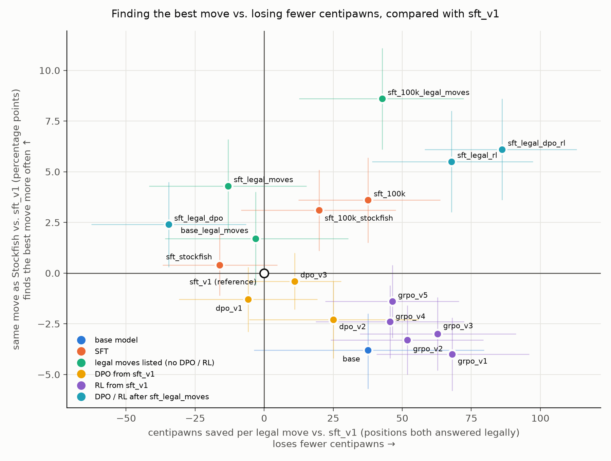

*`results/figures/final/tradeoff.png`* (notebook 16). Every model compared with `sft_v1` on the held-out game positions (up = Stockfish's move more often, right = fewer centipawns lost). The RL models from `sft_v1` (purple) sit to the right but below 0; the RL combinations (`sft_legal_rl`, `sft_legal_dpo_rl`, teal) reach the top right, which is what the combinations were designed for. `sft_legal_dpo` moves left, i.e. loses more centipawns than `sft_v1`. On puzzles, however, none of the combinations beats `sft_legal_moves`.

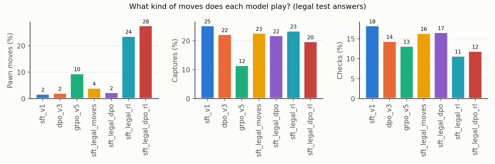

*`results/figures/combinations/move_kinds.png`.* What kind of moves each model plays, among its legal test answers. With the legal moves listed, the RL models (`sft_legal_rl`, `sft_legal_dpo_rl`) play pawn moves in 24–28% of their answers, far more than their starting point `sft_legal_moves` (4%) and even more than `grpo_v5` without the list (10%), and give check less often. DPO (`sft_legal_dpo`) leaves the kind of move unchanged.


*`results/figures/combinations/rl_reward.png`.* The average reward of the sampled answers during RL training. With the legal moves listed (orange, green), the reward starts high (about 0.7) and rises only slightly, because almost every sampled answer is legal. Without the list (`grpo_v5`, blue), the reward starts below 0, because many sampled answers are illegal (−1 each), and rises during training.

- **Figures and tables** (`results/figures/combinations/`): `pairs` (what the rejected answers are), `sft_legal_dpo_training_loss.png`, `sft_legal_dpo_dpo_diagnostics.png`, `sft_legal_rl_reward.png`, `sft_legal_rl_kl.png`, `sft_legal_dpo_rl_reward.png`, `sft_legal_dpo_rl_kl.png`, `rl_reward.png`, `rl_kl.png`, `puzzle_results`, `paired_comparison`, `move_kinds` (table and figure), `puzzle_metrics.png`, `accuracy_by_band.png`, `answer_outcomes.png`.
- **Compute:** 0.54 GPU-hours for DPO and 1.14 for each RL run, on one A10 (the prompts with the list are longer), plus collecting the DPO pairs and grading.

### 13b · More data with the legal moves in the prompt (`sft_100k_legal_moves`)

- **Why we ran it:** both changes to SFT gave good results on their own, in different ways.
  - More data (`sft_100k`) clearly improved the model on game positions: more legal answers, more of Stockfish's moves, and about 40 cp less lost per move.
  - The legal-move list (`sft_legal_moves`) gave the best puzzle accuracy (13.2%) and removed illegal answers, but its moves that are not Stockfish's lose as much as random moves.

  More data improved exactly what the legal-move model lacks, so the natural next question is whether the two gains add up. If they do, this is our strongest SFT model and a better starting point for DPO and RL. If they do not, that is also a result for the paper.
- **What changes:** compared with `sft_legal_moves`, only the amount of data (100,000 positions instead of 20,000; the first 20,000 are the same, in the same order). Compared with `sft_100k`, only the prompt. With `sft_v1`, this completes a 2 × 2 of data size × prompt:

  | | 20,000 positions | 100,000 positions |
  |---|---|---|
  | **No list** | `sft_v1` (7.8%) | `sft_100k` (9.4%) |
  | **Legal moves listed** | `sft_legal_moves` (13.2%) | `sft_100k_legal_moves` |

- **As in notebook 12,** copies are saved after 20k, 40k, 60k and 80k examples and graded; the same learning-rate caveat applies (progress during one run, not a data-scaling curve).
- **Compared with:** `sft_legal_moves` (the effect of more data with the list), `sft_100k` (the effect of the list with more data), `sft_v1`.
- **Results: the two gains add up. `sft_100k_legal_moves` is our best model, at 17.5% of the test puzzles.**

  | | 20,000 positions | 100,000 positions |
  |---|---|---|
  | **No list** | 7.8% (`sft_v1`) | 9.4% (`sft_100k`) |
  | **Legal moves listed** | 13.2% (`sft_legal_moves`) | **17.5%** (`sft_100k_legal_moves`) |

  - It is significantly better than every other model:
    - vs. `sft_legal_moves`: 86 puzzles solved only by it, 43 only by `sft_legal_moves` (p = 0.0002), so more data helps with the list too;
    - vs. `sft_100k`: 145 vs. 64 (p = 2 × 10⁻⁸), so the list helps with more data too;
    - vs. `sft_v1`: 148 vs. 51 (p < 10⁻¹¹).
  - It never answers illegally, and it improves in every rating band: <1200: 24.4%, 1200–1800: 14.0%, 1800–2400: 16.8%, 2400+: 14.8% (`sft_v1`: 8.4%, 8.4%, 10.8%, 3.6%). Its ACPL on puzzles is the lowest of any model (724 cp).
  - **The gains are at least additive.** More data adds 1.6 points without the list but 4.3 points with it. This difference (+2.7 points) is not statistically clear (95% bootstrap interval −0.3 to +5.7), so we can say the two changes add up, but not that they reinforce each other.
  - **Where the gain over `sft_100k` comes from:** on the 214 puzzles where `sft_100k` answered illegally, `sft_100k_legal_moves` solves 26%. On the 786 where `sft_100k` answered legally, it solves 15.1% vs. 12.0% (89 vs. 64 puzzles, p = 0.052, borderline). As in notebook 13, most of the list's gain comes from removing illegal answers, with a smaller, less certain gain in choosing among legal moves.
  - **The learning-rate caveat appears again.** The copy saved after 20,000 examples scores 10.0%, significantly below `sft_legal_moves` (13.2%; 42 vs. 74 puzzles, p = 0.004), although both saw the same data (see 12). The copies after 60,000 and 80,000 examples and the final model all score about 17% (17.3%, 17.2%, 17.5%), but because the learning rate was still falling, this does not show that more data would stop helping. The validation loss fell from 0.52 (after 16,000 examples) to 0.47 and changed little after 80,000.
  - **Game positions:** also the best model at finding good moves. It plays Stockfish's move in 15.1% of the held-out positions and the player's move in 19.2%, both the highest of any model (vs. `sft_legal_moves`: +4.3 points, p = 0.0003). Its moves also lose 45 cp less than `sft_legal_moves`' (interval 24–66 cp), with fewer blunders (50% vs. 56%, p < 0.0001). Compared with `sft_100k`, the list adds Stockfish matches (+5.0 points) but does not change how many centipawns the legal moves lose.
  - **Games:** no invalid moves, no wins against Stockfish, but the most draws of any model (19 of 50, all by repetition).


*`results/figures/final/sft_legal_list.png`* (notebook 16). The four SFT models of this 2 × 2, with 95% intervals: puzzle accuracy (left), legal answers on game positions (middle), and Stockfish match on game positions (right). With the list (orange) the model is always legal and better at every data size; more data raises both lines.


*`results/figures/sft_100k_legal_moves/scaling_curves.png`.* Puzzle accuracy (left) and legal answers (right) of the copies saved during the two 100k runs: with the legal moves listed (orange) and without (blue). The orange line is above the blue one at every point, by 3 to 9 points, and it is always 100% legal. As in 12, read the curves as progress during one run: the early copies were saved before the learning rate had come down.

- **Figures and tables** (`results/figures/sft_100k_legal_moves/`): `training_data` (positions and prompt length), `training_loss.png`, `scaling` and `scaling_curves.png` (this run and `sft_100k`), `two_by_two`, `puzzle_results`, `accuracy_when_legal`, `paired_comparison`, `puzzle_metrics.png`, `accuracy_by_band.png`, `answer_outcomes.png`.
- **Compute:** 5.3 GPU-hours of training on one A10 (22.6M tokens; the prompts are 2.4 times longer than in notebook 12), plus about 30 minutes of grading.

### Final summary: what worked best (notebooks 08–15)

Test-puzzle accuracy of the main models (1,000 puzzles; a random legal move solves 5.6%):

| Model | What it is | Legal moves in the prompt | Puzzle accuracy |
|---|---|---|---|
| `sft_100k_legal_moves` | SFT, 100,000 positions | yes | **17.5%** |
| `sft_legal_moves` | SFT, 20,000 positions | yes | 13.2% |
| `sft_legal_dpo` | `sft_legal_moves` → DPO | yes | 12.8% |
| `sft_legal_dpo_rl` | `sft_legal_moves` → DPO → RL | yes | 10.9% |
| `sft_legal_rl` | `sft_legal_moves` → RL | yes | 10.8% |
| `sft_100k` | SFT, 100,000 positions | no | 9.4% |
| `sft_v1` | SFT, 20,000 positions (progress report) | no | 7.8% |
| `dpo_v3` | best DPO from `sft_v1` | no | 6.7% |
| `grpo_v5` | best RL from `sft_v1` | no | 5.0% |
| base | no training | no | 2.8% |

Every model, on every evaluation, is in notebook 16's table (`results/figures/final/final_results.md`).

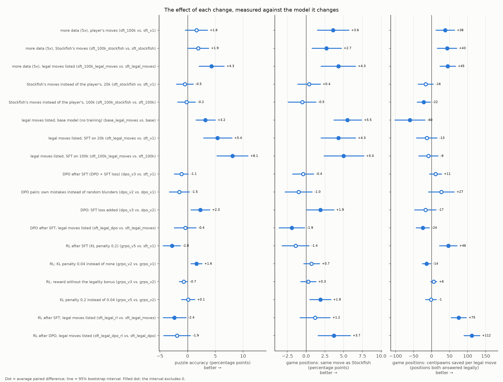

*`results/figures/final/effects.png`.* Each row is one change, measured against the model it changes one thing in (in brackets), on the same 1,000 test puzzles and 1,000 held-out game positions. Dot = average difference; line = 95% interval; a filled dot means the interval excludes 0. Right is better in every panel. Read it row by row:
- **more data** helps on game positions in every case, and on puzzles clearly only with the legal-move list;
- **Stockfish's moves instead of the player's** change nothing;
- **listing the legal moves** helps on puzzles and Stockfish match, but does not lower centipawn loss (for the untrained base model it raises it);
- **DPO** changes little, and after `sft_legal_moves` slightly hurts on game positions;
- **RL** loses puzzles but clearly saves centipawns (right panel), most of all after `sft_legal_moves`.


*`results/figures/final/sft_legal_list.png`.* The 2 × 2 of data size × prompt, with 95% intervals. Left: puzzle accuracy; middle: legal answers on game positions; right: Stockfish match on game positions. The orange line (legal moves listed) is above the blue one (no list) everywhere, and both rise with more data: the two changes add up. `sft_answer_source.png` in the same folder shows the same for the answer source, where the two lines lie on top of each other.


*`results/figures/final/tradeoff.png`.* Every model compared with `sft_v1` (ringed dot) on the held-out game positions: up = plays Stockfish's move more often, right = loses fewer centipawns per move; faint lines are 95% intervals. The RL models from `sft_v1` (purple) are to the right but below 0. The RL combinations (`sft_legal_rl`, `sft_legal_dpo_rl`, teal) reach the top right, as designed. `sft_100k_legal_moves` is highest. `sft_legal_dpo` is to the left.


*`results/figures/final/before_after_solved.gif`.* The base model (left) and `sft_100k_legal_moves` (right) answering the same puzzles. **These are 30 puzzles the best model solves**, chosen at random from the 175 it solves and sorted by rating; the GIF says so on every frame, and that line must stay whenever it is shown. The base model solves none of them and gives 20 illegal or unreadable answers. For the paper, `before_after_random.gif` shows 20 puzzles chosen at random with no selection (the base model solves 0 and gives 11 invalid answers; the best model solves 2 with none).

**What we found:**

1. **Changing what SFT sees is what improved the model, and the two changes add up.**
   - Listing the legal moves: +5.4 points with 20,000 positions, +8.1 with 100,000.
   - 5 times more data: +1.6 points without the list, +4.3 with it.
   - Together: 7.8% → 17.5%, our best model, better than every other model with p ≤ 0.0002.

   Most of the list's gain comes from never answering illegally. More data also clearly improves play in ordinary game positions (notebook 12).
2. **Which answer SFT learns does not matter.** Stockfish's moves and the players' moves give the same accuracy with 20,000 and with 100,000 positions, although they differ in 57% of the positions.
3. **DPO never improved the SFT model it started from.** In four versions (`dpo_v1`, `dpo_v2`, `dpo_v3`, `sft_legal_dpo`), changing the rejected answers did not help. Adding the SFT loss stopped DPO from making the model worse, but not more. In every version, the model learned to prefer the better move on its training pairs, so the method worked as intended; avoiding the model's own blunders just did not lead it to the best move.
4. **RL made every SFT model worse on puzzles.** All 7 RL models solve fewer puzzles than the model they started from. For the five RL models from `sft_v1` the drop is clearly significant (p ≤ 0.0015, and still below 0.05 after notebook 16's adjustment for multiple comparisons). For the two combinations it is borderline: p = 0.028 and 0.047 on their own, and no longer significant once the p-values are adjusted for the number of comparisons (Holm's method, as in notebook 16's `effects` table). So describe it as "a drop that is not statistically clear". The KL penalty limited the damage, but no setting removed it. Solving legality did not help either. The RL models consistently shift to quiet moves (pawn moves) and away from checks and mates. Their legal moves lose fewer centipawns in ordinary game positions, in all 7 runs. Our reading: RL optimizes what its reward measures, avoiding losses in ordinary positions, and that is not what puzzles test.
5. **Combining methods helped on game positions, not on puzzles.** On puzzles, the best model is trained with SFT alone (`sft_100k_legal_moves`, 17.5%). On ordinary game positions, the RL combinations make the fewest blunders of any model (44–45%, vs. 56% for a random move) without playing Stockfish's move less often than their starting point. This is what we designed them for: the legal-move list keeps the model finding good moves, and RL removes many of its bad ones. But it did not carry over to puzzles.

**In one sentence:** in our setting, what the model sees during SFT (more data, the legal moves) decided how well it solves puzzles; DPO and RL learned what their training signals asked for (RL: avoid losses in ordinary positions, which it did), but that did not improve puzzle-solving, alone or in combination.

**Caveats to state in the paper:**
- Each model is one training run with one seed.
- The legal-move list makes the task easier; compare models with the list only with each other.
- We ran many comparisons, so a few p-values just below 0.05 can be chance. Notebook 16 adjusts the comparisons with `sft_v1` for this (Holm's method); after adjustment, the clear results above stay clear (for example `sft_100k_legal_moves`, p ≤ 0.0002 against every other model), while borderline ones, like RL after the combinations, should be described as "a drop that is not statistically clear".
- Puzzles and ordinary game positions measure different skills; report both, since the combinations rank differently on them.

### 16 · Final comparison

Notebook 16 (built by Nathan) puts every model and every evaluation in one place. It needs no GPU and is rerun whenever new results are pushed. It contains:
- one table of every model: puzzles with 95% intervals, game positions, games and training tokens;
- each model compared with `sft_v1`, with p-values adjusted for the number of comparisons;
- the split of puzzle accuracy into legal answers × accuracy when legal;
- the compute of every model, summed over its training stages;
- **the effect of each change** (`effects`): each model compared with the model it changes one thing in, on puzzles and game positions, with 95% intervals and adjusted p-values. This is the figure behind the final summary above;
- **the two SFT 2 × 2 designs** (`sft_answer_source.png`, `sft_legal_list.png`): amount of data × answer source, and amount of data × the legal-move list;
- **the trade-off map** (`tradeoff`): finding the best move vs. losing fewer centipawns, for every model;
- **invalid moves** in single positions vs. whole games (`invalid_moves`);
- **the kind of moves each model plays, and its accuracy on mate-in-1 puzzles** (`move_kinds`).

Its outputs are in `results/figures/final/`. These replace the earlier summary figures in `results/figures/findings_08_14/`, which stay as they were (drawn before 13b and 15). It includes all 19 models.

---

## 9. Facts for the draft, by paper section

This section collects the facts for each section of the paper in one place, in the order of the paper. It is **material to write from, not text for the paper**: the team writes the paper. Most facts repeat sections 1–8, where the details and figures are. **Every citation below must be checked by a person** (authors, year, venue) before it goes into the paper.

### Abstract (the facts it needs)

- **Problem:** language models can talk about chess but often play poorly and propose illegal moves.
- **Question:** which post-training methods improve a small open model at chess, alone and in combination, and why?
- **Model:** Google's Gemma 4 E2B (instruction-tuned; about 2.3B "effective" parameters), trained with LoRA adapters on one GPU.
- **Methods compared:** supervised fine-tuning (SFT), direct preference optimization (DPO), reinforcement learning (RL, with GRPO), and combinations (SFT → DPO, SFT → RL, SFT → DPO → RL). 19 models in total.
- **Data:** positions from Lichess games between 2000+ rated players for training; 1,000 Lichess puzzles for testing (never trained on).
- **Evaluation:** puzzle accuracy (main), legal-move rate, centipawn loss; also 1,000 held-out game positions and full games against a random player and against Stockfish.
- **Key numbers:**
  - base model 2.8% of puzzles; first SFT model 7.8%; a random legal move 5.6%;
  - best model 17.5%: SFT on 100,000 positions with the legal moves listed in the prompt;
  - DPO and RL never beat the SFT model they started from on puzzles;
  - but RL after the legal-move SFT model cut blunders in ordinary game positions from 56% to 44–45%, the fewest of any model.
- **Takeaway:** what the model sees in SFT (more data, the legal moves) decided puzzle performance. DPO and RL optimized their own training signals (avoiding the model's own blunders, losing few centipawns in ordinary positions), which did not transfer to puzzles.

### Related Work (pointers; check each citation)

From the team's Overleaf draft, and how each paper connects to what we did:

| Work | What it does | Connection to our project |
|---|---|---|
| ChessLLM (Zhang et al., 2025, NAACL) | SFT on complete games; longer game context helps; reports Elo against Stockfish | We train on single positions without the move history. Our games against Stockfish are a much weaker version of their evaluation. A direct comparison was planned and dropped (allowed in our progress report). |
| Hwang et al., 2025 (arXiv 2507.00726) | RL with sparse (right or wrong) vs. dense rewards; dense was often better (check the paper's exact setting) | Our RL reward is dense (based on centipawn loss). We found that it rewards safe, quiet moves rather than finding the best one (section 8). A sparse reward is implemented (`mode: sparse` in `configs/rl.yaml`) but was not run: a natural next step. |
| LLM CHESS (Kolasani et al., 2025) | Measures legality and instruction-following errors of language models playing chess | Matches our split of wrong answers into illegal (not allowed) and unparseable (no move found). |
| ChessQA (Wen et al., 2025) | A chess benchmark for language models | Planned as an external benchmark; dropped (allowed in our progress report). |

Methods and tools the paper will need to cite (check each): LoRA and QLoRA (parameter-efficient fine-tuning; QLoRA trains on a 4-bit model); DPO; GRPO (introduced with DeepSeekMath); the TRL library (our trainers); Stockfish; the Lichess game and puzzle databases; Holm's method for multiple comparisons; McNemar's (sign) test for paired comparisons.

### Background (optional section)

What a reader needs to follow the paper. Sections 2 and 7 (glossary) explain each in more detail.
- **Chess notation:** a position is written as a FEN (one line of text); moves are written in UCI (`e2e4`: from-square, to-square). A move is *legal* if the rules allow it in that position.
- **Stockfish and centipawns:** Stockfish is a chess engine far stronger than any human; a centipawn is 1/100 of a pawn. Centipawn loss = how much worse a move is than Stockfish's best move. A blunder (our definition) loses 200+ centipawns, about two pawns.
- **Puzzles:** positions from real games with one winning move (often a mate or a forcing move such as a capture or check), rated by difficulty (we use four bands: <1200, 1200–1800, 1800–2400, 2400+). 110 of our 1,000 test puzzles are mates in one.
- **The methods, briefly:**
  - **SFT:** learn to copy example answers;
  - **DPO:** learn to prefer a better answer over a worse one, relative to the starting model;
  - **RL (GRPO):** the model samples several answers, a reward scores them, and above-average answers become more likely;
  - **KL penalty:** a cost for moving away from the starting model;
  - **LoRA:** a small trainable add-on to a frozen model.
- **Greedy decoding:** the model always gives its single most likely answer, so results are reproducible. (This also means small shifts in probability can change the answer.)

### Methods / Approach

**Data**
- **Training games:** Lichess database, September 2025, one file of 1,404,031 games. Filters:
  - both players rated 2000+;
  - no bot accounts;
  - at least 3 minutes per player;
  - normal ending;
  - at least 20 moves.

  The first 50,000 games that pass are kept.
- **Training positions:** 3 per game, skipping the first 5 moves. That gives 142,500 training positions (47,500 games) and 7,500 validation positions (2,500 games), split by game. Each position comes with the move the player made.
- **Test puzzles:** 1,000 test and 200 dev puzzles from the Lichess puzzle database (6.2M puzzles), 250 (test) and 50 (dev) per rating band. No training position appears among them. The dev puzzles are graded first, as a check, before the test puzzles.
- **Held-out game positions:** 1,000 positions sampled from the validation games (never trained on), frozen in `data/eval/game_positions.csv`.
- **Game openings:** 25 openings (the first 3 moves of held-out games), each played once with each colour, frozen in `data/eval/game_openings.csv`.

**Shared setup (all models)**
- **Model:** Gemma 4 E2B, instruction-tuned, with a pinned version.
- **Training:** LoRA (rank 16, on attention and MLP layers), on a 4-bit quantized model (QLoRA), one epoch, fixed seeds.
- **Prompt:** the FEN, whose turn it is, and "reply with the best move in UCI". The **legal-move variant** adds one line listing every legal move in the position, in alphabetical order. A model is always tested with the prompt it was trained with.
- **Decoding:** greedy (always the most likely answer), the same for every model.
- **Grading:** Stockfish depth 12; centipawn loss capped at 1,000.

**Design choices, and why** (the reasons from our proposal, the course guidelines, and our earlier results)

| Choice | What we did | Why |
|---|---|---|
| Kind of project | post-train an existing model; no comparison of different model families | the course's "Path 1": go deep on *what makes post-training work* (data, inputs, settings), backed by ablations |
| Model | Gemma 4 E2B, instruction-tuned (about 2.3B effective parameters) | a small open model whose training fits on one 12 GB GPU (the laptop GPU we had before Databricks); the instruction-tuned version already follows a prompt format |
| Training method | LoRA adapters on a 4-bit model (QLoRA) | trains a small add-on instead of the whole model, so every run fits on one GPU and takes hours, not days; the frozen model is identical for every run |
| The three methods | SFT first; then DPO and RL, each starting from the same SFT model; then combinations | our research question. DPO and RL need a model that already answers in the right format, so SFT comes first. Starting both from one SFT model shows what each adds on its own |
| SFT | learn to copy a strong player's (or Stockfish's) move | the simplest way to teach the task and the answer format; it gives DPO and RL their starting point |
| DPO | learn from pairs: Stockfish's best move preferred over a bad move | learns which of two moves is better without a separate reward model; the pairs can target exactly the mistakes we want to remove |
| RL with GRPO | the model samples 8 answers per position; Stockfish scores them; above-average answers become more likely | the only method that learns from the model's own answers, including its illegal ones. GRPO judges each answer against the other answers to the same position, so no extra model is needed to estimate how good a position is |
| Off-the-shelf trainers | TRL's SFT, DPO and GRPO trainers | well-tested implementations; we only set their options |
| Training data | positions from Lichess games between 2000+ players, with the move played | many varied, realistic positions with good moves; filters remove fast games, bots and abandoned games |
| Test data | 1,000 Lichess puzzles, 250 per rating band, never trained on | each puzzle has one verified winning move, so an answer is clearly right or wrong; equal bands show where models fail |
| Grading | Stockfish judges every answer (legal? same as the best move? centipawns lost?) | an objective, automatic referee, much stronger than any human |
| Prompt | the board as a FEN, whose turn it is, and "reply in UCI"; no move history | puzzles come with a single position, so the model must work from the board alone; UCI is easy to check |
| Decoding | greedy (always the most likely answer) | results are reproducible and every model is asked the same way |
| One change per experiment | each new model differs from an earlier one in one thing | a difference in results can then be attributed to that change (the course asks for ablations) |
| Dev before test | 200 dev puzzles are graded first; the 1,000 test puzzles are never used to choose settings | keeps the test score an honest estimate |
| Extra evaluations | 1,000 held-out game positions, and full games | promised in our progress report; DPO and RL are trained on ordinary positions, so these test what they were trained for |
| Equal treatment | same prompt format, puzzles, grader and decoding for every model; compute logged per run | a fair comparison, as our proposal promised |

**Settings per method**
- **SFT:**
  - 20,000 positions (or 100,000 for the "100k" models);
  - learning rate 2 × 10⁻⁴ with a cosine schedule, effective batch 32;
  - the answer is the player's move, or Stockfish's best move at depth 10 for the "stockfish" models.
- **DPO:**
  - 4,788 pairs (4,549 for training, 5% held out to monitor training); β = 0.1; learning rate 2 × 10⁻⁵; one epoch;
  - the reference model is the starting SFT model;
  - chosen answer = Stockfish's best move (depth 10);
  - rejected answer = a random legal move losing 200+ cp (`dpo_v1`), or the starting model's own mistake (`dpo_v2`, `dpo_v3`, `sft_legal_dpo`);
  - `dpo_v3` and `sft_legal_dpo` add the SFT loss on the chosen move.
- **RL (GRPO):**
  - 2,000 training positions, 8 sampled answers each (temperature 1.0); learning rate 1 × 10⁻⁵;
  - reward: −1 for an illegal or unparseable answer; for a legal move, 0.1 + (1 − centipawn loss / 1,000), with Stockfish at depth 8;
  - `grpo_v3` changes the reward to −0.5 for invalid answers and no 0.1 bonus;
  - KL penalty β = 0 (`grpo_v1`), 0.04 (`grpo_v2`, `grpo_v3`), 0.1 (`grpo_v4`), 0.2 (`grpo_v5` and both combinations).

**Every model, and why we trained it.** Each model changes one thing in an earlier model, chosen because of what the earlier results showed:

| Model | Method (starts from) | What changed | Why we ran it |
|---|---|---|---|
| `base` | none | – | reference: the model before any training |
| `sft_v1`, `dpo_v1`, `grpo_v1` | SFT; DPO and RL from `sft_v1` | the first version of each method | the progress report: one run per method |
| `sft_stockfish` | SFT | answer = Stockfish's best move, not the player's | puzzles accept only the best move, and strong players often play a different reasonable move; our TA suggested it |
| `dpo_v2` | DPO (`sft_v1`) | rejected = the SFT model's own mistakes | `dpo_v1`'s rejected moves were random blunders the model rarely plays (median 620 cp), so avoiding them taught little; our TA suggested changing the pairs |
| `dpo_v3` | DPO (`sft_v1`) | `dpo_v2` + SFT loss on the chosen move | in `dpo_v1` and `dpo_v2`, DPO lowered the probability of the good move too |
| `grpo_v2` | RL (`sft_v1`) | KL penalty β = 0.04 | `grpo_v1` drifted away from SFT to safe pawn moves (41% of its answers) |
| `grpo_v3` | RL (`sft_v1`) | `grpo_v2` + reward without the legality bonus | the reward valued "any legal move" as much as the whole range of move quality |
| `sft_100k` | SFT | 100,000 positions instead of 20,000 | DPO and RL cannot improve on a weak SFT model; `sft_stockfish` suggested 20,000 examples were too few |
| `sft_100k_stockfish` | SFT | `sft_100k` with Stockfish's moves | do Stockfish's answers help once there is enough data? (completes a 2 × 2) |
| `base_legal_moves`, `sft_legal_moves` | none; SFT | the legal moves listed in the prompt | illegal answers were the largest failure (28% of `sft_v1`'s); separates "knowing the rules" from "choosing a move" |
| `grpo_v4`, `grpo_v5` | RL (`sft_v1`) | β = 0.1 and 0.2 | β = 0.04 slowed the drift away from SFT but did not stop it |
| `sft_100k_legal_moves` | SFT | 100,000 positions with the list | both changes helped on their own; do they add up? |
| `sft_legal_dpo`, `sft_legal_rl`, `sft_legal_dpo_rl` | DPO and/or RL (`sft_legal_moves`) | the combinations, with the best settings: `dpo_v3`'s and β = 0.2 | the research question asks about combinations. Our hypothesis: with no illegal answers, DPO and RL would focus on move quality, which is `sft_legal_moves`' weakness |

Not run, and why:
- the sparse RL reward: optional, and time went to the KL and combination experiments;
- RL again from `sft_100k_legal_moves`: RL made `sft_legal_moves` worse on puzzles;
- training on puzzles, and a different rating threshold: each needs several new runs.

**Compute**
- All later runs used one NVIDIA A10G GPU on Databricks; the first three models used a laptop RTX 5070 Ti.
- Training time per run:
  - SFT: about 1 GPU-hour on 20,000 positions, 1.1 with the list, about 4.4 on 100,000, and 5.3 on 100,000 with the list;
  - DPO: 0.2–0.55 GPU-hours;
  - RL: 0.5 GPU-hours, or 1.1 with the longer legal-move prompt.
- The later runs total about 21.5 A10 GPU-hours of training, plus grading and collecting DPO pairs.
- `sft_v1`'s 6.6 GPU-hours are inflated: it ran on a laptop before a memory fix. Compare methods by tokens seen; notebook 16's `compute` table has both.

### Evaluation / Analysis

**What is measured**

| Evaluation | Size | Metrics |
|---|---|---|
| Test puzzles | 1,000 (250 per rating band) | accuracy (main), legal / illegal / unparseable rate, ACPL of legal answers, accuracy per band |
| Held-out game positions | 1,000 | legal rate, same move as Stockfish, same move as the player, ACPL and blunder rate of legal answers |
| Full games | 50 per opponent (25 openings × 2 colours), vs. a random mover and vs. Stockfish at depth 1 | wins, draws, losses, score; invalid answers are replaced by a random legal move and counted; a game still going after 100 moves is a draw |

**Statistics**
- 95% intervals for accuracies use Wilson's method.
- Two models are compared on the same puzzles with a sign test (McNemar's exact test), counting the puzzles only one of them solves.
- Differences on the same puzzles or positions get 95% intervals by a paired bootstrap.
- With many comparisons, p-values are adjusted with Holm's method (notebook 16).
- The random-move reference (5.6% on puzzles) is the expected accuracy of picking a legal move uniformly at random.
- ACPL and blunder rates are computed over each model's own legal answers. Two models are therefore compared on the positions where both answered legally.

**Main results** (the full table for every model is `results/figures/final/final_results.md`)

| Model | Puzzles | Legal (puzzles) | Positions: same as Stockfish | Positions: ACPL (cp) | Positions: blunders among legal |
|---|---|---|---|---|---|
| base | 2.8% | 41% | 2.7% | 344* | 47%* |
| `sft_v1` | 7.8% | 72% | 6.5% | 392 | 55% |
| `sft_100k` | 9.4% | 79% | 10.1% | 348 | 50% |
| `sft_legal_moves` | 13.2% | 100% | 10.8% | 389 | 56% |
| **`sft_100k_legal_moves`** | **17.5%** | 100% | **15.1%** | 344 | 50% |
| `dpo_v3` (best DPO from `sft_v1`) | 6.7% | 73% | 6.1% | 389 | 55% |
| `grpo_v5` (best RL from `sft_v1`) | 5.0% | 78% | 5.1% | 335 | 50% |
| `sft_legal_dpo` | 12.8% | 100% | 8.9% | 413 | 58% |
| `sft_legal_rl` | 10.8% | 100% | 12.0% | 314 | 45% |
| `sft_legal_dpo_rl` | 10.9% | 100% | 12.6% | **301** | **44%** |
| random legal move | 5.6% | 100% | 5.3% | 391 | 56% |

\* The base model answers only 40% of positions legally, probably the easier ones, so its ACPL and blunder rate are not comparable with the others.

**Findings, each with its evidence**
1. **More data and the legal-move list add up** (17.5%, better than every other model with p ≤ 0.0002).
   - The list adds +5.4 points at 20,000 positions and +8.1 at 100,000; more data adds +1.6 without the list and +4.3 with it.
   - Most of the list's gain comes from never answering illegally.
   - *Evidence:* `final/sft_legal_list.png`, `final/effects.png`; sections 13 and 13b.
2. **The answer source does not matter.** Stockfish's moves and the players' moves give the same accuracy at 20,000 and 100,000 positions, although they differ in 57% of positions.
   - *Evidence:* `final/sft_answer_source.png`; sections 08 and 12b.
3. **DPO never improved its starting SFT model** (4 versions).
   - The model learns to prefer the better move on its pairs (85–90% of held-out pairs in the later versions), but its puzzle accuracy does not rise.
   - Without the SFT loss, DPO lowers the probability of the best move too.
   - *Evidence:* `dpo_v2/` and `dpo_v3/dpo_diagnostics.png`; sections 09 and 15.
4. **RL made every SFT model worse on puzzles but better at avoiding losses.**
   - In all 7 RL runs, the legal moves lose fewer centipawns, and the model shifts towards quiet pawn moves and away from checks and mates in one.
   - A larger KL penalty limits the shift but does not restore accuracy.
   - Solving legality (the combinations) did not prevent it.
   - *Evidence:* `final/move_kinds.png`, `findings_08_14/rl_kl_penalty.png`, `final/tradeoff.png`; sections 10, 14 and 15.
5. **The combinations reached their design goal on game positions, not on puzzles.**
   - The RL combinations have the fewest blunders of any model (44–45% vs. 56% for a random move), without finding Stockfish's move less often than their starting model.
   - On puzzles they are below `sft_legal_moves` (the drop is not statistically clear after adjusting for multiple comparisons).
   - *Evidence:* `final/tradeoff.png`, the 15 results section.
6. **Full games barely separate the models.** No model wins against Stockfish, and most games against a random player are draws. The share of invalid moves in games is the one game measure that differs (about 77% for the base model, 0% for every trained model with the list).
   - *Evidence:* `final/invalid_moves.png`, `game_evals/games_vs_*.png`.

**Figures for the paper, with what each shows** (all in `results/figures/`; more detail in section 8)


*`final/accuracy.png`.* **What it shows:** the puzzle accuracy of all 19 models, with 95% intervals; the dashed line is a random legal move (5.6%). **How to read it:** a model whose interval lies above the line is clearly better than guessing. Only the SFT models (and DPO / RL on top of the legal-move SFT model) are; the DPO and RL models from `sft_v1` are not. `sft_100k_legal_moves` (17.5%) is the highest. **Use:** the main results figure.


*`final/effects.png`.* **What it shows:** one row per change (for example "legal moves listed, SFT on 20k"), measured as the difference from the model it changes, on puzzles (left), Stockfish match on game positions (middle) and centipawns saved per move (right). **How to read it:** a dot right of 0 means the change helped; a filled dot means the 95% interval excludes 0. **Use:** the single figure behind most findings.


*`final/sft_legal_list.png`.* **What it shows:** the 2 × 2 of data size (20,000 vs. 100,000 positions) × prompt (with or without the legal moves), on puzzles and on game positions. **How to read it:** both lines rise (more data helps) and the orange line is above the blue one (the list helps); together they add up to the best model. `final/sft_answer_source.png` is the same design for the answer source, where the lines lie on top of each other (no effect).


*`dpo_v2/` (top) and `dpo_v3/dpo_diagnostics.png` (bottom).* **What it shows:** during DPO training, how often the model prefers the chosen answer (left) and the probability of the chosen and rejected answers relative to the SFT model (right, log scale). **How to read it:** both runs learn the preference (left, about 85–90%). But without the SFT loss (`dpo_v2`), Stockfish's move becomes *less* likely (about 0.3×); with it (`dpo_v3`), it stays at about 1×. **Use:** explains why DPO did not improve puzzle accuracy: nothing pushes the best move up.


*`findings_08_14/rl_kl_penalty.png`.* **What it shows:** RL with KL penalty β = 0, 0.04, 0.1 and 0.2: how far the model moves from SFT (left), its share of pawn moves (middle), and its puzzle accuracy (right). **How to read it:** a larger β keeps the model closer to SFT and cuts the pawn moves, but accuracy stays at about 5%, below SFT (dashed). **Use:** the penalty limits the damage but does not fix what the reward rewards.

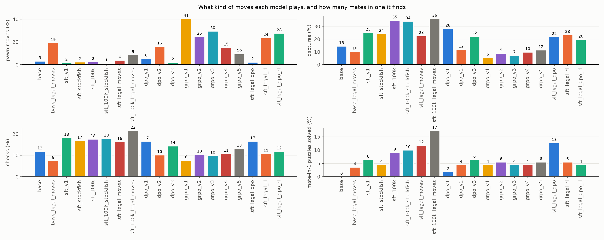

*`final/move_kinds.png`.* **What it shows:** for every model, the share of pawn moves, captures and checks among its legal answers, and its accuracy on the 110 mate-in-one puzzles. **How to read it:** every RL model plays far more pawn moves and fewer checks than the model it started from, and the RL models after `sft_legal_moves` solve about half as many mates in one. **Use:** shows *how* RL changes the model's play.


*`final/tradeoff.png`.* **What it shows:** every model compared with `sft_v1` on the held-out game positions: up = plays Stockfish's move more often, right = its moves lose fewer centipawns. **How to read it:** RL from `sft_v1` (purple) goes right but down; the legal-move SFT models go up; the RL combinations (teal) reach the top right, which is what they were designed for. **Use:** shows that puzzles and ordinary positions measure different skills.


*`final/invalid_moves.png`.* **What it shows:** the share of illegal or unreadable answers in single positions and over whole games. **How to read it:** games are harder (unfamiliar positions), more data lowers the rate by a third to a half, and every trained model with the legal moves listed makes none. **Use:** the one game result that separates the models.

*`final/before_after_solved.gif` and `before_after_random.gif`* (shown at the top of the README): the base model and the best model answering the same puzzles, for slides and the video. The first is a selection of puzzles the best model solves, and says so on every frame; the second is random.

### Conclusions

**Key takeaways**
1. For this small model, the biggest gains came from what SFT sees: more training positions, and the legal moves in the prompt. Together they took puzzle accuracy from 7.8% to 17.5%.
2. DPO and RL learned what their training signals asked for:
   - DPO learned to avoid the model's own blunders on its training pairs;
   - RL learned to lose fewer centipawns in ordinary positions.

   Neither signal asks for the single best move that a puzzle requires, and neither improved puzzle accuracy.
3. Removing illegal answers did not change this for RL. The drift towards quiet moves came from the reward itself, not from legality.
4. Puzzles and ordinary game positions measure different skills. The RL combinations are the best at avoiding losses in game positions and worse on puzzles, so a paper should report both.

**Limitations**
- **One training run per model:** we used one seed, and some differences of 1–2 points are within noise.
- **One small model** (about 2B effective parameters), answering with a single move and no reasoning.
- **The legal-move list makes the task easier.** Models with the list should be compared with each other, not presented as solving the original task.
- **The puzzles and the game positions come from Lichess,** and so do all the training games, from a single month.
- **The copies saved partway through the 100k runs** are not equivalent to models trained on less data, because of the learning-rate schedule.
- **Full games:** invalid answers are replaced by random moves, and the Stockfish opponent is very shallow (depth 1).
- **Compute differs between methods** (for example, 100k SFT vs. 0.5 GPU-hours of RL). The `compute` table gives tokens per model.

**Future work**
- A second seed for the main comparison (`sft_v1` vs. `sft_legal_moves`, and the best model).
- RL with a reward that pays for finding the best move:
  - the sparse reward (Hwang et al.);
  - or RL on puzzle-like positions, where one move wins.
- Training on puzzles (our TA's suggestion), or adding the move history to the prompt (as in ChessLLM).
- Letting the model reason before answering, and larger models.
- The dropped comparisons: ChessQA, and ChessLLM's evaluation.
