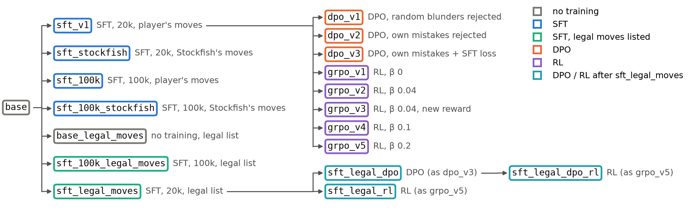
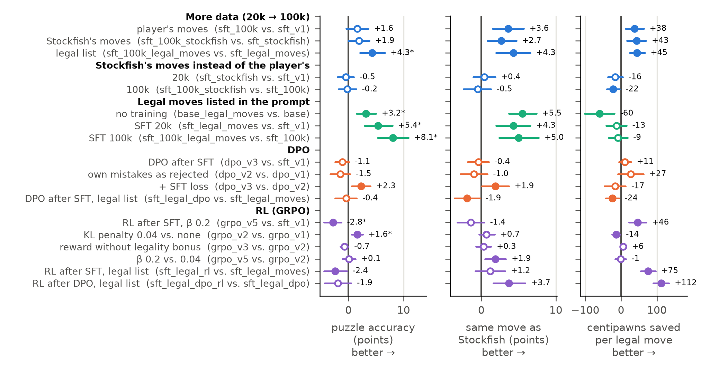
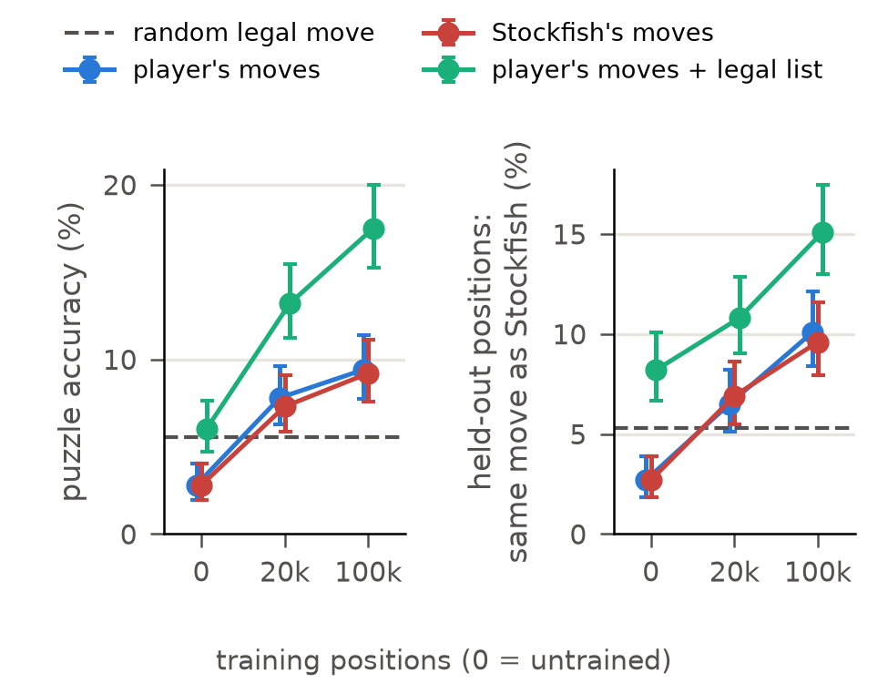
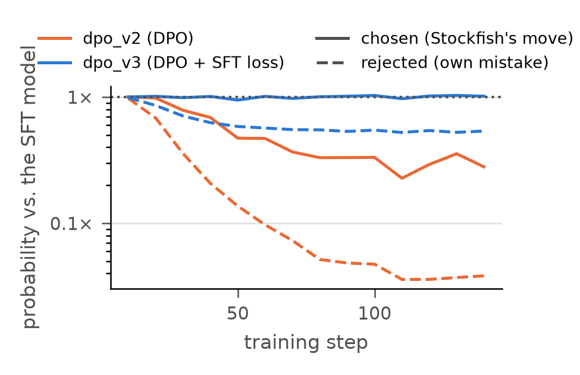
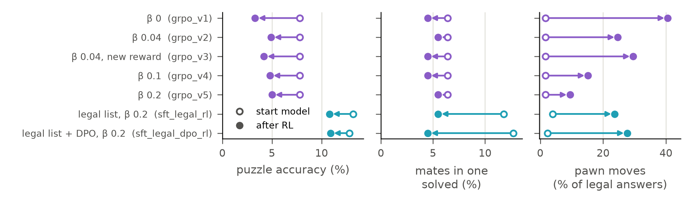
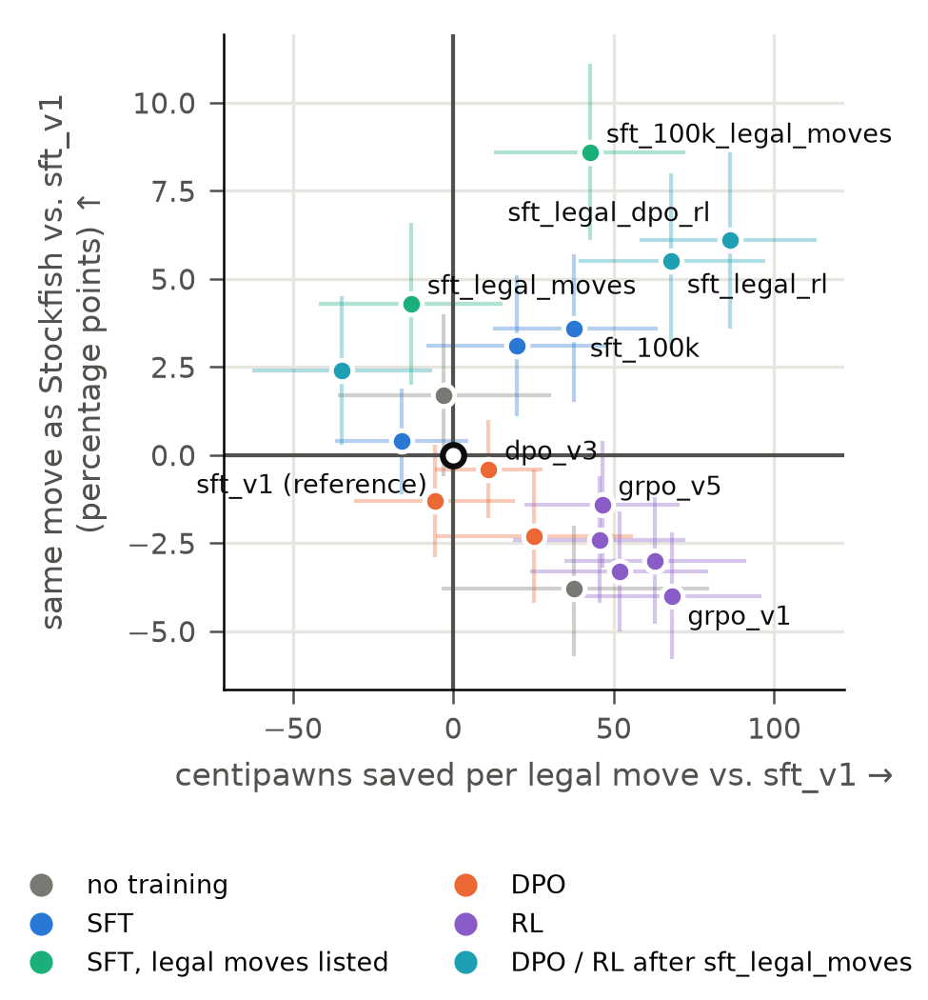

# Project notes

What we are doing and what the results show, readable without the code. Exact settings are in `configs/`, details are in each notebook, and setup instructions are in the [README](../README.md).

As of Nov 5, all four models (base, SFT, DPO, and RL) are trained and graded. After the progress report we ran fourteen new training runs (notebooks 08–15, 12b and 13b), including combinations of methods, and added two new evaluations (notebook 11). Sections 8 and 9 follow the paper's sections: [section 8](#8-the-paper-abstract-to-methods) covers Abstract to Methods (each experiment and why we ran it), [section 9](#9-the-paper-evaluation-and-conclusions) Evaluation and Conclusions (each finding with its evidence).

1. [The project](#1-the-project)
2. [How the methods work](#2-how-the-methods-work)
3. [What each notebook does](#3-what-each-notebook-does)
4. [Results, and why](#4-results-and-why)
5. [Limitations and next steps](#5-limitations-and-next-steps)
6. [Key facts for the report](#6-key-facts-for-the-report)
7. [Glossary](#7-glossary)
8. [The paper: Abstract to Methods](#8-the-paper-abstract-to-methods)
9. [The paper: Evaluation and Conclusions](#9-the-paper-evaluation-and-conclusions)

---

## 1. The project

Language models can describe chess but often play it poorly, frequently proposing illegal moves. We study which post-training methods improve a small open model (Google's Gemma 4 E2B), and why. We compare supervised fine-tuning (SFT), direct preference optimization (DPO), and reinforcement learning (RL), first separately and then in combination.

```
Lichess games (2000+ players) ──> training positions ──> SFT ──┬──> DPO ──┐
                                                                └──> RL ───┤
Lichess puzzles (never trained on) ─────────────────────────> grade every model the same way ──> compare
```

We train on positions from games between strong players, and test on puzzles. Games supply many varied, realistic positions to learn from. Puzzles each have one verified answer: in a typical game position several moves are about equally good, but in a puzzle one move wins and almost every other move loses, so an answer is clearly right or wrong. No test puzzle appears in the training data, so test scores measure how well a model handles positions it has never seen, not whether it remembers answers.

We measure three things. Our main metric is **puzzle accuracy**, the percentage of puzzles solved. The **legal-move rate** is the percentage of answers that are legal moves; the rest are *illegal* (not allowed in the position) or *unparseable* (no move found). **ACPL** (average centipawn loss) measures how much worse the model's legal moves are than the best move according to Stockfish, a strong chess engine, so lower is better.

---

## 2. How the methods work

It helps to start with how the model produces a move. The model reads the prompt, which describes the board as a line of text (a FEN), and writes its answer one token at a time: `e2e4` is four tokens (`e`, `2`, `e`, `4`). At each step it assigns a probability to every possible next token, and we always take the most likely one. Nothing checks the move against the rules of chess before it is written. All three training methods change these probabilities; they differ in which answers they make more or less likely, and based on what.

**The base model** is Gemma 4 E2B as Google released it. It was trained on a very large amount of text to predict the next token, then tuned to follow instructions. That text includes chess, so it knows what moves look like, but it was never trained to choose a move for a given position.

**SFT** (supervised fine-tuning) continues the same next-token training on our own examples: a position, followed by the move a strong player made there. Training makes that move more likely. The model only ever sees correct examples; it is never shown an illegal move or told that one of its own answers was wrong.

**DPO** (direct preference optimization) trains on pairs of answers to the same position: a *chosen* move (Stockfish's best) and a *rejected* move (one that loses a lot). It makes the chosen move more likely *relative to* the rejected one, compared with where the model started. It only cares about this difference. It does not require the chosen move itself to become more likely, and it says nothing about any other move.

**RL** (reinforcement learning) shows the model no answers at all. The model generates its own answers, a *reward* scores each one, and training makes high-reward answers more likely. Our reward comes from Stockfish: −1 for an illegal or unparseable answer, and for a legal move, more the closer it is to the best move. RL is the only method that directly penalizes the model's own illegal moves. The specific algorithm we use is **GRPO**. For each position, the model samples 8 answers, and each one is compared with the group's average reward: answers above the average become more likely, and answers below it less likely. In our settings, this is the classic *policy gradient with a baseline*, where the baseline is the group average. We chose GRPO because it judges each answer simply by comparing it with the model's other answers to the same position.

| | SFT | DPO | RL (GRPO) |
|---|---|---|---|
| Starts from | base model | SFT model | SFT model |
| Learns from | 20,000 positions + the move a strong player made | 4,549 pairs of a better and a worse move | its own answers on 2,000 positions, scored by Stockfish |
| Makes more likely | the human move | the better move, relative to the worse one | answers that score above the group average |
| Compute | 6.6 GPU-hours | 0.33 GPU-hours | 0.54 GPU-hours |

All three train a small add-on to the model (a LoRA adapter) while the original model stays frozen, which lets training fit on one 12 GB GPU.

---

## 3. What each notebook does

| Notebook | What it does | Needs a GPU? |
|---|---|---|
| [00](../notebooks/00_setup_check.ipynb) Setup check | checks the libraries, GPU, Stockfish, and tokenizer | no |
| [01](../notebooks/01_data_pipeline.ipynb) Data pipeline | builds the training positions and the puzzle sets | no |
| [02](../notebooks/02_eval_base_model.ipynb) Base model | grades the untrained model | yes |
| [03](../notebooks/03_sft_first_run.ipynb) SFT | trains with SFT and grades the result | yes |
| [04](../notebooks/04_dpo_rl_inputs.ipynb) DPO and RL inputs | builds the DPO pairs and the RL reward | no |
| [05](../notebooks/05_dpo_first_run.ipynb) DPO | trains with DPO and grades the result | yes |
| [06](../notebooks/06_grpo_first_run.ipynb) RL | trains with GRPO, grades the result, and compares all four models | yes |
| [07](../notebooks/07_understanding_results.ipynb) Understanding the results | explains *why* the models score as they do | no |

Exact settings for every step are in `configs/`.

### 00 · Setup

This notebook checks that the libraries load, shows which GPU is available, tests Stockfish, and downloads the model's tokenizer. Because Stockfish grades every move in the project, we test it on two positions with known answers. The starting position scores about 0 (+32 centipawns), and the same position without Black's queen scores about a queen more (+886), which confirms the sign and the scale of its scores. The notebook also shows how the model splits moves into tokens.

### 01 · Data pipeline

This notebook builds all the data. The test and dev sets come from the Lichess puzzle database (6.2 million puzzles): 1,000 test puzzles and 200 dev puzzles, with equal numbers in four rating bands (<1200, 1200–1800, 1800–2400, 2400+). Both sets are fixed and committed in `data/eval/`.

The training data comes from one file of Lichess games from September 2025, filtered as follows ([numbers](../results/data_stats.json)):

| Filter step | Games remaining |
|---|---|
| Games read | 1,404,031 |
| Both players rated 2000+ | 245,522 |
| No bot accounts | 242,573 |
| Not bullet (at least 3 minutes per player) | 92,501 |
| Ended normally (not on time or abandoned) | 70,904 |
| At least 20 moves (first 50,000 kept) | 50,000 |

From each game we take three positions, skipping the first five moves since openings are mostly memorized, and pair each with the move that was played. This gives 142,500 positions for training and 7,500 for validation, split by game so that no game contributes to both. We exclude bot accounts because a cluster of players rated near 3000 turned out to be almost all bots, and we want the model to learn from human play. The notebook checks that no training position appears among the puzzles, and dataset versions are pinned so the data can be rebuilt exactly.

One detail of the puzzle format matters: a Lichess puzzle starts one move *before* the position to solve. The first listed move is the opponent's, so we apply it, and the second move is the answer.

### 02 · Base model evaluation

This notebook asks the base model every puzzle and grades its answers, giving the baseline every trained model is compared with. Every model, in training and testing, gets the same prompt:

```
Chess position (FEN): <the board>
White to move.
Reply with the best move in UCI notation (for example e2e4) and nothing else.
```

We grade the first move found in the reply. It is checked against the board (legal, illegal, or unparseable), compared with the puzzle's answer (in mate-in-1 puzzles, any checkmating move counts), and scored by Stockfish at a fixed search depth, with centipawn loss capped at 1000. Both UCI and standard notation are accepted, so a correct move is never marked wrong for its format. Text around the move is ignored as well: bold markers, brackets, move numbers, and HTML tags (`<h2>Rd7</h2>` reads as Rd7). The model always gives its single most likely answer (greedy decoding), so grading is reproducible. We load only Gemma's language model and skip its image and audio components, which leaves 4.63B parameters (about 9.3 GB). Each model is graded on the 200 dev puzzles first as a quick check, then on the 1,000 test puzzles.

**Same results on a different GPU.** From mid-November we also run on the course's Databricks GPUs (NVIDIA A10G), so we re-graded the base model there and compared it with the laptop run (RTX 5070 Ti) puzzle by puzzle. 768 of the 1,000 replies were identical. Greedy decoding is reproducible on one machine, but two GPUs round numbers slightly differently, and when the model's top two choices for a token are nearly tied, the rounding can decide between them. For about 10% of puzzles this tipped the base model into wrapping its move in HTML tags (`<h2>Rd7</h2>`), which our move reader did not yet ignore. With tags ignored, the two runs agree closely: accuracy 2.9% vs. 2.8%, legal moves 41.6% vs. 41.2%, unparseable 12.3% vs. 13.0%, ACPL 823 vs. 828. Ignoring tags changes no earlier result, since no laptop reply from any model contained one, and the trained models never use tags.

### 03 · SFT

This notebook trains the SFT model on 20,000 of the training positions, then grades it exactly as in notebook 02 and makes the base vs. SFT comparison. The LoRA adapter has rank 16 and covers the attention and MLP layers, and the frozen model is stored in 4 bits (QLoRA) so training fits in 12 GB of GPU memory. The loss counts only the answer, not the prompt. A 500-example trial run comes first to catch problems early. The full run took 6.6 GPU-hours.

### 04 · DPO and RL inputs

This notebook builds what DPO and RL train on, using training positions only, never puzzles. For DPO, it takes 5,000 positions. In each, Stockfish's best move is the chosen move, and a random legal move that loses at least 200 centipawns is the rejected one. In 212 positions no move lost that much, leaving 4,788 pairs. The rejected moves lose 620 centipawns at the median.

It also defines the RL reward. An illegal or unparseable answer gets −1. In the default *dense* mode, a legal move gets 0.1 plus up to 1 more, depending on how close it is to Stockfish's best move. In the *sparse* mode, only Stockfish's best move gets a reward (1). Stockfish searches less deeply here than in grading, to keep things fast.

### 05 · DPO

This notebook trains the DPO model on 4,549 pairs, starting from the SFT model, and holds out 239 pairs to monitor training. The SFT model is also the reference that DPO compares against, with β = 0.1. One large table in Gemma (4.7 GB) is kept on the CPU during training so it fits on the GPU; this was added after the SFT run, which likely ran slower without it. Training took 0.33 GPU-hours, and the model is then graded like the others.

### 06 · RL

This notebook trains the RL model with GRPO, starting from the SFT model. It uses 2,000 training positions, samples 8 answers for each (16,000 answers in all, each scored by Stockfish with the dense reward), and has no KL penalty holding it close to the SFT model. Training took 0.54 GPU-hours. The notebook then grades the model and makes the comparison table and figures for all four models.

### 07 · Understanding the results

This notebook analyzes the saved results without a GPU or the model. It measures how certain the results are, compares them with random guessing, classifies the illegal moves, measures move quality, and looks at what happened during SFT and DPO training. Every graded model is included automatically, so we rerun it after RL. Section 4 summarizes it.

---

## 4. Results, and why

All results are on the 1,000 test puzzles. The figures and calculations are in [notebook 07](../notebooks/07_understanding_results.ipynb).

| Model | Accuracy | Legal answers | Accuracy when the answer is legal |
|---|---|---|---|
| Random legal move | 5.6% | 100% | 5.6% |
| Base | 2.8% | 41% | 6.8% |
| SFT | 7.8% | 72% | 10.8% |
| DPO | 5.9% | 63% | 9.3% |
| RL (GRPO) | 3.3% | 82% | 4.0% |

The first row is a reference point: picking a random legal move solves 5.6% of the puzzles. The last column separates two questions: can the model produce a valid move, and does it choose well among valid moves?

**The base model** scores below random guessing. Only 41% of its answers are legal, and most are written in standard notation even though we ask for UCI. This fits how it was trained: it writes what chess text usually looks like, without working the move out from the board. When its answer is legal, it is about as good as random.

**SFT** is better than the base model on every measure, and the difference is statistically clear ([figure](../results/figures/accuracy_intervals.png)). It always answers in UCI, because every training example ends with a UCI move. When its answer is legal, it is right about twice as often as random, because it has learned which moves strong players make in which kinds of positions. But 28% of its answers are still illegal, because SFT makes the human move more likely without ever making illegal moves less likely. The mistakes show what the model has not learned: it almost always moves one of its own pieces, so it reads *where* the pieces are, but it often moves them where they cannot go or leaves its king in check ([figure](../results/figures/illegal_reasons.png)). This is worst when the king is under attack and few moves are legal. Puzzle accuracy also stays low because imitating typical moves in ordinary positions is a different skill from finding the one winning move in a puzzle.

**DPO** made the SFT model worse (7.8% → 5.9%), and this drop is unlikely to be chance. The training logs show why. DPO only asks for the better move to become more likely *than* the worse one, and the model achieved this by making *both* less likely: the better move ended about 20 times less likely than under SFT, the worse one about 500 times less likely ([figure](../results/figures/dpo_diagnostics.png)). Since the probabilities of all possible answers add up to 1, the removed probability went to other answers, including illegal ones: 155 answers that were legal under SFT became illegal. So DPO taught the model to prefer Stockfish's move over a bad one, but not to avoid illegal moves. This is one run with one setting, so it does not show that DPO cannot help.

**RL** fixed the weakness it targets and lost accuracy doing so. Its reward penalizes illegal answers, and RL has the most legal answers of any model (82%, up from SFT's 72%). But accuracy fell from 7.8% to 3.3%, a drop that is statistically clear, and when its answer is legal it is right less often than random (4.0% vs. 5.6%). The kind of moves it plays shows why: 41% of its legal answers are pawn moves (SFT: 2%), while captures fell from 25% to 6% and checks from 18% to 8%. A quiet pawn move is almost always legal, so it earns the legal bonus and avoids the −1 penalty, but puzzles are solved by captures, checks, and other forcing moves. The reward invites this trade: an illegal answer costs −1 against at least +0.1 for any legal one, while the best and worst legal moves differ by only 1. The reward rose steadily during training while the answers became much less varied, so the model learned what the reward asked for, not what the puzzles test. Training on game positions and testing on puzzles may add to this. As with DPO, this is one run with one setting.

Across all models, accuracy stays within a few points of random guessing. The model answers in a single move with no reasoning steps, and puzzles are hard. ACPL also turns out to say little on puzzles: almost every move in a puzzle is either about the best or a large mistake, so it mostly repeats what accuracy says ([figure](../results/figures/move_quality.png)).

Our proposal asks whether a method helps by reducing blunders or by improving tactics. On puzzles, these turn out to be almost the same thing: missing the tactic usually *is* the blunder (88% of SFT's legal answers lose 200+ centipawns, and nearly all the rest are correct). Accuracy per puzzle theme (fork, pin, mate in 1, ...) shows no theme standing out clearly, with about 100 puzzles per theme. Separating the two questions needs ordinary game positions, where most moves are reasonable and a blunder is a distinct mistake.

---

## 5. Limitations and next steps

**Limitations**
- Each method has one run, so small differences may be noise. Notebook 07 shows which differences are clear.
- Results per difficulty level are noisy (250 puzzles each, about ±3.4 points).
- SFT learns from ordinary game positions, which may transfer only partly to puzzles.
- Many DPO pairs are easy to tell apart, since the rejected moves are often very bad.
- Note to self: this is currently a WIP

**Next steps**

*Update (Nov 23): this plan was written before the progress report. Steps 1, 2 and 3 below (step 3 is notebook 15), the evaluations on game positions and in games, and the legal-move ablation are now done. Their design is in [section 8](#8-the-paper-abstract-to-methods) (Methods) and their results in [section 9](#9-the-paper-evaluation-and-conclusions) (Evaluation).*

Before the progress report (Nov 6):
- Done: RL (notebook 06) has run, and notebook 07 compares all four models.

Mid November, before the first draft (Nov 24), in this order:

| Step | What to try | Why at this point |
|---|---|---|
| 1. Fix DPO and RL on their own | RL: a KL penalty to the SFT model (`beta` in `rl.yaml`), a smaller gap between illegal and legal answers, the sparse reward, or puzzle-like training positions. DPO: a lower learning rate, adding the SFT loss back in (TRL can combine the two) so the better move stops losing probability, or changing how pairs are built, as our TA suggested (the SFT model's own wrong or illegal answers as the rejected moves, or a different 200-centipawn threshold). | Both currently make SFT worse, so we cannot yet say whether either method helps, and that is the core of our research question. |
| 2. SFT on Stockfish's moves | Keep the same game positions, but use Stockfish's best move as the answer instead of the move the player made. | If it clearly beats `sft_v1`, it becomes the starting point for everything after it, so it comes before the combinations. |
| 3. Combine methods | At least SFT → DPO → RL, from the best SFT model, with the DPO and RL settings that worked in step 1. | Our research question asks which combination works best, and combining methods that each make SFT worse would teach us little. |

Step 2 targets a mismatch in our current SFT data. SFT copies whatever answer it is shown, so it now learns to play like a 2000+ player, who usually picks a reasonable move but not always the best one. A puzzle accepts only the best move. Training on Stockfish's choice teaches the model to find that move directly, which a higher rating threshold only approximates. It also means all three methods learn from the same source, since DPO and RL already use Stockfish.

Alongside these, if time allows:
- Other SFT data changes our TA suggested: train on puzzles (not the test ones) instead of games, or change the rating threshold. Each needs a new SFT run, so one or two at most.

Promised in our proposal, still to decide as a team:
- Move quality on held-out game positions (legal-move rate, centipawn loss, blunder rate). It is the cheapest of these, and the only way to separate "fewer blunders" from "better tactics", which puzzles cannot do.
- Win-loss rate in games against Stockfish (simple to run).
- ChessQA, and a comparison with ChessLLM (more work).
- RL on puzzle positions as well as games.
- A similar data and compute budget for every method. So far SFT used 6.6 GPU-hours, DPO 0.33, and RL 0.54, so at the least, we report compute for every run. SFT's time is inflated: it ran before the memory fix described under notebook 05, when its 500-example trial ran about 5 times faster per step, so tokens seen (1.9M for SFT, 0.87M for DPO, 1.5M for RL) compare the methods better than hours.

Each ablation changes one factor, retrains, and grades the result the same way. Most factors are a setting in a config file:

| Ablation | Setting (file) | Default | Alternatives |
|---|---|---|---|
| DPO rejected moves | to be added | a random move losing 200+ cp | the SFT model's own wrong answers; illegal moves |
| DPO rejection threshold | `rejected_min_cp_loss` (`dpo.yaml`) | 200 | e.g. 100, 400 |
| SFT training data | to be added | games | puzzles (not the test ones); a mix |
| SFT answer for each position | to be added | the move the player made | Stockfish's best move |
| Player rating threshold | `min_elo` (`data.yaml`) | 2000 | e.g. 1600, 2200 |
| RL reward | `mode` (`rl.yaml`) | dense | sparse (following Hwang et al., cited in our draft) |
| Legal moves in the prompt (optional) | `show_legal_moves` (`prompt.yaml`) | no | yes |

---

## 6. Key facts for the report

This section held the data and method facts for the four progress-report models. They are now extended to every model, together with the design choices and the reasons for each experiment, in [sections 8](#8-the-paper-abstract-to-methods) and [9](#9-the-paper-evaluation-and-conclusions), which follow the paper's sections. (The earlier version of this section is in the repository's history.)

---

## 7. Glossary

- **Token:** the unit of text a model reads and writes.
- **FEN:** a one-line text encoding of a full board position.
- **UCI / SAN:** two ways to write a move: `e2e4` (from-square, to-square) and `e4` or `Nf3` (standard chess notation).
- **Stockfish:** a free chess engine, far stronger than any human; our reference for move quality.
- **Centipawn:** one hundredth of a pawn. +100 means White is about one pawn ahead.
- **LoRA / adapter:** fine-tuning that freezes the original model and trains a small add-on (the adapter). QLoRA does the same with the frozen model stored in 4 bits, to save GPU memory.
- **Cross-entropy loss:** the training loss of SFT. Lower means the model gives higher probability to the correct move.
- **Reference model / β:** in DPO, the frozen starting model that the trained model is compared with, and how strongly the trained model is held close to it.
- **Policy gradient / baseline:** the basic RL update: make each sampled answer more or less likely according to how much its reward exceeds a baseline, the reward the model typically gets.
- **Greedy decoding:** always choosing the most likely next token, so results are reproducible.
- **Test set / dev set:** 1,000 puzzles for final results, never used for training or for choosing settings, and 200 separate puzzles for checks and for choosing settings.
- **Data leakage:** overlap between training and test data, which inflates test scores.
- **Statistically clear:** unlikely to be explained by chance (p < 0.05 in a paired comparison on the same puzzles).
- **Ablation:** an experiment that changes one factor and keeps everything else fixed.
- **GPU-hour:** one hour of one GPU's time; our measure of compute.

---

## 8. The paper: Abstract to Methods

Sections 8 and 9 follow the paper's sections and hold what each one needs. The paper has at most 8 pages, references not counted: Abstract to Background about 2 pages, Methods and Evaluation 5, Conclusions 1. **Anything removed from sections 8 and 9 is left out of the paper** (list at the end of section 9). Every citation must be checked by a person. The figures and Table 1 are in `results/figures/paper/` (notebook 16, section 11): a `.pdf` for Overleaf and a `.png` to view. No other figure goes in the paper.

**Getting the figures and Table 1 into Overleaf**
1. **Use the `.pdf` files.** They stay sharp at any size and are already sized for ICML; the `.png` files are previews.
2. **Upload a figure** in one of two ways:
   - In Overleaf, click **Upload** (above the file list) → **From external URL**, paste the file's link, and keep its name (e.g. `fig2_effects.pdf`). Every link follows this pattern; change only the file name at the end: `https://raw.githubusercontent.com/adrianapsay/chess-post-training/main/results/figures/paper/fig2_effects.pdf`
   - Or, on GitHub, open the file in `results/figures/paper/`, click **Download raw file**, then in Overleaf **Upload** → **From computer**.
3. **Place it in the paper.** Figs. 1, 2 and 5 span both columns; Figs. 3, 4 and 6 fit one column:
   ```latex
   \begin{figure*}[t]                 % both columns (Figs. 1, 2, 5)
     \centering
     \includegraphics[width=\textwidth]{fig2_effects.pdf}
     \caption{...}
     \label{fig:effects}
   \end{figure*}

   \begin{figure}[t]                  % one column (Figs. 3, 4, 6)
     \centering
     \includegraphics[width=\columnwidth]{fig3_sft.pdf}
     \caption{...}
     \label{fig:sft}
   \end{figure}
   ```
4. **Table 1 is text, not an image.** Open `table1_models.tex` on GitHub, copy all of it, paste it where the table goes, and replace the "TODO" caption. It uses `\usepackage{booktabs}`; if Overleaf reports an error about `\toprule`, add that line to the preamble.
5. **If a figure changes,** notebook 16 redraws it; upload the new PDF with the same name and Overleaf replaces the old one.

### Abstract
*At most 180 words.*
- **Problem:** language models can talk about chess but often play poorly and propose illegal moves.
- **Question:** which post-training methods improve a small open model at chess, alone and in combination, and why?
- **What we did:** Gemma 4 E2B (about 2.3B effective parameters) trained with LoRA on one GPU; SFT, DPO and RL (GRPO), alone and combined: 19 models, each changing one thing. Tested on 1,000 Lichess puzzles, 1,000 held-out game positions, and full games.
- **Results:** SFT took puzzle accuracy from 2.8% (base model) to 7.8%, and to 17.5% with more data and the legal moves listed in the prompt (9.4% without the list). DPO and RL never beat the SFT model they started from on puzzles. RL after the legal-list model made the fewest blunders on game positions of any model (44–45% of its moves, vs. 56% for the model it started from).
- **Takeaway:** what the model sees in SFT decided puzzle performance; DPO and RL optimized their own training signals, which did not transfer to puzzles.
- **Fix in the current draft** (draft of Nov 23, 21:27): remove the "Correspondence to: Cieua Vvvvv" footnote and the "Accepted at … ICML 2024" line. Optional: "(9.4% without the list)" after the 17.5%.

### Related Work
*About 0.8 page.*

| Work | What it does | Connection to ours |
|---|---|---|
| ChessLLM (Zhang et al., 2025, NAACL) | SFT on complete games; longer game context helps; Elo against Stockfish | We train on single positions without move history; our games against Stockfish are a much weaker version of their evaluation. |
| Hwang et al., 2025 (arXiv 2507.00726) | RL with sparse vs. dense rewards; dense was often better (check their exact setting) | Our reward is dense (centipawn loss), and we found it rewards safe, quiet moves rather than the best one. A sparse reward is future work. |
| LLM CHESS (Kolasani et al., 2025) | Benchmarks language models on legality and instruction-following in games, including against a random opponent | We split wrong answers the same way (illegal vs. unparseable) and also play a random mover. |
| ChessQA (Wen et al., 2025) | A chess benchmark for language models | Planned as an external test; dropped, as our progress report allowed. |

- **Also cite:** LoRA, QLoRA, DPO, GRPO (DeepSeekMath), TRL, Gemma, Stockfish, the Lichess databases, Holm's method, McNemar's test. Chess engines (Shannon, AlphaZero) need only 2–3 sentences.
- **Fix in the current draft:** LLM CHESS benchmarks models; it does not train them (the sentence "Although this paper had the chess engines play against opponents who generated random moves, and still found limited success in training the models…" says otherwise). 1.3 is still in the proposal's future tense ("We will…"). Remove "each method will use comparable training data and computational budgets" (1.3): that is not what we did (the best SFT model used 22.7M training tokens, RL from `sft_v1` 3.4M); we report tokens per model instead (Table 1). To fit the page budget: Singhal & Sridevi and Cui et al. do not connect to our work.

### Background
*About 0.5 page.*
- **Notation:** a position is written as a FEN (one line of text); a move in UCI (`e2e4`: from-square, to-square). A move is legal if the rules allow it.
- **Stockfish and centipawns:** Stockfish is a chess engine far stronger than any human. A centipawn is 1/100 of a pawn; centipawn loss is how much worse a move is than Stockfish's best, and ACPL its average. A blunder (our definition) loses 200+ centipawns.
- **Puzzles:** positions from real games with one winning move (often a mate or a capture or check), rated in four bands: <1200, 1200–1800, 1800–2400, 2400+. 110 of our 1,000 test puzzles are mates in one.
- **The methods:** SFT copies example answers; DPO learns to prefer a better answer over a worse one, relative to the starting model; RL (GRPO) samples several answers, scores them with a reward, and makes above-average answers more likely; a KL penalty is a cost for moving away from the starting model; LoRA is a small trainable add-on to a frozen model.
- **Greedy decoding:** the model always gives its single most likely answer, so results are reproducible.

### Methods / Approach
*About 1.9 pages, with Fig. 1 and Table 1.*

**Design.** We post-train one model and change one thing at a time, so each difference can be attributed to that change (the course's "Path 1": what makes post-training work, backed by ablations). SFT comes first, because DPO and RL need a model that already answers in the right format. DPO and RL each start from the same SFT model (`sft_v1`), so each shows what it adds. Then each method's inputs are varied, and the methods are combined. 19 models.



- **Fig. 1** (`fig1_models.pdf`, both columns): every model, colored by method, with an arrow from the model it was trained from; each arrow is one change.
- **Table 1** (`table1_models.tex`, both columns; [view](../results/figures/paper/table1_models.md)): every model's puzzle accuracy (95% interval), legal rate, and on held-out positions its Stockfish match, ACPL and blunders, plus training tokens. † = legal moves listed in the prompt (an easier task); \* = the base model's ACPL and blunders are not comparable (only 40% of its answers are legal). The caption is still to write.

**Model and training**
- Gemma 4 E2B, instruction-tuned, pinned version; its language part only (4.63B parameters, about 2.3B effective). Why: small and open, trains on one 12 GB GPU, and already follows a prompt format.
- LoRA (rank 16, attention and MLP layers) on a 4-bit model (QLoRA); one epoch; fixed seeds. Why: a small add-on instead of the whole model, so every run fits on one GPU in hours, and the frozen model is identical for every run.
- TRL's SFT, DPO and GRPO trainers (well tested; we only set options).
- The first three models trained on a laptop RTX 5070 Ti, the rest on one A10G (Databricks): about 21.5 A10 GPU-hours in total. Compare models by training tokens (Table 1), since the GPUs differ.

**Data**
- Lichess, September 2025: 1,404,031 games. Filters: both players rated 2000+, no bots, at least 3 minutes each, normal ending, at least 20 moves (they remove fast, bot and abandoned games). The first 50,000 games that pass are kept (70,904 pass every filter except the length filter).
- 3 positions per game, after move 5: 142,500 training positions (47,500 games) and 7,500 validation positions (2,500 games), split by game, each with the move played.

**Evaluation sets** (built once and frozen; never trained on)
- **Puzzles:** 1,000 test and 200 dev puzzles from the Lichess puzzle database (6.2M puzzles), 250 and 50 per rating band. Why: one verified winning move, so an answer is clearly right or wrong; equal bands show where models fail.
- **Held-out game positions:** 1,000 positions from validation games; measured: legal rate, Stockfish match, ACPL, blunders. Why: promised in our progress report; DPO and RL are trained on ordinary positions, so this tests what they were trained for.
- **Games:** 25 held-out openings × 2 colours = 50 games per model against a random mover and against Stockfish at depth 1. An invalid answer is replaced by a random legal move and counted; a game still going after 100 moves is a draw.

**Prompt, decoding, grading**
- Prompt: the FEN, whose turn it is, and "reply with the best move in UCI". No move history, since puzzles come as one position; UCI is easy to check.
- Legal-move variant: one more line listing every legal move, alphabetically. The answer is not constrained. A model is tested with the prompt it was trained with.
- Greedy decoding for every model: reproducible, and every model is asked the same way.
- Stockfish (depth 12) grades every answer: legal, the best move, centipawns lost (capped at 1,000). Why: an objective, automatic referee far stronger than any human.

**SFT** (copy a target move: the simplest way to teach the task and the answer format)
- `sft_v1`: 20,000 positions; target = the player's move; learning rate 2 × 10⁻⁴, cosine schedule, effective batch 32.
- `sft_stockfish`: target = Stockfish's best move (depth 10). Why: puzzles accept only the best move, and strong players often play another reasonable move (our TA's suggestion).
- `sft_100k`: 100,000 positions; the first 20,000 are `sft_v1`'s, in the same order. Why: the SFT model gave the best move little probability (about 1.5%), so DPO and RL had little to sharpen, and `sft_stockfish` suggested 20,000 examples were too few.
- `sft_100k_stockfish`: 100,000 positions, Stockfish's moves. Why: do Stockfish's moves help with enough data? (a 2 × 2: answer source × data size)
- `base_legal_moves`, `sft_legal_moves`: the legal-move prompt, untrained and with SFT on 20,000 positions. Why: illegal answers were the largest failure (28% of `sft_v1`'s); this separates knowing the rules from choosing a move.
- `sft_100k_legal_moves`: 100,000 positions with the list. Why: both changes helped, in different ways (more data lowered centipawn loss, the list model's weakness): do they add up? (a second 2 × 2: prompt × data size)

**DPO** (prefer Stockfish's best move over a bad one: no reward model needed, and the pairs can target the mistakes we want removed)
- 4,788 pairs from 5,000 positions (4,549 to train, 239 held out); β = 0.1; learning rate 2 × 10⁻⁵; one epoch; starts from `sft_v1`, which is also the reference model. Chosen = Stockfish's best move (depth 10).
- `dpo_v1`: rejected = a random legal move losing 200+ cp.
- `dpo_v2`: rejected = `sft_v1`'s own mistake on positions it was not trained on (50.2% illegal answers, 49.8% legal blunders). Why: `dpo_v1`'s rejected moves were blunders the model rarely plays (median 620 cp), so avoiding them taught little (our TA's suggestion).
- `dpo_v3`: `dpo_v2` + the SFT loss on the chosen move. Why: DPO lowered the best move's probability too.

**RL with GRPO** (learns from the model's own answers, illegal ones included; no value model needed)
- 2,000 positions × 8 sampled answers (temperature 1.0); learning rate 1 × 10⁻⁵. Each answer is compared with the average reward of its group of 8 (itself included).
- Reward: −1 for an illegal or unparseable answer; 0.1 + (1 − centipawn loss / 1,000) for a legal move (Stockfish depth 8). KL penalty: GRPO subtracts β × KL, a cost for moving away from the SFT model.
- `grpo_v1`: β = 0.
- `grpo_v2`: β = 0.04. Why: `grpo_v1` drifted to quiet pawn moves (41% of its answers).
- `grpo_v3`: β = 0.04, −0.5 for an invalid answer, no 0.1 bonus. Why: the reward valued "any legal move" as much as the whole range of move quality.
- `grpo_v4`, `grpo_v5`: β = 0.1 and 0.2. Why: at β = 0.04 the KL kept rising.

**Combinations** (all from `sft_legal_moves`)
- `sft_legal_dpo` (`dpo_v3`'s setting, pairs rebuilt from its own mistakes); `sft_legal_rl` (`grpo_v5`'s setting, β = 0.2); `sft_legal_dpo_rl` (RL after `sft_legal_dpo`).
- Why: our research question asks about combinations. `sft_legal_moves` was the best model at the time, and with it almost no answer is illegal: within each GRPO group of 8 legal answers the legality bonus cancels, and DPO's rejected answers become legal blunders, so both methods should work on move quality, which is that model's weakness. `dpo_v3`'s setting was the only DPO that did not damage SFT; β = 0.2 kept RL closest to SFT.
- Not rerun from `sft_100k_legal_moves`, because RL made `sft_legal_moves` worse on puzzles. Not run: the sparse RL reward, and training on puzzles.

**Why the results can be trusted**
- No leakage: no training position appears among the puzzles (0 overlaps); training and validation are split by game.
- The same conditions for every model: frozen test sets, the same grader and decoding, pinned versions, fixed seeds. Re-grading the base model on a different GPU gave nearly the same accuracy (2.9% vs. 2.8%).
- Settings were never chosen on the test puzzles; dev and test accuracy agree across the 19 models (correlation 0.92).
- Controlled comparisons: one change each; a random legal move as a reference (5.6% on puzzles: the expected accuracy of picking a legal move uniformly at random).
- Statistics: Wilson 95% intervals for accuracies; a sign test (McNemar's exact test) for two models on the same puzzles; paired bootstrap intervals for differences; Holm's adjustment over the 18 one-change comparisons of Fig. 2; ACPL and blunders compared only on positions both models answered legally.

**Fix in the current draft:**
- 2.5: "After filtering, we have 50,000 qualifying games" → the first 50,000 games that passed were kept.
- 2.6 describes only the puzzles: add the held-out game positions and the games.
- 2.8.1 never says the two data sizes (20,000 and 100,000 positions, the first 20,000 the same).
- 2.9: "Stockfish's preferred move, evaluated at depth 10, as the chosen response" has no verb.
- 2.10: GRPO compares each answer with its group's average (itself included), not "the other responses".
- 2.11 gives no reason beyond "the strongest model at the time": add the legality-bonus reason above, and why RL was not rerun from `sft_100k_legal_moves`.
- Missing: the statistics ("Why the results can be trusted" above).
- Tables 1–3 of the draft (DPO configurations, KL coefficients, post-training sequences) repeat Table 1 and Fig. 1: replace them with those. Table 3 also reads "SFO" for SFT.
- Methods, Evaluation and Conclusions should be numbered sections (Methods' subsections are now 2.3–2.11, inside Background). Write model names as `\texttt{sft\_v1}`.


---

## 9. The paper: Evaluation and Conclusions

### Evaluation / Analysis
*About 3.4 pages, with Figs. 2–6. If pages run short, drop Fig. 1 (Table 1 then gets a "starts from" column), then Fig. 4 (its numbers go in the text).*

Every comparison is paired, on the same 1,000 puzzles or 1,000 positions. Fig. 2 gives the overview; each finding below has its own figure.



**Fig. 2** (`fig2_effects.pdf`, both columns): each of the 18 one-change comparisons as a difference with its 95% interval, on puzzle accuracy, Stockfish match and centipawns saved per move. A filled dot means the interval excludes 0; \* means still significant after Holm's adjustment (six are: the list at 0, 20k and 100k positions, more data with the list, RL after SFT (lower), and the KL penalty). **Takeaway:** changes to what SFT sees help on puzzles; DPO never helps; RL lowers puzzle accuracy but saves centipawns.

**Finding 1 · What SFT sees matters most** (Figs. 3 and 2)
- **The legal-move list:** `sft_legal_moves` 13.2% vs. 7.8% for `sft_v1` (p = 3 × 10⁻⁵), the first clear gain, and above `sft_100k` with 5 times less data (p = 0.004). At 100,000 positions the list adds 8.1 points (p = 2 × 10⁻⁸).
- **Mostly by never answering illegally:** on the 278 puzzles `sft_v1` answered illegally, `sft_legal_moves` solves 14.4% (40 of the 109 puzzles only it solves); where `sft_v1` answered legally, the two are close (12.7% vs. 10.8%, p = 0.24).
- **The list needs training:** the untrained model with the list solves 6.0%, the same as a random legal move (5.6%, p = 0.31).
- **More data:** +1.6 points without the list (p = 0.14, not clear on puzzles) but clearly better on game positions (Stockfish match 10.1% vs. 6.5%, p = 0.0009; 38 cp less lost per move); +4.3 points with the list (p = 0.0002).
- **Together:** `sft_100k_legal_moves`, 17.5%, is better than every other model (p ≤ 0.0002 against each). The two gains add up (whether they reinforce each other is not clear: the extra +2.7 points has interval −0.3 to +5.7). On positions it has the highest Stockfish match (15.1%), and compared with `sft_legal_moves` it loses 45 cp less per move and blunders less (50% vs. 56%).
- **Careful:** the list makes the task easier; compare list models with each other.



**Fig. 3** (`fig3_sft.pdf`, one column): puzzle accuracy (left) and Stockfish match on positions (right) against training positions (0 = untrained, 20k, 100k), for the player's moves, Stockfish's moves, and the player's moves with the list. **Takeaway:** the list helps only after training and adds up with more data; the player's and Stockfish's lines overlap, so the answer source does not matter.

**Finding 2 · The answer source does not matter** (Fig. 3)
- Stockfish's and the players' moves differ in 57.3% of training positions, yet give the same accuracy: 7.3% vs. 7.8% at 20,000 positions (p = 0.6), 9.2% vs. 9.4% at 100,000 (p = 0.9).
- Each model did learn its own labels (`sft_100k` plays the player's move 12.2% of the time vs. 8.4%, p < 0.0001), but learning Stockfish's moves did not make the model agree with Stockfish more (9.6% vs. 10.1%, p = 0.68). A possible explanation, not tested: Stockfish's choice comes from a search many moves deep that the model cannot reproduce from the board alone.

**Finding 3 · DPO never improved its starting SFT model** (Fig. 4)
- `dpo_v2` 4.4%, below `sft_v1` (p = 0.0005). `dpo_v3` (+ SFT loss) 6.7%: back to `sft_v1`'s level (p = 0.12), not above it. On the list model: 12.8% vs. 13.2% (p = 0.76).
- **Why:** DPO learns the preference (85–90% of held-out pairs), but without the SFT loss it pushes the rejected answer down faster than the chosen one, and both fall: the best move becomes less likely (log-probability −4.19 → −5.51). With the SFT loss the best move holds (−4.22) while the model's own mistakes fall to about half. Nothing pushes the best move up.
- On game positions DPO slightly hurt (Fig. 2), and DPO before RL added nothing over RL alone.



**Fig. 4** (`fig4_dpo.pdf`, one column): during training, the probability of the chosen (solid) and rejected (dashed) answers relative to the SFT model, for `dpo_v2` and `dpo_v3`. **Takeaway:** without the SFT loss, DPO makes even the best move less likely; with it, the best move holds but never rises.

**Finding 4 · RL trades finding the best move for avoiding losses** (Figs. 5 and 2)
- **Every RL run lowered puzzle accuracy and shifted to quiet pawn moves.** `grpo_v1`: 3.3% and 40.6% pawn moves (`sft_v1`: 7.8% and 1.7%). When legal, the RL models from `sft_v1` are right only 4.0–6.4% of the time, about as often as a random legal move (5.6%).
- **The KL penalty limits the drift, not the loss.** β = 0.04 helped (4.9% vs. 3.3%, p = 0.0025, significant after Holm) but stayed below `sft_v1` (p = 0.0015), and its KL kept rising (0.01 → 0.30). β = 0.1 and 0.2 kept the model closer (KL 0.22, 0.17) with fewer pawn moves (15.2%, 9.5%), but accuracy stayed at 4.8–5.0% (`grpo_v5` below `sft_v1`, p = 0.0006). The reward without the legality bonus made no difference (4.2%, p = 0.12).
- **The reward rose during training while puzzle accuracy fell.** The RL models' legal moves lose fewer centipawns, but those from `sft_v1` play Stockfish's move less often (significantly for four of five).
- **Solving legality did not stop it.** After `sft_legal_moves` (average reward +0.73 from the start, vs. −0.07 for `grpo_v5`), pawn moves still rose from 4.0% to 23.7% (27.7% after DPO), checks fell from 16% to 11%, mates in one from 11.8% to 5.5%, and puzzle accuracy from 13.2% to 10.8% and 10.9% (p = 0.028 and 0.047; not significant after Holm). A small change in probability (KL 0.08) changed the answer on 60% of the puzzles, because greedy decoding picks whichever option is on top.
- **Our reading** (not tested directly): the reward pays for losing few centipawns in ordinary positions, where a quiet move is often safe and a mate is rare. The KL penalty limits how far the model follows the reward, not what the reward asks for.



**Fig. 5** (`fig5_rl.pdf`, both columns): each of the 7 RL runs from its start model (open dot) to after RL (filled dot): puzzle accuracy, mates in one solved, pawn moves. **Takeaway:** every RL run solves fewer puzzles and mates in one and plays more pawn moves; a larger KL penalty shortens the shift but does not restore accuracy, and solving legality (teal) does not stop it.

**Finding 5 · Finding the best move and avoiding losses are different skills** (Fig. 6)
- **Puzzles and positions agree on finding the best move:** the best puzzle model also matches Stockfish most often (17.5%, 15.1%).
- **Avoiding losses is a different matter:** most models' legal moves blunder about as often as random moves (44–58% vs. 56%). `sft_legal_moves` finds Stockfish's move more often than `sft_v1` (10.8% vs. 6.5%, p = 0.0003), yet its moves lose as much as random ones (ACPL 389 vs. 391; 56% blunders).
- **The RL combinations lose the least:** 75 and 88 cp less per move than their start, blunders down to 45% and 44% (p < 10⁻¹⁰), ACPL 314 and 301, the lowest of any model, with Stockfish match slightly up (not significant). Compared with `sft_v1`: 86 cp saved and 6.1 points more Stockfish matches. But they solve fewer puzzles than their start (finding 4), while the best puzzle model blunders more (50%).



**Fig. 6** (`fig6_tradeoff.pdf`, one column): every model against `sft_v1` on held-out positions: up = finds Stockfish's move more often, right = loses fewer centipawns. RL from `sft_v1` goes right but down; the list models go up; the RL combinations reach the top right.

**Finding 6 · Full games barely separate the models** (2–3 sentences, no figure)
- No model wins against Stockfish (depth 1); against a random mover at most 10 of 50 games are won, and most are drawn. No model plays a sound game, even when every move is legal.
- Only the share of invalid moves differs: 77% for the base model, about 20% with 100,000 positions, 0% with the list. It is higher in games than in single positions, because games reach positions unlike the training data.

**The text must also say:** the legal-move list makes the task easier; and even the best models are weak (ACPL 344 for the best puzzle model vs. 391 for a random move; at most 17% of mates in one; no wins against Stockfish).

**Fix in the current draft:** remove the template text under Evaluation ("Do not include acknowledgements …").

### Conclusions
*At most 1 page (about 0.7).*

**Takeaways**
1. For this small model, the biggest gains came from what SFT sees: more training positions and the legal moves in the prompt, together 7.8% → 17.5%.
2. DPO and RL learned what their training signals asked for (avoiding the model's own blunders; losing few centipawns in ordinary positions). Neither signal asks for the single best move a puzzle needs, and neither improved puzzle accuracy.
3. Removing illegal answers did not change this for RL: the drift to quiet moves comes from the reward, not from legality.
4. Puzzles and ordinary positions measure different skills; the RL combinations are best at avoiding losses and worse on puzzles, so both should be reported.

**Limitations**
- One training run per model (one seed); differences of 1–2 points are within noise.
- One small model, answering with a single move and no reasoning.
- The legal-move list makes the task easier.
- All data comes from Lichess (training games from one month).
- Compute differs between methods (22.7M training tokens for the best SFT model, 3.4M for RL from `sft_v1`); Table 1 gives tokens per model.
- Later experiments were chosen after seeing earlier test results; the main effects are large, survive Holm's adjustment, and agree with the dev puzzles and the game positions.
- Full games are weak evidence: invalid answers are replaced by random moves, and Stockfish plays at depth 1.

**Future work**
- A second seed for the main comparisons.
- An RL reward that pays for finding the best move: the sparse reward (Hwang et al.), or RL on puzzle-like positions.
- Training on puzzles (our TA's suggestion), or adding the move history to the prompt (as in ChessLLM).
- Reasoning before answering; larger models.
- The dropped comparisons: ChessQA and ChessLLM's evaluation.

**Fix in the current draft:** replace the lorem ipsum.

### Removed from the paper

Removed from sections 8 and 9 because the paper does not need them, so also **left out of the paper**. None of them is in the current draft. None changes a finding: each is a detail behind a finding that keeps its main evidence, or a number that Table 1 or a figure already shows. Every number still exists in the file named.

| Removed | Why it can go | Where it still is |
|---|---|---|
| The copies saved partway through the 100k runs, their scores, the learning-rate caveat, and `scaling_curves.png` | `sft_v1` vs. `sft_100k` is the clean comparison of data sizes | `results/sft_100k*_at_*k.json`; notebooks 12, 12b, 13b |
| Accuracy by rating band (the bands stay in the data description) | no finding depends on it | `results/summary.csv`; `accuracy_by_band.png` per model |
| Where in the list the models' answers fall; the untrained model picks the first listed move 11.6% of the time | "the list needs training" rests on 6.0% = random | notebook 13 |
| The cost of the longer prompt; GPU-hours per run, and `sft_v1`'s inflated laptop hours | training tokens per model are in Table 1; the total stays | notebook 13; `results/figures/final/compute.md` |
| DPO pair and training details: the SFT models' mistake rates (59.9%, 47.9%), the 680 cp median, the training-pair preference (83%, 91%), `sft_legal_moves`' starting log-probability (−3.26) | finding 3 keeps the pair composition, the held-out preference and the log-probabilities that explain it | notebooks 09 and 15; `results/dpo_v*_training.json` |
| RL details: the reward-curve figure, the checks and captures at each β | pawn moves, mates in one and the KL values show the shift | `results/figures/combinations/`; `results/figures/final/move_kinds.md` |
| "Same move as the player" (except the check in finding 2) | not one of the paper's measures | `results/figures/game_evals/game_positions.md` |
| Game details: losses, draws by repetition or the move limit, the best model's 19 draws, `sft_legal_rl`'s 10 wins (p = 0.07), each model's invalid-move rate, the game figures | games get 2–3 sentences; no game result is significant | `results/figures/game_evals/`; `results/figures/final/invalid_moves.md` |
| The "solved only by one model / only by the other" counts, and the p-values of comparisons that Fig. 2 shows with intervals (e.g. 0.067, 0.13, 0.012, 0.037, 0.011) | Fig. 2 shows each difference with its interval and marks what survives Holm | `results/figures/final/effects.md`, `vs_sft_v1.md` |
| Secondary numbers: the best model's gain over `sft_100k` split by legality (214 / 786 puzzles); `sft_100k`'s legal rate on positions and the p-value of its blunder rate (0.03); `grpo_v2`'s 52 cp; the two RL combinations being identical (p = 1.0); accuracy when legal for the SFT models; 08's early reading that 20,000 examples teach the format, not the best move | each finding keeps its main evidence; the rest is in Table 1 or Fig. 2 | notebooks 12, 13b, 15; `results/figures/final/` |
| The all-models table, the design-choices table and the notebook-by-notebook record of the earlier notes | their numbers are in Table 1, their reasons in Methods, their results in Evaluation | git history of these notes |
| Figures not in the paper: `final/accuracy.png`, `final/accuracy_decomposition.png`, `final/invalid_moves.png`, `final/move_kinds.png`, `findings_08_14/legal_moves.png`, and the screen versions of Figs. 2–6 | the seven paper figures show the same results | `results/figures/` |
